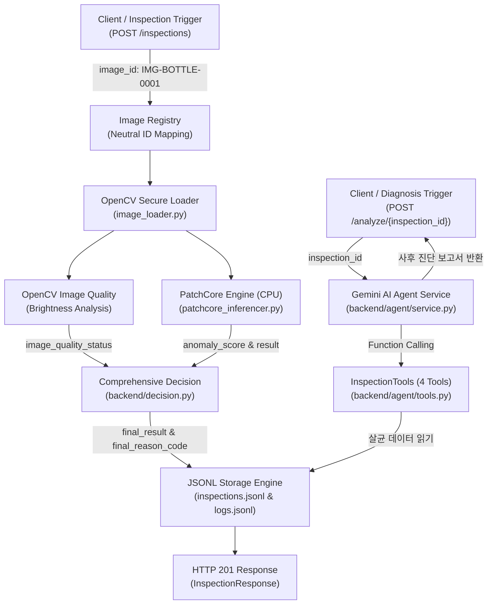

# VisionInsight
> **MVTec AD Bottle 기반 산업용 Vision 검사 이상 진단 AI Agent 서비스**

[](https://www.python.org/)
[](https://fastapi.tiangolo.com/)
[](https://pytorch.org/)
[](https://github.com/openvinotoolkit/anomalib)
[]()

---

## 1. 프로젝트 개요

**VisionInsight**는 산업용 제조 라인의 병(Bottle) 비전 검사 시스템에서 발생하는 이상 상황을 다각도로 진단하는 AI 시스템입니다.  
OpenCV 기반의 영상 품질 분석과 PatchCore 비지도 이상 탐지(Anomaly Detection) 모델을 결합하여 제품 결함과 촬영 환경 이상을 독립적으로 감지하며, 산업용 안전 원칙에 따른 종합 판정(`final_result`)을 도출합니다. **Gemini AI Agent**가 검사 결과와 라이프사이클 이벤트 로그를 도구로 자율 조사하여 이상 원인과 대처 방안을 근거 중심으로 설명하는 진단 보고서를 생성합니다.

### 핵심 특징
- **제품 결함과 영상 품질의 완전한 분리:** 영상 품질 저하(조도 저하 등)와 제품 결함(파손, 오염 등)을 독립적으로 평가하여 불필요한 결함 오진단을 방지합니다.
- **CPU 추론 실측:** ResNet-18 기반 PatchCore의 기존 평가 부분집합에서 단일 이미지 평균 **42.53ms**를 기록했습니다. Gemini 응답 시간이나 생산라인 전체 처리량은 아닙니다.
- **산업용 종합 판정 체계:** 제품 판정(`result`), 영상 품질(`image_quality_status`), 추론 상태(`defect_detection_status`)를 결합하여 `OK`, `NG`, `REINSPECT`(재검), `ERROR`(오류)의 4단계 종합 판정을 제공합니다.
- **완전한 감사 추적성 (Audit Trail):** 검사 시작부터 전처리, 추론, 판정, 저장에 이르는 전 과정을 구조화된 JSONL 이벤트 로그로 자동 영구화합니다.
- **평가 정답 및 민감 정보 격리:** 중립적인 이미지 식별자를 사용하고 Agent 전송 경계에서 image_id 제거·제품 ID 별칭화·평가 필드 및 내부 경로 차단을 검증합니다. OS 수준의 완전 격리를 의미하지 않습니다.
- **결정적 근거 기반 AI 진단 (Grounding):** Gemini Agent가 추측으로 진단하지 않고, 실제 서버 도구 실행 Trace 및 Evidence ID / JSON Pointer를 통해서만 관측 사실을 입증하도록 강제합니다.

PatchCore와 백엔드가 판정을 확정하며 Agent는 이를 변경하지 않습니다. Agent는 사후 조사·설명만 수행하고 실제 PLC·컨베이어·배출 장치를 제어하지 않습니다.

### 마일스톤 현황
- **Day 1 ~ Day 3.5 완료:**
  - FastAPI 기반 비전 검사 파이프라인 및 고유 ID 발급 시스템
  - OpenCV 영상 밝기 지표 계산 및 품질 분석
  - 180장 정상 이미지 학습 ResNet-18 PatchCore 모델 구축 및 CPU 추론 엔진
  - 29장 독립 정상 검증 데이터셋 기반 임계값(34.1442) 산출 및 무결성 검증 로직
  - 산업용 종합 판정(`final_result`, `final_reason_code`) 비즈니스 로직
  - T01(정상), T03(조도 저하), T05(로드 실패), T06(미검출 불량) 4대 시나리오 실측 검증
  - Cloud Run CPU 배포를 위한 경량 Dockerfile 및 운영 의존성 분리
- **Day 4 완료 (`DAY4_DONE`, 2026-10-17 / Step 1~5):**
  - **Step 1 구현 완료:** `InspectionTools` 4개 구현 및 단위 검증 완료 (`get_inspection_result`, `get_execution_logs`, `analyze_image_quality`, `get_inspection_history`).
  - **Step 2 구현 완료:** `AgentService` 오케스트레이션, Gemini 수동 Function Calling 바인딩, Evidence ID 및 JSON Pointer 결정적 근거 검증, 판정 보호 정책, 정상 검사 조건부 조기 종료 완료.
  - **Step 3 구현 완료:** FastAPI `POST /analyze/{inspection_id}` 사후 분석 엔드포인트 구현 및 Mock 기반 회귀 검증 완료 ([API 문서](docs/day4-step3-api.md) 참조).
  - **Step 4 완료:** 운영 Agent에서 단순 JSON → Fact Catalog 참조 복원 → `DiagnosisDraft` → Pydantic/Evidence/Pointer 검증을 연결했고 T01/T03/T05/T06 실제 성공 회차를 확인했습니다.
  - **Step 5 완료:** 최종 전체 오프라인 **1089 PASS / 0 FAIL / 4 SKIP / 경고 2건**. SKIP은 T03 이미지 의존 Day3.5 통합 테스트이며 보안·Agent 필수 검증은 통과했습니다.
  - [최종 완료 보고서](docs/day4-step5-final-verification.md)와 [과거 실패·실서버 기록](docs/day4-step4-gemini-validation.md)을 구분합니다. Day4 완료는 배포 완료가 아닙니다.
- **향후 구현 예정 (별도 승인, Day 5 ~ Day 7):**
  - **신규 영상 검사 확장:** 컨베이어 동영상 Live View, 프레임 Grab, ROI 선택 기반 PatchCore 및 Gemini 재진단
  - **Day 5:** 상황별 추가 조사, 반례 평가 및 가설 검증
  - **Day 6:** React/TypeScript 기반 검사 관제 웹 대시보드 구축 (Live View & Grab View 포함)
  - **Day 7:** Google Cloud Run 컨테이너 배포 및 영구 저장소(Cloud Storage) 전환

| 실제 Gemini 대표 성공 | 검사 ID | 서버 최종 판정 | FastAPI / 분석 상태 | 전체 시간 | 검증 Fact |
|---|---|---|---|---|---|
| T01 정상 | INSP-001396 | OK | 200 / COMPLETED | 13.578초 | 6개 |
| T03 입력 영상 품질 경고 | INSP-001398 | REINSPECT | 200 / COMPLETED | 24.600초 | 12개 |
| T05 이미지 로딩 실패 | INSP-001405 | ERROR | 200 / COMPLETED | 16.333초 | 17개 |
| T06 저장 OK / 외부 평가상 미탐 | INSP-001406 | OK | 200 / COMPLETED | 26.371초 | 6개 |

각 시나리오에 성공 회차가 최소 1개 있다는 뜻이며 반복 안정성·상용 운영 신뢰성을 보장하지 않습니다.
T06은 외부 정답 없이 검사 기록만 사용했습니다. 원본 ASGI 본문은 미보관으로, 자연어 검토는 검증된 선택 코드와 서버 고정 문구의 사후 재구성에 한정됩니다. PatchCore 미탐 해결을 뜻하지 않습니다.

---

## 2. 시스템 아키텍처



---

## 3. 기술 스택

### 백엔드 및 머신러닝 (현재 활성화)
- **Language & Runtime:** Python 3.11 (Miniconda `vision-insight`)
- **Web API Framework:** FastAPI 0.115+, Uvicorn, Pydantic v2
- **Computer Vision:** OpenCV (`opencv-python-headless` 4.10+)
- **Deep Learning Inference:** PyTorch 2.6.0 (CPU 빌드), torchvision 0.21.0
- **Anomaly Detection:** Anomalib 1.2+ (PatchCore, ResNet-18 Backbone, Coreset Subsampling)
- **Testing:** pytest 9.1+, TestClient (HTTPX)
- **Containerization:** Docker (`python:3.11-slim`), Linux Debian 기반

### AI Agent (구현 완료) 및 웹·클라우드 (후속 검증)
- **AI Agent:** Google Gemini (`gemini-3.8-flash`, `google-genai==2.31.0`, 수동 Function Calling)
- **Frontend:** React, TypeScript, Vite
- **Cloud Infrastructure:** Google Cloud Run (Serverless CPU), Artifact Registry, Cloud Storage (GCS)

---

## 4. 핵심 데이터 필드 정의

VisionInsight는 판정의 모호함을 방지하기 위해 **제품 결함 여부**와 **시스템의 최종 종합 조치**를 명확히 구분합니다.

| 필드명 | 데이터 타입 | 가능한 값 예시 | 필드 정의 및 설명 |
| :--- | :--- | :--- | :--- |
| `status` | string | `COMPLETED`, `FAILED` | 검사 파이프라인 프로그램 자체의 실행 성공/실패 여부 |
| `result` | string | `OK`, `NG`, `UNKNOWN` | **순수 PatchCore 모델의 제품 결함 판정** (점수가 임계값 이하이면 OK, 초과이면 NG) |
| `image_quality_status` | string | `NORMAL`, `WARNING_LOW_BRIGHTNESS`, `WARNING_HIGH_BRIGHTNESS`, `ERROR` | OpenCV 기반 이미지 조도 및 해상도 품질 판정 |
| `defect_detection_status` | string | `COMPLETED`, `FAILED`, `SKIPPED` | 모델 추론의 실제 수행 상태 (영상 로드 실패 시 SKIPPED) |
| `decision_confidence` | string | `HIGH`, `UNCERTAIN_DUE_TO_IMAGE_QUALITY`, `NOT_APPLICABLE` | 규칙 기반 판정 신뢰도 (영상 품질 경고 시 UNCERTAIN 부여) |
| `final_result` | string | `OK`, `NG`, `REINSPECT`, `ERROR` | **백엔드가 확정한 최종 종합 판정** (실제 설비 제어와 별개) |
| `final_reason_code` | string | `ALL_CHECKS_PASSED`, `PRODUCT_ANOMALY_DETECTED`, `IMAGE_QUALITY_WARNING`, 등 | 최종 종합 판정이 도출된 근거 코드 |
| `anomaly_score` | float | `32.2679`, `45.1200` | PatchCore가 산출한 이미지 단위 연속형 이상 점수 |
| `decision_threshold` | float | `34.1442` | 검증 데이터 기반으로 산출된 공식 판정 임계값 |

> [!IMPORTANT]
> **`result`와 `final_result`의 차이:**
> - `result`는 영상 품질이나 파이프라인 상태와 무관하게 **오직 AI 모델이 제품 외관을 보고 내린 소견**입니다.
> - `final_result`는 영상 품질 이상 시 불량품으로 오판하지 않고 **재검사(`REINSPECT`)를 지시하는 공정 제어용 최종 판정**입니다.

---

## 5. 산업용 종합 판정 정책 (`backend/decision.py`)

검사 파이프라인은 다음 6가지 우선순위 규칙에 따라 결정론적(Deterministic)으로 종합 판정을 내립니다.

1. **Rule 1 (파이프라인 실패):** 검사 실행 실패(`status=FAILED`) 또는 이미지 로드 실패 시 즉시 `final_result=ERROR` (사유: `INSPECTION_FAILED`)
2. **Rule 2 (영상 품질 경고):** 영상 품질에 경고(`WARNING_*`)가 발생한 경우, 제품 판정과 무관하게 오판 방지를 위해 `final_result=REINSPECT` (사유: `IMAGE_QUALITY_WARNING`)
3. **Rule 3 (추론 불가):** PatchCore 모델이 비활성화되었거나 추론 실패 시 즉시 `final_result=REINSPECT` (사유: `DEFECT_DETECTION_UNAVAILABLE`)
4. **Rule 4 (제품 결함 검출):** 영상 품질이 정상이고 모델이 불량(`result=NG`)으로 판정한 경우 `final_result=NG` (사유: `PRODUCT_ANOMALY_DETECTED`)
5. **Rule 5 (정상 통과):** 영상 품질이 정상이고 모델이 정상(`result=OK`)으로 판정한 경우 `final_result=OK` (사유: `ALL_CHECKS_PASSED`)
6. **Rule 6 (미정의 조합 예외 방어):** 정의되지 않은 예외 조합 발생 시 임의의 합격을 금지하고 안전하게 `final_result=REINSPECT` 처리

---

## 6. PatchCore 모델 및 평가 결과

### 6.1 학습 및 검증 구성
- **학습 데이터:** MVTec AD Bottle 정상(`train/good`) 원본 209장 중 **180장** 사용 (고정 시드: 42)
- **검증 데이터:** 학습에 참여하지 않은 **독립 정상 이미지 29장** 분리
- **임계값 산출 방식:** 독립 정상 검증 29장의 이상 점수 분포에 기반한 통계적 임계값 ($\mu + 3\sigma = 34.1442$)
- **백본:** ResNet-18 (ImageNet 사전학습 가중치)
- **메모리 뱅크 형상:** `[9216, 384]` (180장의 패치 임베딩 Coreset 서브샘플링)
- **체크포인트 SHA256:** `4b239d28e72c63bf782cd1d31981d7f4362c591e7c23164e4c0ac8b5e99b52a3`

### 6.2 기존 평가 부분집합 (83장) 결과
*독립 테스트 이미지 83장(정상 20장, 불량 63장)에 대한 공식 평가 지표:*

| 평가지표 | 실측 결과 | 비고 |
| :--- | :---: | :--- |
| **정상 이미지 (Negative)** | 20장 | True Negative (TN): 20, False Positive (FP): 0 |
| **불량 이미지 (Positive)** | 63장 | True Positive (TP): 32, False Negative (FN): 31 |
| **Image AUROC** | **0.8286** | 이상 점수의 정상/불량 분별력 지표 |
| **Precision (정밀도)** | **100.0%** (1.0000) | 모델이 NG로 판정한 제품 중 실제 불량 비율 |
| **Recall (재현율)** | **50.79%** (0.5079) | 실제 불량 중 모델이 NG로 검출해낸 비율 |
| **F1-Score** | **0.6737** | 정밀도와 재현율의 조화 평균 |
| **Accuracy (정확도)** | **62.65%** (0.6265) | 전체 83장 중 올바른 판정 비율 |
| **평균 추론 지연시간** | **42.53 ms** | x86_64 CPU 기준 단일 이미지 추론 시간 |

### 6.3 모델 성능의 한계 및 주의사항
1. **불량 미검출(FN) 한계:** 현재 불량 63장 중 31장(주로 미세 오염 contamination 및 미세 파손)을 검출하지 못했습니다 (Recall 50.79%).
2. **T06 미검출 사례 보존:** T06(실제 파손 불량) 이미지는 현재 모델에서 이상 점수 **32.2679** (임계값 34.1442 이하)로 산출되어 `result=OK`, `final_result=OK`로 도출됩니다. 이는 현재 모델의 실제 한계이며 인위적으로 조작하지 않고 그대로 보존합니다.
3. **통계적 신뢰도 한계:** Precision 100%는 주어진 83장 테스트 세트에서의 결과이며, 모든 실제 공정 환경에서 오탐(FP)이 0%임을 보장하지 않습니다. 또한 임계값은 29장의 작은 표본에 기반하므로 향후 추가 데이터 확보가 필요합니다.
4. **Pixel AUROC 미측정 사유:** `AGENTS.md` 데이터 안전 규칙에 따라 평가용 마스크(`ground_truth`)를 운영 워크스페이스에 배치하지 않으므로 픽셀 단위 AUROC 및 IoU는 측정하지 않았습니다.

---

## 7. 핵심 검증 시나리오 (T01, T03, T05, T06)

| 시나리오 | 상황 설명 | 입력 식별자 | image_quality_status | result | final_result | final_reason_code |
| :---: | :--- | :--- | :---: | :---: | :---: | :--- |
| **T01** | 정상 조명 하의 정상 제품 검사 | `IMG-BOTTLE-0084` | `NORMAL` | `OK` (31.33) | **`OK`** | `ALL_CHECKS_PASSED` |
| **T03** | 조명 조도 저하 발생 상황 | `IMG-BOTTLE-INJ-0001` | `WARNING_LOW_BRIGHTNESS` | `OK` (31.78) | **`REINSPECT`** | `IMAGE_QUALITY_WARNING` |
| **T05** | 이미지 파일 로드 실패 (카메라 고장 미확정) | `IMG-BOTTLE-NONEXISTENT`| `ERROR` | `UNKNOWN` | **`ERROR`** | `INSPECTION_FAILED` |
| **T06** | 불량품 투입 (현재 모델 미검출 한계) | `IMG-BOTTLE-0001` | `NORMAL` | `OK` (32.27) | **`OK`** | `ALL_CHECKS_PASSED` |

---

## 8. 로컬 개발 환경 및 실행 가이드

### 8.1 Conda 가상환경 준비
```bash
# vision-insight 환경 활성화 (Python 3.11)
conda activate vision-insight

# 의존성 설치 (개발 환경)
pip install -r requirements.txt
```

### 8.2 FastAPI 서버 실행
```bash
# 개발 모드 실행 (backend 폴더 감시, uvicorn 자동 재시작)
python -m uvicorn backend.main:app --host 0.0.0.0 --port 8000 --reload --reload-dir backend
```
- 서버가 기동되면 FastAPI lifespan에 의해 PatchCore 모델(`patchcore_bottle.ckpt`)이 메모리에 싱글톤으로 사전 적재됩니다 (최초 기동 시간: 약 3.8초).

### 8.3 주요 API 엔드포인트 및 호출 예시

#### 1) 헬스체크 (`GET /health`)
```bash
curl -X GET http://localhost:8000/health
# 응답: {"status": "ok"}
```

#### 2) 등록된 중립 이미지 목록 조회 (`GET /inspections/images`)
```bash
curl -X GET http://localhost:8000/inspections/images
# 응답: {"total_images": 210, "image_ids": ["IMG-BOTTLE-0001", "IMG-BOTTLE-0002", ...]}
```

#### 3) 검사 실행 요청 (`POST /inspections`)
```bash
curl -X POST http://localhost:8000/inspections \
  -H "Content-Type: application/json" \
  -d '{"product_id": "PROD-BOTTLE-001", "image_id": "IMG-BOTTLE-0001"}'
```
**응답 예시 (HTTP 201 Created):**
```json
{
  "inspection_id": "INSP-000001",
  "product_id": "PROD-BOTTLE-001",
  "image_id": "IMG-BOTTLE-0001",
  "status": "COMPLETED",
  "result": "OK",
  "image_quality_status": "NORMAL",
  "final_result": "OK",
  "final_reason_code": "ALL_CHECKS_PASSED",
  "anomaly_score": 32.2679,
  "decision_threshold": 34.1442,
  "defect_detection_status": "COMPLETED",
  "timestamp": "2026-10-14T10:43:14.624696+00:00"
}
```

#### 4) 검사 사후 이상 진단 요청 (`POST /analyze/{inspection_id}`)
실제 분석에는 서버의 `GEMINI_API_KEY`와 `GEMINI_MODEL` 설정이 필요하며 유료 Gemini 요청이 발생할 수 있습니다. 키를 브라우저·문서·Git에 넣지 마세요. 아래는 호출 예시이며 실제 실행은 별도 승인 대상입니다. 키가 없으면 분석만 503으로 실패하고 기존 검사 API는 유지됩니다.

기본 조사/최종 JSON은 각각 15초, 전체 60초·여유 2초·재시도 0회입니다. `AGENT_FINAL_MODEL_TIMEOUT_SECONDS=30`은 승인된 특정 검증 회차의 자식 프로세스에서만 선택하며 모든 요청의 기본값이 아닙니다.

```bash
curl -X POST http://localhost:8000/analyze/INSP-000001
```
**응답 주요 필드 발췌 예시 (HTTP 200 OK / Mock 또는 Agent 성공 시):** 실제 응답에는 아래 발췌 외 필수 Fact 전체와 근거가 연결된 권고 등이 포함됩니다.
```json
{
  "analysis_id": "ANALYSIS-8ba058a5a9554a468bd074e4719557c7",
  "inspection_id": "INSP-000001",
  "analysis_status": "COMPLETED",
  "error_code": null,
  "inspection_result": "OK",
  "final_result": "OK",
  "final_reason_code": "ALL_CHECKS_PASSED",
  "overall_summary": "기록된 모델 판정과 종합 판정은 OK입니다. 실제 무결점 제품을 보증하지 않습니다.",
  "observed_facts": [
    {
      "fact_id": "F0001",
      "evidence_id": "E0001",
      "source_tool": "get_inspection_result",
      "source_field": "/data/status",
      "source_event": null,
      "observed_value": "COMPLETED"
    }
  ],
  "possible_causes": [],
  "recommended_checks": [],
  "limitations": ["현재 진단은 단일 검사 기록 기반이며 현장 물리 점검을 대체하지 않습니다."],
  "tools_used": ["get_inspection_result"],
  "tool_execution_trace": [
    {
      "sequence": 1,
      "round_number": 1,
      "tool_name": "get_inspection_result",
      "arguments": {"inspection_id": "INSP-000001"},
      "executed": true,
      "success": true,
      "error_code": null,
      "elapsed_ms": 2.945,
      "evidence_id": "E0001"
    }
  ],
  "model_name": "gemini-3.8-flash",
  "model_availability": "NOT_TESTED",
  "timestamp": "2026-10-15T01:52:42.500094+00:00"
}
```

#### 5) 대화형 API 문서 (Swagger UI)
- 브라우저에서 `http://localhost:8000/docs` 접속

### 8.4 테스트 실행 및 검증 결과

프로젝트 루트에서 `vision-insight` 환경을 활성화한 뒤 아래 PowerShell 명령으로 출력 경로와 HTTPX 전송을 격리합니다. 단독 `pytest` 명령만으로는 이 격리가 적용되지 않습니다.

```powershell
$env:PYTHONDONTWRITEBYTECODE='1'; $env:PYTHONIOENCODING='utf-8'; @'
import os, sys, tempfile
from pathlib import Path
from unittest.mock import patch
import httpx, pytest
root = Path(tempfile.mkdtemp(prefix='vision_day4_step5_'))
for key, child in {'OUTPUT_DIR':'outputs','LOG_DIR':'logs','TEST_DATA_DIR':'test_data','INSPECTIONS_FILE':'inspections.jsonl','INSPECTION_LOGS_FILE':'inspection_logs.jsonl'}.items():
    os.environ[key] = str(root / child)
os.environ['AGENT_FINAL_MODEL_TIMEOUT_SECONDS'] = '15'
def guard(event, args):
    if event == 'open' and isinstance(args[0], (str, bytes, os.PathLike)) and '/evaluation_private/' in os.fsdecode(args[0]).replace('\\', '/').lower():
        raise AssertionError('EVALUATION_ACCESS_FORBIDDEN')
sys.addaudithook(guard)
with patch.object(httpx.HTTPTransport, 'handle_request', side_effect=AssertionError('NETWORK_FORBIDDEN')), patch.object(httpx.AsyncHTTPTransport, 'handle_async_request', side_effect=AssertionError('NETWORK_FORBIDDEN')):
    raise SystemExit(pytest.main(['tests'] + ['-q', '-rs', '-p', 'no:cacheprovider', '--basetemp', str(root / 'pytest'), '--junitxml', str(root / 'results.xml')]))
'@ | python -
```

> **테스트 결과 구분 안내:**
> - **이번 최종 전체 회귀:** 2026-10-17, **1089 PASS / 0 FAIL / 4 SKIP / XFAIL·XPASS 0 / 경고 2건**, 28.08초. 최신 입력 타입 보강 이후 전체를 1회 재검증했습니다.
> - **이번 관련 실행:** Agent 988 PASS, READY/timeout/격리·보안 213 PASS. 그룹은 중복되므로 합산하지 않습니다.
> - **SKIP 4건:** 임시 환경에 T03 주입 이미지가 등록되지 않은 Day3.5 이미지 통합 검사입니다. 각각의 이름·미검증 범위·Day4 제외 판단은 [최종 보고서](docs/day4-step5-final-verification.md#4-최종-통합-테스트)를 참조하세요. SKIP을 PASS로 계산하지 않습니다.
> - **과거 기록:** 이전 README의 전체 536 PASS 및 단순 보고서 개별 50 PASS는 당시 결과이며 최신 전체 결과가 아닙니다. 후속 전체 1089 PASS 기록과 이번 최종 실행도 구분합니다.
> - **주의:** 오프라인 테스트의 PASS는 Mock 대역 및 로컬 SDK 직렬화 성공이며, 실제 Gemini 서버에서의 최종 진단 품질 성공을 의미하지 않습니다.

---

## 9. Cloud Run 배포 준비 현황 (Day 7 로드맵)

- **운영용 CPU 최적화:** [requirements-prod.txt](file:///c:/Users/USER/AI-NativeAgent/Project/InspectAgent/requirements-prod.txt)에 PyTorch 공식 CPU 휠(`torch==2.6.0+cpu`, `torchvision==0.21.0+cpu`)을 지정하여 수 GB의 CUDA 오버헤드를 배제했습니다.
- **컨테이너 빌드 명세:** [Dockerfile](file:///c:/Users/USER/AI-NativeAgent/Project/InspectAgent/Dockerfile)은 `python:3.11-slim` 기반으로 단일 워커 Uvicorn을 바인딩하며, `PORT` 환경변수에 동적으로 대응합니다.
- **이미지 내 모델 번들링:** 체크포인트 크기가 24.18MB로 매우 작으므로 컨테이너 빌드 시 포함하여 Cold Start를 최소화했습니다.
- **검사 이미지 공급 방안 (Day 7 배포 전 결정 필요):**
  - 방안 A (데모 이미지 번들링): 중립 데모 이미지 5~10장을 컨테이너에 동봉 (MVP 추천)
  - 방안 B (Cloud Storage 연동): GCS 버킷에서 이미지를 스트리밍 다운로드
- **상세 배포 가이드:** [docs/cloud-run-deployment-guide.md](file:///c:/Users/USER/AI-NativeAgent/Project/InspectAgent/docs/cloud-run-deployment-guide.md) 참조.

---

## 10. 다음 단계 안내 및 인수인계 계획

### 10.1 Day 4 완료 후 후속 작업 (각각 별도 승인)
1. **Day 5 반례·추가 조사:** 정상/NG·품질 경고의 경계 및 비표준 조사 흐름 효율을 평가합니다.
2. **선택적 이미지 통합 테스트 보완:** 외부 임시 환경에서 T03 fixture를 준비해 남은 SKIP 4건을 검증합니다.
3. **관측성 개선 검토:** 원본 응답의 안전한 보관과 기존 timeout 요약 필드의 오래된 표시를 별도 개선합니다.
4. **웹 및 배포 검증:** 실제 UI 연동·로컬 브라우저 E2E 후 저장 계층·인증·비밀값·배포 설정을 점검합니다. 이번 Day4 완료 작업에서 수행한 내용이 아닙니다.

과거 HTTP 400/504 이력은 상세 검증 문서에 보존합니다. 504의 서버 내부 원인과 실제 청구 비용은 UNKNOWN이며, 단일 성공만으로 반복 안정성을 주장하지 않습니다. 로컬 JSONL은 개발용이며 Cloud Run 영구 저장을 대신하지 않습니다.

### 10.2 신규 영상 검사 요구사항 (향후 개발 로드맵)
Day 4 완료 후 VisionInsight는 정적 단일 이미지 검사에서 **동영상 기반 실시간 검사 관제 시스템**으로 확장될 예정입니다:
- **컨베이어 Live View 동영상 연동:** MVTec Bottle 이미지들로 합성한 컨베이어 벨트 주행 동영상을 `data/outputs/videos`에서 로드하여 웹 화면에 스트리밍.
- **실시간 프레임 Grab:** 동영상 재생 중 특정 시점의 프레임을 캡처(Grab)하여 정지 이미지 생성.
- **마우스 드래그 ROI(Region of Interest) 선택:** 웹 UI에서 마우스 드래그로 검사할 병 영역(ROI)을 지정.
- **ROI 이미지 대상 기존 PatchCore 추론 적용:** 드래그로 추출된 관심 영역 이미지에 대해 기존 훈련된 ResNet-18 PatchCore 엔진 및 임계값(34.1442)을 동일하게 적용하여 실시간 결함 판정.
- **품질 경고 및 검사 실패 시 Gemini Agent 자율 재진단:** 조명 이상(`WARNING_LOW_BRIGHTNESS`) 또는 검사 실패(`ERROR`) 발생 시 Gemini Agent가 자동으로 호출되어 원인 및 점검 가이드 제시.
- **실행 로그 데이터 정제:** 검사 라이프사이클 이벤트 로그에서 불필요하거나 가상인 `product_id`를 제외하고 정제된 감사 로그 유지.
- **React 관제 화면 구현:** Live View 플레이어와 Grab Image View, ROI 선택 도구, Agent 진단 패널을 통합한 React 대시보드 구축 (Day 6).

> **주의:** 기존 훈련된 PatchCore 체크포인트(`models/patchcore/patchcore_bottle.ckpt`)와 결정 임계값(`34.1442`)은 그대로 유지됩니다.  
> 실제 Gemini API 호출 및 유료 모델 요청은 사용자의 사전 확인 및 명시적 승인 하에서만 1회씩 진행됩니다.
