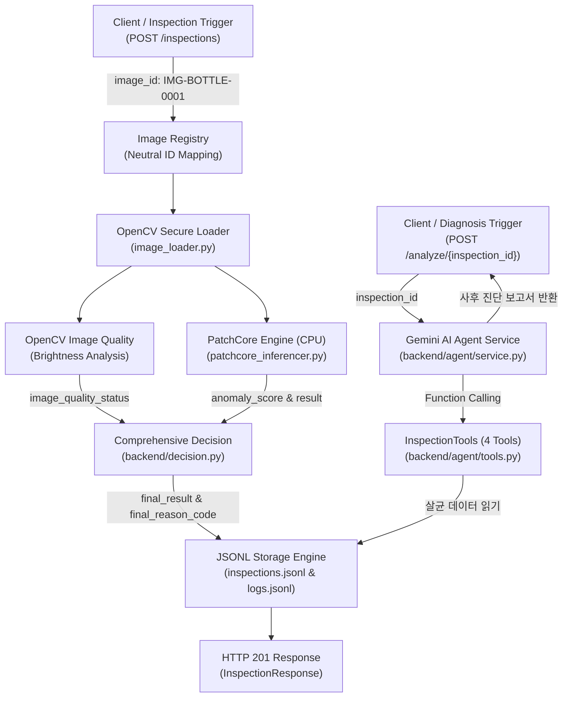

# VisionInsight
> **MVTec AD Bottle 기반 산업용 Vision 검사 이상 진단 AI Agent 서비스**

[](https://www.python.org/)
[](https://fastapi.tiangolo.com/)
[](https://pytorch.org/)
[](https://github.com/openvinotoolkit/anomalib)
[](docs/day4-step5-final-verification.md)

---

## 1. 프로젝트 개요

**VisionInsight**는 산업용 제조 라인의 병(Bottle) 비전 검사 시스템에서 발생하는 이상 상황을 다각도로 진단하는 AI 시스템입니다.  
OpenCV 기반의 영상 품질 분석과 PatchCore 비지도 이상 탐지(Anomaly Detection) 모델을 결합하여 제품 결함과 촬영 환경 이상을 독립적으로 감지하며, 산업용 안전 원칙에 따른 종합 판정(`final_result`)을 도출합니다. **Gemini AI Agent**가 검사 결과와 라이프사이클 이벤트 로그를 도구로 자율 조사하여 이상 원인과 대처 방안을 근거 중심으로 설명하는 진단 보고서를 생성합니다.

### 핵심 특징
- **제품 결함과 영상 품질의 완전한 분리:** 영상 품질 저하(조도 저하 등)와 제품 결함(파손, 오염 등)을 독립적으로 평가하여 불필요한 결함 오진단을 방지합니다.
- **CPU 추론 실측:** ResNet-18 기반 PatchCore의 기존 평가 부분집합에서 단일 이미지 평균 **42.53ms**를 기록했습니다. Gemini 응답 시간이나 생산라인 전체 처리량은 아닙니다.
- **산업용 종합 판정 체계:** 제품 판정(`result`), 영상 품질(`image_quality_status`), 추론 상태(`defect_detection_status`)를 결합하여 `OK`, `NG`, `REINSPECT`(재검), `ERROR`(오류)의 4단계 종합 판정을 제공합니다.
- **완전한 감사 추적성 (Audit Trail):** 검사 시작부터 전처리, 추론, 판정, 저장에 이르는 전 과정을 구조화된 JSONL 이벤트 로그로 자동 영구화합니다.
- **평가 정답 및 민감 정보 격리:** 중립적인 이미지 식별자를 사용하고 Agent 전송 경계에서 image_id 제거·제품 ID 별칭화·평가 필드 및 내부 경로 차단을 검증합니다. OS 수준의 완전 격리를 의미하지 않습니다.
- **결정적 근거 기반 AI 진단 (Grounding):** Gemini Agent가 추측으로 진단하지 않고, 실제 서버 도구 실행 Trace 및 Evidence ID / JSON Pointer를 통해서만 관측 사실을 입증하도록 강제합니다.

PatchCore와 백엔드가 판정을 확정하며 Agent는 이를 변경하지 않습니다. Agent는 사후 조사·설명만 수행하고 실제 PLC·컨베이어·배출 장치를 제어하지 않습니다.

### 마일스톤 현황
- **Day 1 ~ Day 3.5 완료:**
  - FastAPI 기반 비전 검사 파이프라인 및 고유 ID 발급 시스템
  - OpenCV 영상 밝기 지표 계산 및 품질 분석
  - 180장 정상 이미지 학습 ResNet-18 PatchCore 모델 구축 및 CPU 추론 엔진
  - 29장 독립 정상 검증 데이터셋 기반 임계값(34.1442) 산출 및 무결성 검증 로직
  - 산업용 종합 판정(`final_result`, `final_reason_code`) 비즈니스 로직
  - T01(정상), T03(조도 저하), T05(로드 실패), T06(미검출 불량) 4대 시나리오 실측 검증
  - Cloud Run CPU 배포를 위한 경량 Dockerfile 및 운영 의존성 분리
- **Day 4 완료 (`DAY4_DONE`, 2026-10-17 / Step 1~5):**
  - **Step 1 구현 완료:** `InspectionTools` 4개 구현 및 단위 검증 완료 (`get_inspection_result`, `get_execution_logs`, `analyze_image_quality`, `get_inspection_history`).
  - **Step 2 구현 완료:** `AgentService` 오케스트레이션, Gemini 수동 Function Calling 바인딩, Evidence ID 및 JSON Pointer 결정적 근거 검증, 판정 보호 정책, 정상 검사 조건부 조기 종료 완료.
  - **Step 3 구현 완료:** FastAPI `POST /analyze/{inspection_id}` 사후 분석 엔드포인트 구현 및 Mock 기반 회귀 검증 완료 ([API 문서](docs/day4-step3-api.md) 참조).
  - **Step 4 완료:** 운영 Agent에서 단순 JSON → Fact Catalog 참조 복원 → `DiagnosisDraft` → Pydantic/Evidence/Pointer 검증을 연결했고 T01/T03/T05/T06 실제 성공 회차를 확인했습니다.
  - **Step 5 완료:** 최종 전체 오프라인 **1089 PASS / 0 FAIL / 4 SKIP / 경고 2건**. SKIP은 T03 이미지 의존 Day3.5 통합 테스트이며 보안·Agent 필수 검증은 통과했습니다.
  - [최종 완료 보고서](docs/day4-step5-final-verification.md)와 [과거 실패·실서버 기록](docs/day4-step4-gemini-validation.md)을 구분합니다. Day4 완료는 배포 완료가 아닙니다.
- **2026-10-23 제출 준비 시점의 구현 범위:**
  - React/TypeScript LiveView·영상 선택·재생·Pause·프레임 이동, MANUAL Grab·ROI 검사 및 정적 이미지 검사 UI가 구현되어 있습니다.
  - Heatmap·Zoom/Pan·Pixel Inspector, 병 Edge 후보·신뢰도·영역별 GV, Gemini Vision Judge와 Diagnostic Agent의 명시적 실행·저장 결과 조회가 구현되어 있습니다. Edge/GV는 참고 정보이며 새 제품 판정 기준이 아닙니다.
  - Quality Shadow Metrics는 기본 OFF이며 판정과 분리된 Sidecar를 저장합니다. **A-3-2 전체 상태는 PARTIAL**입니다.
  - 신규 RIG는 기본 `judge-assisted-v1` 정책으로 최초 정상 완료 검사 한 건을 기준으로 진행합니다. REINSPECT이면 Gemini Judge는 선택적으로 실행하고, Gemini 미실행·비활성·실패여도 작업자가 `MANUAL_OK` / `MANUAL_NG` / `HOLD`를 명시적으로 저장할 수 있습니다. 프론트엔드 연동과 격리 검증을 수행했으며 실행 중 서버 반영·실제 LIVE 호출은 별도입니다. 기존 RIG의 3회 정책과 이력은 유지합니다.
  - AUTO 연속 검사, 실제 카메라·PLC·배출 장치 제어, Cloud Run 실제 배포·GCS 영구 저장 전환은 미구현 또는 후속 검증 대상입니다. [개선 이력](docs/progress/visioninsight-improvement-log.md)을 참조하세요.

위 Day4 수치는 과거 검증 기록입니다. **2026-10-23 제출 준비 Step 2는 정적 점검 범위였으며, 이후 Judge/RIG 수정의 격리 회귀·사본 빌드는 8.7에 별도로 기록합니다. 실제 추론·외부 호출 성공을 뜻하지 않습니다.**

| 실제 Gemini 대표 성공 | 검사 ID | 서버 최종 판정 | FastAPI / 분석 상태 | 전체 시간 | 검증 Fact |
|---|---|---|---|---|---|
| T01 정상 | INSP-001396 | OK | 200 / COMPLETED | 13.578초 | 6개 |
| T03 입력 영상 품질 경고 | INSP-001398 | REINSPECT | 200 / COMPLETED | 24.600초 | 12개 |
| T05 이미지 로딩 실패 | INSP-001405 | ERROR | 200 / COMPLETED | 16.333초 | 17개 |
| T06 저장 OK / 외부 평가상 미탐 | INSP-001406 | OK | 200 / COMPLETED | 26.371초 | 6개 |

각 시나리오에 성공 회차가 최소 1개 있다는 뜻이며 반복 안정성·상용 운영 신뢰성을 보장하지 않습니다.
T06은 외부 정답 없이 검사 기록만 사용했습니다. 원본 ASGI 본문은 미보관으로, 자연어 검토는 검증된 선택 코드와 서버 고정 문구의 사후 재구성에 한정됩니다. PatchCore 미탐 해결을 뜻하지 않습니다.

---

## 2. 시스템 아키텍처



---

## 3. 기술 스택

### 백엔드 및 머신러닝 (선언된 실행 구성)
- **Language & Runtime:** Python 3.11 (Miniconda `vision-insight`)
- **Web API Framework:** FastAPI 0.115+, Uvicorn, Pydantic v2
- **Computer Vision:** `opencv-python-headless>=4.9.0.80`
- **Deep Learning Inference:** 제출용 CPU 선언은 `torch==2.6.0+cpu`, `torchvision==0.21.0+cpu` (기존 개발 환경의 설치 빌드와 다를 수 있음)
- **Anomaly Detection:** `anomalib==2.7.0`, `timm==1.0.30` (PatchCore, ResNet-18)
- **Testing:** `pytest>=8.0.0`, TestClient (HTTPX)
- **Containerization:** Docker (`python:3.11-slim`), Linux Debian 기반

### AI Agent·웹 (구현) 및 클라우드 (배포 준비)
- **AI Agent:** Google Gemini (`gemini-3.8-flash`, `google-genai==2.31.0`, 수동 Function Calling)
- **Frontend:** React, TypeScript, Vite
- **Cloud Infrastructure:** Google Cloud Run, Artifact Registry, Cloud Storage는 배포 계획이며 실제 배포 완료로 표시하지 않습니다.

---

## 4. 핵심 데이터 필드 정의

VisionInsight는 판정의 모호함을 방지하기 위해 **제품 결함 여부**와 **시스템의 최종 종합 조치**를 명확히 구분합니다.

| 필드명 | 데이터 타입 | 가능한 값 예시 | 필드 정의 및 설명 |
| :--- | :--- | :--- | :--- |
| `status` | string | `COMPLETED`, `FAILED` | 검사 파이프라인 프로그램 자체의 실행 성공/실패 여부 |
| `result` | string | `OK`, `NG`, `UNKNOWN` | **순수 PatchCore 모델의 제품 결함 판정** (점수가 임계값 이하이면 OK, 초과이면 NG) |
| `image_quality_status` | string | `NORMAL`, `WARNING_LOW_BRIGHTNESS`, `WARNING_HIGH_BRIGHTNESS`, `ERROR` | OpenCV 기반 이미지 조도 및 해상도 품질 판정 |
| `defect_detection_status` | string | `COMPLETED`, `FAILED`, `SKIPPED` | 모델 추론의 실제 수행 상태 (영상 로드 실패 시 SKIPPED) |
| `decision_confidence` | string | `HIGH`, `UNCERTAIN_DUE_TO_IMAGE_QUALITY`, `NOT_APPLICABLE` | 규칙 기반 판정 신뢰도 (영상 품질 경고 시 UNCERTAIN 부여) |
| `final_result` | string | `OK`, `NG`, `REINSPECT`, `ERROR` | **백엔드가 확정한 최종 종합 판정** (실제 설비 제어와 별개) |
| `final_reason_code` | string | `ALL_CHECKS_PASSED`, `PRODUCT_ANOMALY_DETECTED`, `IMAGE_QUALITY_WARNING`, 등 | 최종 종합 판정이 도출된 근거 코드 |
| `anomaly_score` | float | `32.2679`, `45.1200` | PatchCore가 산출한 이미지 단위 연속형 이상 점수 |
| `decision_threshold` | float | `34.1442` | 검증 데이터 기반으로 산출된 공식 판정 임계값 |

> [!IMPORTANT]
> **`result`와 `final_result`의 차이:**
> - `result`는 영상 품질이나 파이프라인 상태와 무관하게 **오직 AI 모델이 제품 외관을 보고 내린 소견**입니다.
> - `final_result`는 영상 품질 이상 시 불량품으로 오판하지 않고 **재검사(`REINSPECT`)를 지시하는 공정 제어용 최종 판정**입니다.

---

## 5. 산업용 종합 판정 정책 (`backend/decision.py`)

검사 파이프라인은 다음 6가지 우선순위 규칙에 따라 결정론적(Deterministic)으로 종합 판정을 내립니다.

1. **Rule 1 (파이프라인 실패):** 검사 실행 실패(`status=FAILED`) 또는 이미지 로드 실패 시 즉시 `final_result=ERROR` (사유: `INSPECTION_FAILED`)
2. **Rule 2 (영상 품질 경고):** 영상 품질에 경고(`WARNING_*`)가 발생한 경우, 제품 판정과 무관하게 오판 방지를 위해 `final_result=REINSPECT` (사유: `IMAGE_QUALITY_WARNING`)
3. **Rule 3 (추론 불가):** PatchCore 모델이 비활성화되었거나 추론 실패 시 즉시 `final_result=REINSPECT` (사유: `DEFECT_DETECTION_UNAVAILABLE`)
4. **Rule 4 (제품 결함 검출):** 영상 품질이 정상이고 모델이 불량(`result=NG`)으로 판정한 경우 `final_result=NG` (사유: `PRODUCT_ANOMALY_DETECTED`)
5. **Rule 5 (정상 통과):** 영상 품질이 정상이고 모델이 정상(`result=OK`)으로 판정한 경우 `final_result=OK` (사유: `ALL_CHECKS_PASSED`)
6. **Rule 6 (미정의 조합 예외 방어):** 정의되지 않은 예외 조합 발생 시 임의의 합격을 금지하고 안전하게 `final_result=REINSPECT` 처리

---

## 6. PatchCore 모델 및 평가 결과

### 6.1 학습 및 검증 구성
- **학습 데이터:** MVTec AD Bottle 정상(`train/good`) 원본 209장 중 **180장** 사용 (고정 시드: 42)
- **검증 데이터:** 학습에 참여하지 않은 **독립 정상 이미지 29장** 분리
- **임계값 산출 방식:** 독립 정상 검증 29장의 이상 점수 분포에 기반한 통계적 임계값 ($\mu + 3\sigma = 34.1442$)
- **백본:** ResNet-18 (ImageNet 사전학습 가중치)
- **메모리 뱅크 형상:** `[9216, 384]` (180장의 패치 임베딩 Coreset 서브샘플링)
- **체크포인트 SHA256:** `4b239d28e72c63bf782cd1d31981d7f4362c591e7c23164e4c0ac8b5e99b52a3`

### 6.2 기존 평가 부분집합 (83장) 결과
*독립 테스트 이미지 83장(정상 20장, 불량 63장)에 대한 공식 평가 지표:*

| 평가지표 | 실측 결과 | 비고 |
| :--- | :---: | :--- |
| **정상 이미지 (Negative)** | 20장 | True Negative (TN): 20, False Positive (FP): 0 |
| **불량 이미지 (Positive)** | 63장 | True Positive (TP): 32, False Negative (FN): 31 |
| **Image AUROC** | **0.8286** | 이상 점수의 정상/불량 분별력 지표 |
| **Precision (정밀도)** | **100.0%** (1.0000) | 모델이 NG로 판정한 제품 중 실제 불량 비율 |
| **Recall (재현율)** | **50.79%** (0.5079) | 실제 불량 중 모델이 NG로 검출해낸 비율 |
| **F1-Score** | **0.6737** | 정밀도와 재현율의 조화 평균 |
| **Accuracy (정확도)** | **62.65%** (0.6265) | 전체 83장 중 올바른 판정 비율 |
| **평균 추론 지연시간** | **42.53 ms** | x86_64 CPU 기준 단일 이미지 추론 시간 |

### 6.3 모델 성능의 한계 및 주의사항
1. **불량 미검출(FN) 한계:** 현재 불량 63장 중 31장(주로 미세 오염 contamination 및 미세 파손)을 검출하지 못했습니다 (Recall 50.79%).
2. **T06 미검출 사례 보존:** T06(실제 파손 불량) 이미지는 현재 모델에서 이상 점수 **32.2679** (임계값 34.1442 이하)로 산출되어 `result=OK`, `final_result=OK`로 도출됩니다. 이는 현재 모델의 실제 한계이며 인위적으로 조작하지 않고 그대로 보존합니다.
3. **통계적 신뢰도 한계:** Precision 100%는 주어진 83장 테스트 세트에서의 결과이며, 모든 실제 공정 환경에서 오탐(FP)이 0%임을 보장하지 않습니다. 또한 임계값은 29장의 작은 표본에 기반하므로 향후 추가 데이터 확보가 필요합니다.
4. **Pixel AUROC 미측정 사유:** `AGENTS.md` 데이터 안전 규칙에 따라 평가용 마스크(`ground_truth`)를 운영 워크스페이스에 배치하지 않으므로 픽셀 단위 AUROC 및 IoU는 측정하지 않았습니다.

---

## 7. 핵심 검증 시나리오 (T01, T03, T05, T06)

| 시나리오 | 상황 설명 | 입력 식별자 | image_quality_status | result | final_result | final_reason_code |
| :---: | :--- | :--- | :---: | :---: | :---: | :--- |
| **T01** | 정상 조명 하의 정상 제품 검사 | `IMG-BOTTLE-0084` | `NORMAL` | `OK` (31.33) | **`OK`** | `ALL_CHECKS_PASSED` |
| **T03** | 조명 조도 저하 발생 상황 | `IMG-BOTTLE-INJ-0001` | `WARNING_LOW_BRIGHTNESS` | `OK` (31.78) | **`REINSPECT`** | `IMAGE_QUALITY_WARNING` |
| **T05** | 이미지 파일 로드 실패 (카메라 고장 미확정) | `IMG-BOTTLE-NONEXISTENT`| `ERROR` | `UNKNOWN` | **`ERROR`** | `INSPECTION_FAILED` |
| **T06** | 불량품 투입 (현재 모델 미검출 한계) | `IMG-BOTTLE-0001` | `NORMAL` | `OK` (32.27) | **`OK`** | `ALL_CHECKS_PASSED` |

---

## 8. 로컬 개발 환경 및 실행 가이드

### 8.1 Windows 환경 및 Python 의존성 설치

대상은 **Windows x64 + Miniconda Python 3.11**, CPU 추론 구성입니다. 아래는 제출본 실행 절차이며 **이번 작업에서 설치·기동 성공을 확인한 명령이 아닙니다.** 기존 개발 서버·Conda 환경에 덮어 설치하지 말고 승인된 별도 검증 PC/VM을 사용하세요. 프로젝트 루트는 `backend/`, `frontend/`, requirements 파일이 있는 디렉터리입니다.

새 환경에서만 생성하며 기존 `vision-insight` 환경을 재생성하지 않습니다.

```cmd
cd /d "<압축 해제한 InspectAgent 경로>"
conda create -n vision-insight python=3.11
conda activate vision-insight
python --version
python -m pip --version

python -m pip install -r requirements-prod.txt -r requirements.txt
python -m pip check
```

- `requirements-prod.txt`: CPU Torch/Torchvision·Anomalib/Timm·API·DB·Gemini 런타임입니다. CPU 휠 추가 인덱스가 파일에 선언되어 있습니다.
- `requirements.txt`: API·영상·설정·pytest/HTTPX이며 `requirements-db.txt`를 포함합니다. **이 파일만 설치하면 ML 의존성이 빠집니다.** `ENABLE_PATCHCORE=false`여도 최상위 Torch import가 있어 패키지 누락을 해결하지 못합니다.
- 두 파일을 한 resolver에 전달해 CPU 버전 고정과 테스트 의존성을 함께 적용합니다. 새 환경 설치와 기존 런타임에 테스트 패키지만 추가하는 경우를 구분하세요.
- CPU 휠의 Windows x64/Python 3.11 설치·전이 의존성 충돌·새 머신의 모델 캐시 요구사항은 **NOT_VERIFIED**입니다. `>=` 항목도 있어 완전한 Python lock이 아닙니다. 다른 OS/아키텍처의 재현성은 보장하지 않습니다.

### 8.2 Backend·Frontend 실행

#### 설정 및 Backend (프로젝트 루트)

기본값은 `backend/config.py`, 비밀값 없는 예시는 [.env.example](.env.example)입니다. 기본 로컬 기동에 `.env` 복사가 필수는 아닙니다. 예제 DB URL·토큰 placeholder는 실행 가능한 인증정보가 아니며 미사용 DB 설정은 넣지 마세요. **기존 `.env`·`.env.roi-db.local`은 덮어쓰거나 제출하지 않습니다.**

일반 Settings와 HTTP Vision Judge는 **OS 환경변수 > 루트 `.env` > 코드 기본값** 순으로 읽고 캐시합니다. ROI는 OS 환경변수가 우선이며 파일 간에는 `.env.roi-db.local`이 `.env`보다 우선합니다. 실행 중 서버 값은 현재 디스크 설정과 다를 수 있습니다. `.env`를 수정해도 기존 프로세스에 자동 적용되지 않습니다.

새 실행 세션의 기본 예시입니다. 기존 서버가 포트를 사용 중이면 중복 기동·임의 재시작하지 마세요.

```cmd
cd /d "<압축 해제한 InspectAgent 경로>"
conda activate vision-insight
set "QUALITY_SHADOW_ENABLED=false"
set "JUDGE_ASSISTED_WORKFLOW_ENABLED=true"
set "VISION_REVIEW_LIVE_ENABLED=false"
python -m uvicorn backend.main:app --host 127.0.0.1 --port 8000 --workers 1
```

사용자가 기존에 사용한 **Shadow ON 실행 방식**은 다음과 같습니다. 명령 안내는 현재 서버 활성화·재시작 승인이나 새 검사 승인이 아닙니다.

```cmd
conda activate vision-insight
set "QUALITY_SHADOW_ENABLED=true"
python -m uvicorn backend.main:app --host 127.0.0.1 --port 8000 --workers 1
```

- Backend: `http://127.0.0.1:8000`, API 문서: `http://127.0.0.1:8000/docs`.
- 신규 정책의 코드 기본값은 `JUDGE_ASSISTED_WORKFLOW_ENABLED=true`입니다. 명시적 `false`는 새 그룹도 레거시 정책으로 생성하는 호환 옵션이며 기존 그룹은 이 설정 변경과 무관하게 생성 당시 정책을 유지합니다. 신규 그룹은 `max_attempts`·`remaining_attempts`가 `null`이며 완료 검사 한 건 이후 제품 Retry를 반복하지 않습니다. ERROR·저장 미확정은 정상 REINSPECT 수동 승인 경로와 분리하고, 동일 Capture 중복 추론 방지를 유지합니다.
- 기본 `ENABLE_PATCHCORE=true`에서 lifespan이 Checkpoint를 적재합니다. `/health` 성공만으로 모델 적재·추론 성공을 보장하지 않습니다. Checkpoint와 Metadata를 함께 준비하세요.
- 제출 시연은 `--reload`를 사용하지 않습니다. Capture 세션은 메모리 기반이며 종료 시 소실됩니다. 종료 시 관리 중 PNG가 삭제되고 새 Store 디렉터리 초기화·TTL 정리에서도 임시 PNG가 삭제될 수 있습니다. **F5도 세션 bootstrap을 요청하므로 운영 서버에서 무해한 조회로 취급하지 마세요.** PNG 백업만으로 소유 세션을 복원할 수 없습니다.
- Shadow는 원본 Crop 해상도로 계산하며 판정·기존 JSONL/API를 변경하지 않습니다. 기본 OFF이며 저장 위치는 `OUTPUT_DIR/quality_shadow_metrics/quality-shadow-v1/opencv-original-exact-variance-v1/<inspection_id>/<crop_sha256>.json`입니다. A-3-2의 미완료 수락 항목은 남아 있습니다.

#### Frontend (별도 CMD)

잠금된 Vite 8.3.4의 Node 요구사항은 **`^20.19.0 || >=22.12.0`**입니다. 현재 개발 PC의 Node 24.11.0은 범위에 들어가지만 새 머신의 설치·빌드는 미검증입니다. 지원 범위의 Node LTS와 함께 제공되는 npm을 사용하고 버전을 기록하세요. 프로젝트에 별도 `engines`/`packageManager` 고정은 없습니다.

```cmd
cd /d "<압축 해제한 InspectAgent 경로>\frontend"
node --version
npm --version
npm ci
npm run dev
```

- 접속: **`http://localhost:5173`**. PowerShell에서 npm 실행이 차단되면 CMD 또는 `npm.cmd`를 사용하세요.
- `node_modules/`는 ZIP에 없어도 정상입니다. 잠금 파일로 `npm ci`가 성공하는지가 기준입니다. Vite는 devDependency이므로 개발 실행·빌드에서 `--omit=dev`를 사용하지 마세요. `'vite'을 찾을 수 없음`이면 경로·Node 버전·설치 성공 여부·devDependency 제외 설정부터 확인합니다. 전역 Vite 설치·lock 삭제로 우회하지 마세요.
- API는 `VITE_API_BASE_URL` 또는 기본 `/api`입니다. 현재 Vite는 `/api`를 `127.0.0.1:8000`으로 프록시하고 Origin을 `http://localhost:5173`으로 설정합니다. 포트·호스트 변경 시 CORS·쿠키·Origin·ROI 허용 Origin을 함께 검증해야 합니다.
- `npm run build`는 TypeScript 검사와 Vite 빌드이며 **후속 격리 검증 항목(이번에는 미실시)**입니다. `dist/`의 별도 정적 호스팅은 API 라우팅 검증이 필요합니다. Google Fonts는 외부 요청이며 로컬 번들 자산이 아닙니다.
- 페이지 진입은 Capture 세션 발급을 요청합니다. 첫 검증은 비어 있는 별도 `CAPTURE_DIR`와 승인된 제출 자료 사본을 사용하며 기존 운영 서버에 브라우저를 연결하지 마세요.

#### 선택적 PostgreSQL ROI 관리

PostgreSQL은 **ROI 설정 저장·버전·승인·활성화 관리**에 필요합니다. 영상 재생·수동 ROI 기반 Grab과 별도이며 DB는 해당 관리 요청 시 연결됩니다. DB 미설정은 관리 API 503, 인증 불일치는 401/403 등으로 제한됩니다. DB 라이브러리는 Backend import에 필요하므로 설치에서 빼지 마세요.

신규·독립 DB를 승인한 경우에만 다음 순서를 사용합니다. 기존 DB에 대한 초기화 명령이 아닙니다.

```cmd
python scripts/setup_roi_database.py prepare
docker compose --env-file .env.roi-db.local -f compose.roi-db.yaml up -d
python scripts/setup_roi_database.py initialize
python -m alembic upgrade head
python scripts/setup_roi_database.py grants
```

`prepare`는 기존 `.env.roi-db.local`이 있으면 중단합니다. 생성한 비밀값은 공유하지 않으며 운영자가 중립 제품 ID 목록을 등록해야 합니다. Compose의 `127.0.0.1:55432`·컨테이너명·볼륨명은 고정입니다. **프로젝트명만 바꿔도 완전히 격리되지 않으므로 기존 DB가 있는 PC에서는 그대로 실행하지 마세요.** [ROI API 계약](docs/roi-postgresql-api.md)과 [마이그레이션](migrations/env.py)을 참조하세요. 이번에는 DB 연결·명령 실행을 하지 않았습니다.

#### 선택적 Gemini 설정 및 timeout

API 키 없이도 기존 검사는 가능하지만 Diagnostic Agent LIVE는 `MISSING_API_KEY`(503)로 제한되고 Judge LIVE는 비활성화됩니다. 모델 접근 권한·Google 가용성은 별도입니다. 키를 `VITE_` 변수·브라우저 번들·문서에 넣지 마세요.

| 구분 | 현재 코드 계약 |
|---|---|
| Diagnostic Agent | `GEMINI_API_KEY`, `GEMINI_MODEL`. 조사 요청 기본 15초, 최종 JSON 상한 기본 30초, 전체 60초. 최종 요청은 잔여 시간에서 예비 2초를 뺀 범위로 제한 |
| Vision Judge | HTTP 경로는 `VisionReviewService.from_settings()`로 동일 서버 Settings를 사용. LIVE 기본 `false`, 모델 기본 `gemini-3.8-flash`, timeout 기본 30초. `GEMINI_API_KEY`가 비어 있거나 모델이 허용 목록 밖이면 차단 |
| 설정 회귀 수정 | 이전 HTTP 경로는 `.env`를 읽는 Settings와 달리 LIVE·모델·timeout을 OS에서만 다시 읽어 `.env`의 LIVE 허용을 누락했음. 이제 HTTP 경로는 Settings 우선순위를 따름. 직접 호출용 `from_environment()`는 이전 계약 호환을 위해 유지 |
| Vision 모델·timeout | 허용 모델은 `gemini-3.8-flash`와 `gemini-4-argon`, 서비스 timeout 유효 범위는 0초 초과·30초 이하. 실제 Google 모델 접근 가능성·LIVE 성공은 이번 수정에서 검증하지 않음 |

Judge를 30초로 사용할 때는 사용자 승인 후 **새 Backend CMD에** 다음을 명시합니다. 키는 사용자 로컬 비밀 설정으로 별도 제공하며 기존 서버를 강제 재로드하지 않습니다.

```cmd
set "VISION_REVIEW_MODEL=gemini-3.8-flash"
set "VISION_REVIEW_TIMEOUT_SECONDS=30"
set "VISION_REVIEW_LIVE_ENABLED=true"
```

키는 로컬 `.env`의 `GEMINI_API_KEY` 또는 해당 CMD의 같은 이름 환경변수로 제공하세요. 기존 프로세스에만 키가 있었다면 새 CMD가 이를 상속한다고 가정하지 않습니다. 비밀값은 출력하거나 공유하지 마세요. `GOOGLE_API_KEY`는 이 애플리케이션의 Judge 키 설정으로 사용하지 않습니다. OS의 `VISION_REVIEW_LIVE_ENABLED=false`는 `.env`의 `true`보다 우선합니다.

버튼은 소유 세션·현재 REINSPECT 검사·영구 Crop SHA256 연결·지원 Capability·LIVE 설정·유효 키·미사용 요청·해당 Crop 전송 동의가 모두 맞을 때 활성화됩니다. 외부 이미지 전송은 Crop별 동의 후 LIVE 버튼으로 명시 실행합니다. 탭 전환·품질 경고만으로 자동 호출하지 않습니다. Judge는 독립 참고 의견이며 서버/작업자 판정을 덮어쓰지 않습니다. 분석 실패는 `ANALYSIS_FAILED`와 `judge_verdict=null`로 구분하며 자동 재호출하지 않습니다.

신규 정책에서는 1차 검사 패널의 **2차 Gemini Judge 보기 (선택)**와 Judge 패널의 **3차 작업자 확인으로 이동**으로 이동합니다. Gemini가 없거나 실패해도 작업자 표시명·판단 사유·명시적 결과를 입력해 확인할 수 있습니다. 시스템의 `MANUAL_REVIEW_REQUIRED`와 작업자가 저장하는 `HOLD`는 별개입니다. HOLD는 보류 이력을 남기며 이후 새 버전으로 명시적인 결정을 할 수 있습니다. 저장된 서버 `final_result`는 계속 REINSPECT입니다.

기존 그룹/대기 Capture의 localStorage 힌트는 자동 삭제하지 않습니다. **새 제품 검사 시작**은 확인 대화상자와 현재 Capture의 서버 소유권·출처·미사용 검증 후 로컬 선택만 전환하며 과거 RIG를 변경하지 않습니다. 새 브라우저에서 소유 세션이 필요한 기존 Grab/Judge 조회는 파일 존재만으로 보장되지 않습니다.

이번 수정은 실행 중 Uvicorn을 재시작하지 않았습니다. `--reload`가 없는 기존 서버에는 코드 변경이 적용되지 않으므로 Capture·진행 중 작업을 확인하고 별도 재시작 승인이 필요합니다. 실제 Gemini 호출도 별도 승인 대상이며 모의 검증을 LIVE 성공으로 표시하지 않습니다. 기존 제출 ZIP은 변경하지 않았으므로 최신 수정 반영본을 제출하려면 별도로 재패키징해야 합니다.

### 8.3 주요 API 엔드포인트 및 호출 예시

#### 1) 헬스체크 (`GET /health`)
```bash
curl -X GET http://localhost:8000/health
# 응답: {"status": "ok"}
```

#### 2) 등록된 중립 이미지 목록 조회 (`GET /inspections/images`)
```bash
curl -X GET http://localhost:8000/inspections/images
# 응답: {"total_images": 210, "image_ids": ["IMG-BOTTLE-0001", "IMG-BOTTLE-0002", ...]}
```

#### 3) 검사 실행 요청 (`POST /inspections`)
```bash
curl -X POST http://localhost:8000/inspections \
  -H "Content-Type: application/json" \
  -d '{"product_id": "PROD-BOTTLE-001", "image_id": "IMG-BOTTLE-0001"}'
```
**응답 예시 (HTTP 201 Created):**
```json
{
  "inspection_id": "INSP-000001",
  "product_id": "PROD-BOTTLE-001",
  "image_id": "IMG-BOTTLE-0001",
  "status": "COMPLETED",
  "result": "OK",
  "image_quality_status": "NORMAL",
  "final_result": "OK",
  "final_reason_code": "ALL_CHECKS_PASSED",
  "anomaly_score": 32.2679,
  "decision_threshold": 34.1442,
  "defect_detection_status": "COMPLETED",
  "timestamp": "2026-10-14T10:43:14.624696+00:00"
}
```

#### 4) 검사 사후 이상 진단 요청 (`POST /analyze/{inspection_id}`)
실제 분석에는 서버의 `GEMINI_API_KEY`와 `GEMINI_MODEL` 설정이 필요하며 유료 Gemini 요청이 발생할 수 있습니다. 키를 브라우저·문서·Git에 넣지 마세요. 아래는 호출 예시이며 실제 실행은 별도 승인 대상입니다. 키가 없으면 분석만 503으로 실패하고 기존 검사 API는 유지됩니다.

현재 코드 기본값은 조사 모델 요청 15초, 최종 JSON 상한 30초, 전체 60초·최종 예비 2초·자동 재시도 0회입니다. 최종 요청은 남은 전체 예산으로 제한됩니다. 이는 Diagnostic Agent 계약이며 Vision Judge의 OS 변수·fallback 차이는 위 실행 안내를 참조하세요. 과거 회차의 15초 설정과 현재 기본값을 구분합니다.

```bash
curl -X POST http://localhost:8000/analyze/INSP-000001
```
**응답 주요 필드 발췌 예시 (HTTP 200 OK / Mock 또는 Agent 성공 시):** 실제 응답에는 아래 발췌 외 필수 Fact 전체와 근거가 연결된 권고 등이 포함됩니다.
```json
{
  "analysis_id": "ANALYSIS-8ba058a5a9554a468bd074e4719557c7",
  "inspection_id": "INSP-000001",
  "analysis_status": "COMPLETED",
  "error_code": null,
  "inspection_result": "OK",
  "final_result": "OK",
  "final_reason_code": "ALL_CHECKS_PASSED",
  "overall_summary": "기록된 모델 판정과 종합 판정은 OK입니다. 실제 무결점 제품을 보증하지 않습니다.",
  "observed_facts": [
    {
      "fact_id": "F0001",
      "evidence_id": "E0001",
      "source_tool": "get_inspection_result",
      "source_field": "/data/status",
      "source_event": null,
      "observed_value": "COMPLETED"
    }
  ],
  "possible_causes": [],
  "recommended_checks": [],
  "limitations": ["현재 진단은 단일 검사 기록 기반이며 현장 물리 점검을 대체하지 않습니다."],
  "tools_used": ["get_inspection_result"],
  "tool_execution_trace": [
    {
      "sequence": 1,
      "round_number": 1,
      "tool_name": "get_inspection_result",
      "arguments": {"inspection_id": "INSP-000001"},
      "executed": true,
      "success": true,
      "error_code": null,
      "elapsed_ms": 2.945,
      "evidence_id": "E0001"
    }
  ],
  "model_name": "gemini-3.8-flash",
  "model_availability": "NOT_TESTED",
  "timestamp": "2026-10-15T01:52:42.500094+00:00"
}
```

#### 5) 대화형 API 문서 (Swagger UI)
- 브라우저에서 `http://localhost:8000/docs` 접속

### 8.4 과거 테스트 결과 및 검증 범위

아래는 **2026-10-17 Day4 당시의 과거 실행 예시**이며 현재 제출본용 실행 명령이 아닙니다. 이후 추가된 DB·Capture·모델 경로를 모두 격리한다고 보장하지 않습니다. 현재 전체 테스트를 이 명령이나 단독 `pytest`로 실행하지 말고 후속 작업에서 임시 저장소·네트워크/모델/DB 차단 범위를 검토해 승인된 테스트만 실행하세요. 이번 제출 준비에서는 테스트를 실행하지 않았습니다.

```powershell
$env:PYTHONDONTWRITEBYTECODE='1'; $env:PYTHONIOENCODING='utf-8'; @'
import os, sys, tempfile
from pathlib import Path
from unittest.mock import patch
import httpx, pytest
root = Path(tempfile.mkdtemp(prefix='vision_day4_step5_'))
for key, child in {'OUTPUT_DIR':'outputs','LOG_DIR':'logs','TEST_DATA_DIR':'test_data','INSPECTIONS_FILE':'inspections.jsonl','INSPECTION_LOGS_FILE':'inspection_logs.jsonl'}.items():
    os.environ[key] = str(root / child)
os.environ['AGENT_FINAL_MODEL_TIMEOUT_SECONDS'] = '15'
def guard(event, args):
    if event == 'open' and isinstance(args[0], (str, bytes, os.PathLike)) and '/evaluation_private/' in os.fsdecode(args[0]).replace('\\', '/').lower():
        raise AssertionError('EVALUATION_ACCESS_FORBIDDEN')
sys.addaudithook(guard)
with patch.object(httpx.HTTPTransport, 'handle_request', side_effect=AssertionError('NETWORK_FORBIDDEN')), patch.object(httpx.AsyncHTTPTransport, 'handle_async_request', side_effect=AssertionError('NETWORK_FORBIDDEN')):
    raise SystemExit(pytest.main(['tests'] + ['-q', '-rs', '-p', 'no:cacheprovider', '--basetemp', str(root / 'pytest'), '--junitxml', str(root / 'results.xml')]))
'@ | python -
```

> **테스트 결과 구분 안내:**
> - **Day4 당시 최종 전체 회귀:** 2026-10-17, **1089 PASS / 0 FAIL / 4 SKIP / XFAIL·XPASS 0 / 경고 2건**, 28.08초. 해당 회차의 입력 타입 보강 이후 전체를 재검증한 기록입니다.
> - **Day4 당시 관련 실행:** Agent 988 PASS, READY/timeout/격리·보안 213 PASS. 그룹은 중복되므로 합산하지 않습니다.
> - **SKIP 4건:** 임시 환경에 T03 주입 이미지가 등록되지 않은 Day3.5 이미지 통합 검사입니다. 각각의 이름·미검증 범위·Day4 제외 판단은 [최종 보고서](docs/day4-step5-final-verification.md#4-최종-통합-테스트)를 참조하세요. SKIP을 PASS로 계산하지 않습니다.
> - **과거 기록:** 이전 README의 536 PASS 및 개별 50 PASS는 별도 회차입니다. 1089 PASS도 현재 제출본의 새 실행 결과가 아니며 후속 기록은 개선 이력을 참조하세요.
> - **주의:** 오프라인 테스트의 PASS는 Mock 대역 및 로컬 SDK 직렬화 성공이며, 실제 Gemini 서버에서의 최종 진단 품질 성공을 의미하지 않습니다.
> - **2026-10-23 제출 준비:** 문서·리소스·링크·정적 참조만 점검합니다. 설치·빌드·기동·운영 회귀는 미실시입니다. 캐시 자동 정리 초안 역시 기존 이력상 검증 미실시이며 완료로 승격하지 않습니다.

### 8.5 제출 리소스 분류 및 보호

다음은 현재 코드 참조 기준의 제출 계약이며 **삭제·이동 지시가 아닙니다.** 실제 제출 ZIP은 아직 확보하지 못했으므로 포함 여부는 NOT_VERIFIED입니다.

| 분류 | 경로·자료 | 포함 이유·조건 |
|---|---|---|
| REQUIRED | `backend/` 전체 | main·Agent·DB·Grab·RIG·Shadow import. Shadow가 OFF여도 해당 모듈은 필요 |
| REQUIRED | `frontend/src/`, `frontend/public/`, `frontend/index.html`, `frontend/package.json`, `frontend/package-lock.json`, `frontend/vite.config.ts`, `frontend/tsconfig*.json` | 설치·UI·타입 검사·빌드. `public/visioninsight.svg` 포함 |
| REQUIRED | `requirements-prod.txt`, `requirements.txt`, `requirements-db.txt`, `README.md`, `.env.example` | 완전한 설치 안내·의존성 참조·비밀값 없는 설정 형식 |
| DEMO_REQUIRED | `models/patchcore/patchcore_bottle.ckpt`, `models/patchcore/model_metadata.json` | 실제 PatchCore 시연. Metadata 해시·34.1442 기준 유지 |
| DEMO_REQUIRED | `data/outputs/videos/bottle_conveyor_clean_h264_1920x480_8s.mp4` (VID-000001) | 영상 목록은 등록 세 파일을 모두 조회하므로 VID-000003만 시연해도 세 파일을 보존 |
| DEMO_REQUIRED | `data/outputs/videos/bottle_conveyor_bright_no_lines_h264_1920x480_8s.mp4` (VID-000002) | 기존 등록 보존 |
| DEMO_REQUIRED | `data/outputs/videos/bottle_conveyor_mixed_ok_ng_16s_h264_1920x480.mp4` (VID-000003) | 제출 시연용 16초 혼합 영상. 판정 결과를 사전 보장하지 않음 |
| DEMO_REQUIRED (정적 검사 시연) | `dataset/bottle/`의 허용 입력 PNG, 필요 시 `test_data/injected_images/` | Dataset 구조·집합 변경 시 정렬 기반 `IMG-BOTTLE-*` 매핑이 달라질 수 있음. 라이선스·공유 범위 확인, 평가 마스크·비공개 평가 자료 제외 |
| OPTIONAL (ROI 관리 시연에는 필요) | `compose.roi-db.yaml`, `alembic.ini`, `migrations/`, `scripts/setup_roi_database.py` | 새 DB 설정·버전·승인 관리 재현. 기존 DB 볼륨·인증정보는 제출하지 않음 |
| OPTIONAL (과거 결과 시연에는 연결 자료 필요) | `data/inspections.jsonl`, `data/inspection_logs.jsonl`, `data/outputs/grab_inspection_inputs/` 및 아래 저장 디렉터리 | 승인된 기록만 공유하며 Crop·Manifest·검사·RIG·Sidecar 연결 보존. 이름·ID 변경·원본 기록 정리·인증 우회 금지 |
| OPTIONAL | `tests/`, `scripts/`, `frontend/scripts/`, `frontend/playwright/`, 관련 테스트 설정, `docs/`, `AGENTS.md`, `Dockerfile`, `.dockerignore`, 발표 자료 | 기본 실행과 별도의 재현·설계 자료로 권장 보존. npm의 E2E 스크립트를 쓸 때 해당 하네스·설정은 필요. 인증 문자열·개인 경로·공유 범위를 검토 |
| EXCLUDE | `.env`, `.env.roi-db.local`, 실사용 키·DB 비밀번호·관리 토큰·서비스 계정 파일 | 새 로컬 설정을 생성. `.env.example`만 형식 예시로 제공 |
| EXCLUDE | `.git/`, `frontend/node_modules/`, 일반 제출용 `frontend/dist/`, Python·Vite·브라우저 캐시, Chrome 프로필·Cookies·History·세션, 임시 Capture·미정제 로그·개인정보 자료 | 비밀·대용량 누적 방지. 필요한 테스트 증거를 캐시로 오인해 원본에서 삭제하지 않음 |
| EXCLUDE | 평가 전용 비공개 자료·정답 마스크·평가 답안 | 제출·운영 입력과 분리하며 조사·복사·자동 포함 금지 |

과거 결과 관련 저장 위치는 기본 `OUTPUT_DIR=data/outputs` 하위의 `grab_inspection_inputs/`, `inspection_anomaly_maps/`, `reinspection_history/`, `quality_shadow_metrics/`, `vision_reviews/`, `agent_reports/`입니다. 사용자/제품 정보·소유권 메타데이터를 검토하고 공유 대상을 별도 승인해야 합니다. 이미 보존된 데이터를 이 문서를 이유로 수정하지 않습니다.

Checkpoint·영상·Dataset·검사 산출물은 대체로 Git ignored입니다. **Git 추적 파일만 압축하면 전체 시연본이 아닐 수 있습니다.** 반대로 일반 폴더 ZIP은 `.gitignore`를 자동 적용하지 않아 비밀 설정·브라우저 프로필이 포함될 수 있습니다. 소스·테스트의 고정 인증 문자열도 테스트 전용인지 검토하고 실사용 비밀 포함 시 제출을 중단합니다. 이번에는 압축·제외 대상 삭제·비밀번호 변경을 하지 않았습니다.

### 8.6 후속 독립 실행 검증 계획 (미실시)

1. 실제 ZIP 경로를 확보하고 내부 목록의 필수 소스·잠금 파일·모델·영상·비밀 설정 제외 여부를 대조합니다. 무조건 전체 개발 폴더를 복사하지 않습니다.
2. 승인된 별도 경로·검증 PC/VM에 압축 해제하고 기존 Conda·DB·Capture·출력 경로를 공유하지 않습니다. 8.1의 Python 설치, 8.2의 `npm ci`, `npm run build`, `python -m pip check`를 검증합니다. 현재 성공 여부는 NOT_VERIFIED입니다.
3. 모델 로드 미승인 시 검증 세션에 `ENABLE_PATCHCORE=false`를 지정해 기본 API부터 확인합니다. 이 결과를 모델 추론 PASS로 취급하지 않습니다. 실제 모델 적재·실추론은 별도 승인 범위입니다.
4. 같은 PC라면 Backend 8001·Frontend 5174 등으로 포트를 분리하고 Frontend에 `VITE_API_BASE_URL=http://127.0.0.1:8001`, Backend에 `CORS_ALLOWED_ORIGINS=http://127.0.0.1:5174`를 지정합니다. `python -m uvicorn backend.main:app --host 127.0.0.1 --port 8001 --workers 1`, 별도 Frontend CMD에서 `npm run dev -- --host 127.0.0.1 --port 5174` 후 **`http://127.0.0.1:5174`**로 접속합니다. 기본 `/api` 프록시는 8000 고정이므로 API 주소 지정을 생략하지 않습니다.
5. `CAPTURE_DIR`는 비어 있는 검증 전용 경로로 지정하고 `QUALITY_SHADOW_ENABLED=false`, `JUDGE_ASSISTED_WORKFLOW_ENABLED=true`, `VISION_REVIEW_LIVE_ENABLED=false`로 시작합니다. 페이지 진입의 새 격리 세션 발급과 기존 운영 세션을 구분합니다. 레거시 정책 회귀에서만 명시적으로 `JUDGE_ASSISTED_WORKFLOW_ENABLED=false`를 지정합니다. ROI 검증용 DB·이름·볼륨·Origin은 별도 승인 후 준비합니다.
6. `/health`, 영상 목록·재생, 허용된 이미지·Heatmap·기록 조회를 확인합니다. 기존 Grab 소유권 오류를 우회하지 않습니다. 새 Grab·검사·실추론·Gemini LIVE는 별도 승인 전 실행하지 않습니다. 기존 읽기 전용 E2E 러너도 포트 8000/5173을 사용하므로 변경 승인 없이 격리 서버 검증에 실행하지 않습니다.
7. 실패는 설치·import·모델/파일 경로·DB·Origin/세션·외부 API로 분류합니다. 버전·오류는 검증 전용 로그에만 저장하고 비밀값을 가립니다. 현재 실행 서버의 작업 디렉터리·유효 설정은 디스크 코드만으로 확정하지 않습니다.

---

### 8.7 2026-10-23 Judge 설정 복구 및 신규 검사 정책 검증

- HTTP Judge 설정을 서버 Settings로 통일하고 신규 그룹의 `judge-assisted-v1` 기본값과 UI를 연결했습니다. 과거 RIG·Judge 저장 결과는 변환하지 않습니다.
- 운영 데이터·네트워크·실제 모델 적재/추론을 차단한 `scripts.safe_regression_backend.run_tests()`에서 관련 10개 모듈 **313 PASS / 0 FAIL / 7 SKIP**을 확인했습니다. SKIP은 실제 Checkpoint 경로 6건과 빈 격리 저장소의 기존 이력 조회 1건입니다.
- Node의 `--test --test-reporter=tap`으로 서버에 접근하지 않는 프론트엔드 19개 스크립트 **145 PASS / 0 FAIL / 0 SKIP**을 확인했습니다. TypeScript·Vite `npm run build`는 외부 사본에서 통과했으며 개발 `node_modules`와 `dist`는 변경하지 않았습니다. 이번에 `npm ci`나 새 패키지 설치를 한 것은 아닙니다.
- 증거: `C:/Users/USER/VisionInsight_Regression/judge-workflow-20261023_171306_9532cb13/`의 `backend-regression/backend.xml`, `safety.json`, `frontend-final.tap`, `frontend-build-final.log`. 임시 검증 증거 경로이며 실행에 필요한 프로젝트 경로가 아닙니다.
- 실제 Chrome E2E·Gemini LIVE·운영 서버 재시작·신규 Grab·실제 PatchCore 추론·DB 연결은 실행하지 않았습니다. **코드 구현·격리 검증과 운영 반영을 구분**하며 기존 A-3-2 PARTIAL 상태는 변경하지 않습니다.

## 9. Cloud Run 배포 준비 현황 (Day 7 로드맵)

- **CPU 의존성 선언:** [requirements-prod.txt](requirements-prod.txt)에 `torch==2.6.0+cpu`, `torchvision==0.21.0+cpu`를 지정했습니다. 새 머신의 설치·메모리 측정과는 구분합니다.
- **컨테이너 명세:** [Dockerfile](Dockerfile)은 Python 3.11·단일 워커·`PORT` 바인딩을 정의합니다. 이번에 Docker build·배포를 실행하지 않았습니다.
- **모델 COPY 계약:** 약 24.18MiB Checkpoint와 Metadata를 COPY합니다. 실제 빌드·Cold Start 개선을 이번에 검증한 것은 아닙니다.
- **전체 시연본과 차이:** 현재 Dockerfile은 Frontend·영상·Dataset·DB 마이그레이션을 COPY하지 않습니다. 컨테이너만으로 전체 시연 구성이 완성되지 않으며 실제 Cloud Run 배포·GCS 저장 전환은 미완료입니다.
- **검사 이미지 공급 방안 (Day 7 배포 전 결정 필요):**
  - 방안 A (데모 이미지 번들링): 중립 데모 이미지 5~10장을 컨테이너에 동봉 (MVP 추천)
  - 방안 B (Cloud Storage 연동): GCS 버킷에서 이미지를 스트리밍 다운로드
- **상세 배포 가이드:** [docs/cloud-run-deployment-guide.md](docs/cloud-run-deployment-guide.md) 참조.

---

## 10. 다음 단계 안내 및 인수인계 계획

### 10.1 Day4 당시 후속 계획과 현재 상태의 구분
1. **Day 5 반례·추가 조사:** 정상/NG·품질 경고의 경계 및 비표준 조사 흐름 효율을 평가합니다.
2. **선택적 이미지 통합 테스트 보완:** 외부 임시 환경에서 T03 fixture를 준비해 남은 SKIP 4건을 검증합니다.
3. **관측성 개선 검토:** 원본 응답의 안전한 보관과 기존 timeout 요약 필드의 오래된 표시를 별도 개선합니다.
4. **웹 및 배포 검증:** 이후 웹 UI는 구현되었지만 현재 제출 ZIP의 독립 실행·저장 계층·배포는 별도 검증 대상입니다. Day4나 과거 Chrome E2E 기록을 새 제출본의 설치 성공 증거로 사용하지 않습니다.

과거 HTTP 400/504 이력은 상세 검증 문서에 보존합니다. 504의 서버 내부 원인과 실제 청구 비용은 UNKNOWN이며, 단일 성공만으로 반복 안정성을 주장하지 않습니다. 로컬 JSONL은 개발용이며 Cloud Run 영구 저장을 대신하지 않습니다.

### 10.2 현재 영상 검사 기능과 미완료 범위

현재 PoC는 **녹화·합성 영상 기반 MANUAL 검사 관제**입니다. LiveView·Grab·ROI·PatchCore·React 대시보드는 구현되어 있지만 실제 카메라의 실시간 연속 검사와 같지 않습니다.

- **구현:** 등록 영상 선택·스트리밍·Pause/Seek/프레임 이동, ROI Grab 검사, Heatmap·원본 픽셀 뷰어, Edge/GV 비교, 검사·Gemini 저장 결과 조회.
- **명시 실행:** Vision Judge는 독립 참고 의견이고 Diagnostic Agent는 도구 기반 사후 설명입니다. 품질 경고가 발생했다고 Gemini가 자동 호출되거나 서버 판정이 교체되지 않습니다.
- **유지:** Checkpoint·34.1442·GV 125~150·기존 판정 정책 및 Crop·Manifest·JSONL·RIG·Heatmap·Sidecar·파일명·ID 매핑을 보존합니다. 제출 준비를 이유로 로그를 정제·덮어쓰지 않습니다.
- **미완료:** AUTO 연속 검사, 실제 PLC/카메라 제어, Cloud Run/GCS 운영 전환, 신규 3단계 정책의 실제 서버 반영·브라우저 E2E·Gemini LIVE 재검증, A-3-2의 남은 수락 검증.
- **제출 우선순위:** 신규 기능을 중단하고 ZIP의 비밀 파일 제외·필수 리소스·독립 설치/기동을 검증합니다. 운영 전처리·모델·실추론·외부 호출 변경은 별도 승인 대상입니다.

> **주의:** 기존 훈련된 PatchCore 체크포인트(`models/patchcore/patchcore_bottle.ckpt`)와 결정 임계값(`34.1442`)은 그대로 유지됩니다.  
> 실제 Gemini API 호출 및 유료 모델 요청은 사용자의 사전 확인 및 명시적 승인 하에서만 1회씩 진행됩니다.
