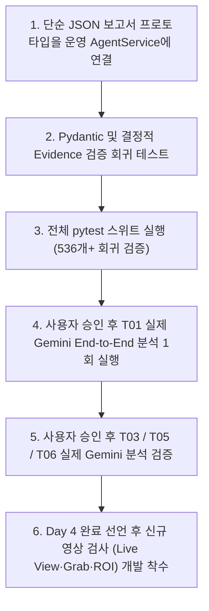

# VisionInsight — Day 4 AI Agent 개발 현황 및 인수인계서 (`docs/day4-agent-handoff.md`)

> **문서 버전:** 2.0 (Day 4 Step 1~4 진행 상태 및 실서버 검증 반영)  
> **기준 마일스톤:** Day 4 Step 1~3 완료, Step 4 실서버 검증 진행 중 (미완료)  
> **참조 정책:** [AGENTS.md](file:///c:/Users/USER/AI-NativeAgent/Project/InspectAgent/AGENTS.md), [docs/agent-data-access-policy.md](file:///c:/Users/USER/AI-NativeAgent/Project/InspectAgent/docs/agent-data-access-policy.md), [docs/day4-step4-gemini-validation.md](file:///c:/Users/USER/AI-NativeAgent/Project/InspectAgent/docs/day4-step4-gemini-validation.md)

---

## 1. 개요 및 현재 상태

Day 4의 목표는 **Gemini Function Calling을 활용하여 검사 결과 및 실행 로그를 자율적으로 조사하고 구조화된 이상 진단 보고서를 생성하는 AI Agent를 구현하는 것**입니다.

현재까지 Day 4 Step 1(도구 4개), Step 2(AgentService 및 프롬프트/근거 검증), Step 3(FastAPI 엔드포인트) 구현이 완료되었으며, **Step 4(실제 Gemini API 실서버 검증)가 진행 중**입니다.  
실제 Gemini API 검증 과정에서 Function Calling과 도구 실행은 확인되었으나, 최종 구조화 응답 스키마 제약으로 인해 **Day 4 Step 4는 아직 최종 완료되지 않았으며 진행 중**입니다.

---

## 2. Day 4 세부 진행 결과

### A. 구현 완료된 AI Agent 기능

1. **Gemini 수동 Function Calling 바인딩 (`backend/agent/service.py`):**
   - SDK 자동 함수 실행(`disable=True`)을 끄고, 서버가 호출 인자 검증 및 실행 Trace 감사를 직접 제어.
   - `gemini-3.8-flash` 모델과 `AUTO` 모드 Function Calling 선언.
   - 모델의 생각 서명(`thought signature`) 및 호출 ID를 순서대로 보존하여 후속 요청으로 전달.

2. **InspectionTools 4종 (`backend/agent/tools.py`):**
   - `get_inspection_result(inspection_id)`: 단일 검사의 제품 판정, 영상 품질 상태, PatchCore 이상 점수 및 임계값 조회.
   - `get_execution_logs(inspection_id)`: 검사 라이프사이클 이벤트 로그 조회 (살균된 이벤트 코드 및 metrics).
   - `analyze_image_quality(inspection_id)`: 이미지 밝기 평균, 표준편차, 정상 기준 통계 조회.
   - `get_inspection_history(product_id, limit=5)`: 동일 제품 과거 검사 이력 조회 (불투명 별칭 `TARGET-PRODUCT` 매핑을 통해 원본 ID 은닉).

3. **AgentService 오케스트레이션 (`backend/agent/service.py`):**
   - 다중 라운드 도구 실행 제어 (최대 4라운드, 8회 실행, 동일 도구 연속 호출 2회 제한).
   - 시간 제한 관리 (모델 timeout 15초, 도구 timeout 3초, 전체 분석 timeout 60초).
   - SDK `attempts=1`, `automatic_continuation=False`를 통한 비용 및 호출 수 엄격 제어.

4. **FastAPI 사후 분석 엔드포인트 (`POST /analyze/{inspection_id}`):**
   - `backend/agent/api.py`를 `backend/main.py`에 등록 완료.
   - 선행 존재 확인(404), API 키 부재 시 안전한 503 반환, 검사 ID 형식 검증(422) 처리.
   - 비동기 lifespan 기반 AgentRuntime 지연 적재 및 안전한 자원 해제.

5. **실제 Python 도구 실행 Trace 및 Audit Trail:**
   - 실행 순서, 라운드 번호, 도구명, 인자, 성공 여부, 소요 시간(ms), `evidence_id`(`E0001`~`E0004`)를 서버가 직접 기록.

6. **Evidence ID 및 JSON Pointer 기반 결정적 근거 검증 (Grounding):**
   - Agent가 보고서에 서술한 관측 사실(`observed_facts`)이 실제 도구 반환값의 특정 JSON Pointer 위치 데이터와 정확히 일치하는지 서버 Python이 엄격 비교.
   - 가짜 Evidence ID, 변조된 수치, 미실행 도구의 데이터 생성 시 `EVIDENCE_MISMATCH`로 즉각 거부.

7. **Pydantic 구조화 응답 검증 (`DiagnosisDraft`, `AnalysisResponse`):**
   - 6대 핵심 판정(`status`, `result`, `image_quality_status`, `defect_detection_status`, `final_result`, `final_reason_code`) 필드 필수 검증.

8. **검사 판정 보호 정책:**
   - 비전 모델의 결함 판정(`result`)이나 시스템 종합 판정(`final_result`)을 Agent가 임의로 수정하거나 번복할 수 없음.
   - `result=OK`를 실제 무결점 보증으로 해석하지 못하도록 시스템 지침 및 검증 로직 강제.

9. **정상 검사 조건부 조기 종료 (Early Termination):**
   - 6대 핵심 판정이 모두 정상이고 `anomaly_score <= decision_threshold`인 경우, 불필요한 다중 라운드(로그·품질·이력 조회 및 종료 확인 요청)를 건너뛰고 1회 도구 실행 후 즉시 구조화 응답 단계로 전환하여 지연 시간 및 토큰 낭비 방지 (2요청 단축 경로).

---

### B. 실제 Gemini API 실서버 검증 경과 및 결과

실제 `POST /analyze/INSP-001396`(T01 시나리오)를 대상으로 한 건씩 사용자 승인 하에 진행된 검증 결과는 다음과 같습니다:

1. **Function Calling 및 Python 도구 실행 성공 (PASS):**
   - 실제 Gemini 모델이 첫 번째 요청에서 `get_inspection_result` 도구를 정확히 선택하여 반환.
   - Python 저장소 조회 및 `evidence_id=E0001` 생성 완료.

2. **FunctionResponse 프로토콜 교정 (PASS):**
   - 초기 검증 시 후속 요청에서 SDK 기본 변환으로 `role="tool"`이 전달되어 Gemini 서버에서 HTTP 400 거부 발생.
   - GenerateContent 명세에 맞추어 `role="user"`로 프로토콜을 교정하고 SDK 변환 검증 완료.

3. **다중 라운드 504 지연 개선 및 조기 종료 검증 (PASS):**
   - 4개 도구 순차 실행 후 종료 확인 요청에서 Gemini 서버 504 DEADLINE_EXCEEDED 발생.
   - 정상 검사 조건부 조기 종료를 도입하여 1회 도구 실행 직후 즉시 구조화 단계로 전환 성공.

4. **복잡한 DiagnosisDraft 구조화 요청의 HTTP 400 (FAIL):**
   - 조기 종료 후 최종 구조화 응답(`DiagnosisDraft`) 요청에서 `INVALID_ARGUMENT / RESPONSE_SCHEMA` HTTP 400 지속 발생.
   - SDK types.Schema에서 표준 JSON Schema `response_json_schema`로 전환했으나 복잡한 구조로 인해 서버 거부 지속.

5. **스키마 후보 실서버 격리 실험 결과 (A/B/C PASS vs D/E2 FAIL):**
   - **A, B, C 후보 (실서버 PASS / HTTP 200):** 평탄한 문자열, 인라인 객체 배열 등 단순 구조는 Gemini 서버가 정상 수락.
   - **D, E2 후보 (실서버 FAIL / HTTP 400):** `$defs/$ref` 중첩 정의, Union/Nullable 타입, Enum 제약, 배열 min/max 제약이 결합된 복잡한 스키마는 서버 검증기에서 거부됨을 확인.

6. **단순 JSON + Python 엄격 검증 프로토타입 실서버 실험 (PASS):**
   - `scripts/agent_simple_report_prototype.py`를 통해 전송 스키마는 454바이트/깊이 2의 단순 JSON(사실 토큰 참조 배열)으로 축소.
   - 모델은 사실 토큰과 요약/권고 코드만 선택하고, 실제 관측값 복원 및 엄격한 Pydantic/Evidence 검증은 서버 Python에서 수행.
   - **실서버 단일 요청 실험 결과:** HTTP 200 수락, SimpleReport 파싱 성공, 기존 `DiagnosisDraft` 변환 및 6대 핵심 사실 결정적 근거 검증 **100% 통과 (PASS)**.

---

### C. 미완료 항목 (진행 중)

다음 항목들은 아직 완료되지 않았으며 후속 작업으로 인수인계됩니다:

1. **단순 JSON 방식의 운영 AgentService 연결:**  
   실험 스크립트(`scripts/agent_simple_report_prototype.py`)의 토큰 카탈로그 생성 및 변환 로직을 실제 운영 `backend/agent/service.py`의 구조화 응답 경계에 통합.
2. **T01 전체 End-to-End 분석 성공:**  
   운영 서비스 연결 후 `POST /analyze/INSP-001396`를 호출하여 실제 도구 실행 → 단순 JSON 생성 → Python 근거 검증 → HTTP 200 반환 전체 흐름 완수.
3. **T03, T05, T06 시나리오 실제 Gemini 분석 검증:**  
   조도 저하(T03), 로드 실패(T05), 미검출 불량(T06)에 대한 실제 Agent 진단 보고서 생성 및 근거 일치성 검증.
4. **최종 진단 품질 검증:**  
   생성된 한국어 진단 요약, 가설 후보, 권고 조치가 산업용 원칙(AGENTS.md)을 준수하는지 품질 평가.
5. **Day 4 Step 5 통합 마무리:**  
   전체 E2E 테스트 통과 및 Day 4 최종 완료 선언.

---

## 3. 테스트 실행 결과

- **마지막 전체 회귀 테스트 실행 결과:**
  ```bash
  python -m pytest tests -q -p no:cacheprovider
  # 536 passed, 3 warnings in 19.14s (100% 통과)
  ```
  - Day 1~3 비전 검사 파이프라인 (105개)
  - Day 4 Step 1~3 Agent 도구, 서비스, API (210개)
  - 효율화 및 조기 종료 테스트 (test_agent_efficiency.py, 25개)
  - 스키마 분할 및 단순 보고서 프로토타입 테스트 (test_agent_e2_partitions.py, test_agent_simple_report.py, 50개)
  - 총 **536개 테스트 통과 (실제 SDK 네트워크 전송 차단 환경에서 무결성 검증)**.

- **후속 개별 테스트 실행 결과:**
  - 단순 JSON 보고서 실서버 실험 전 관련 단위 테스트 50개 통과 확인.
  - 모든 후속 개별 실험에서 전체 536개를 매번 재실행한 것은 아니므로, 마지막 전체 회귀 결과(536 passed)와 개별 검증 결과를 구분하여 관리합니다.
  - **주의:** 오프라인 테스트의 PASS는 Mock 대역 및 로컬 SDK 직렬화 통과를 의미하며, 실제 Gemini 서버에서의 최종 진단 품질 성공을 보증하지 않습니다.

---

## 4. 신규 영상 검사 요구사항 (향후 로드맵)

Day 4 완료 후 VisionInsight에 다음 신규 영상 검사 기능이 추가될 예정입니다 (현재 구현 완료 기능이 아니라 이후 개발 계획):

1. **컨베이어 Live View 동영상 연동:**  
   MVTec AD Bottle 이미지들로 생성한 컨베이어 벨트 이송 동영상을 `data/outputs/videos`에서 로드하여 웹 화면에 실시간 재생.
2. **실시간 프레임 Grab:**  
   동영상 재생 중 작업자 또는 센서 트리거 시 특정 프레임을 캡처하여 정지 이미지 생성.
3. **마우스 드래그 ROI(Region of Interest) 선택:**  
   웹 화면에서 마우스 드래그를 통해 검사 대상 병 영역을 직관적으로 지정.
4. **ROI 이미지 대상 기존 PatchCore 추론 적용:**  
   드래그된 ROI 이미지에 대해 기존 구축된 ResNet-18 PatchCore 엔진 및 고정 임계값(`34.1442`)을 그대로 적용하여 결함 판정.
5. **품질 경고 및 검사 실패 시 Gemini Agent 자율 재진단:**  
   OpenCV 조명 경고(`WARNING_LOW_BRIGHTNESS`) 또는 검사 오류(`ERROR`) 발생 시 Gemini Agent가 호출되어 원인 분석 및 대처 가이드 제시.
6. **실행 로그 데이터 정제:**  
   검사 라이프사이클 이벤트 로그에서 불필요한 `product_id`를 제외하고 정제된 감사 로그 유지.
7. **React 대시보드 구현 (Day 6):**  
   Live View 스트리밍 플레이어, Grab Image 뷰어, ROI 드래그 박스, Agent 진단 패널을 갖춘 React 관제 UI 개발.

> **불변 원칙:** 기존 훈련된 PatchCore 체크포인트(`models/patchcore/patchcore_bottle.ckpt`)와 결정 임계값(`34.1442`)은 재학습 없이 그대로 유지됩니다.

---

## 5. 다음 작업 인수인계 및 작업 순서

다음 작업을 이어받을 엔지니어는 반드시 아래 6단계 순서에 따라 작업을 진행하세요:



### 상세 절차
1. **단순 JSON 보고서 프로토타입의 운영 AgentService 연결:**
   - `scripts/agent_simple_report_prototype.py`의 토큰 카탈로그 빌더 및 `SimpleReport -> DiagnosisDraft` 역변환 로직을 `backend/agent/service.py`의 구조화 응답 생성 루프에 연결.
   - 외부 전달 스키마는 검증된 `simple_output_schema()` (454B) 사용.
2. **Pydantic 및 결정적 Evidence 검증 회귀 테스트:**
   - `backend/agent/service.py`의 `_verify_report()`가 변환된 초안의 6대 핵심 사실, JSON Pointer 일치성, 가설 조건을 완벽히 통과하는지 오프라인 Mock 검증.
3. **전체 pytest 실행:**
   - `python -m pytest tests -q -p no:cacheprovider`를 실행하여 536개 이상의 테스트가 100% 통과함을 확인.
4. **별도 승인 후 T01 실제 Gemini End-to-End 분석:**
   - 사용자의 명시적 승인을 받은 후, `POST /analyze/INSP-001396` 1회를 실행하여 실제 Gemini 호출 → 도구 실행 → 단순 JSON 생성 → Python 검증 → HTTP 200 반환 전체 흐름 검증.
5. **별도 승인 후 T03/T05/T06 실제 Gemini 분석:**
   - T03(조도 저하), T05(로드 실패), T06(미검출 불량)에 대해 1회씩 순차 승인 하에 분석 실행 및 진단 품질 평가.
6. **Day 4 완료 판단 후 영상 Grab·ROI 기반 개발 진행.**

> **금지 사항:** 사전 승인 없는 임의의 실제 Gemini API 호출 및 유료 모델 요청은 엄격히 금지됩니다.
