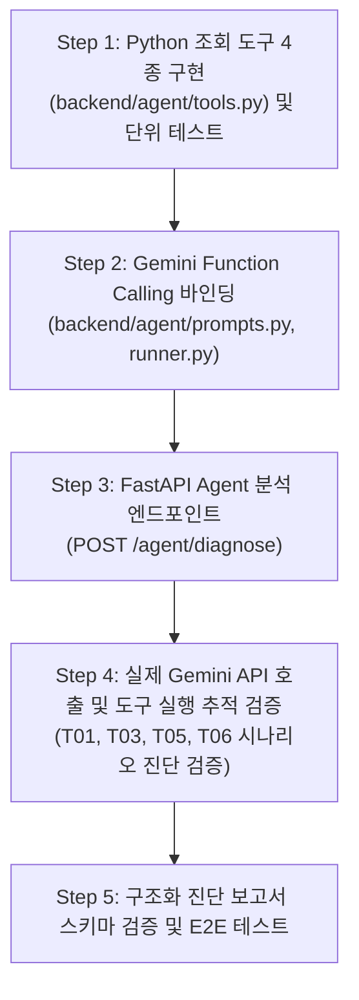

# VisionInsight — Day 4 Gemini AI Agent 개발 인수인계서 (`docs/day4-agent-handoff.md`)

> **문서 버전:** 1.0  
> **작성일:** 2026-10-14  
> **기준 마일스톤:** Day 3.5 완료 (105개 pytest 통과) -> Day 4 개발 착수  
> **참조 정책:** [docs/agent-data-access-policy.md](file:///c:/Users/USER/AI-NativeAgent/Project/InspectAgent/docs/agent-data-access-policy.md), [AGENTS.md](file:///c:/Users/USER/AI-NativeAgent/Project/InspectAgent/AGENTS.md)  

---

## 1. Day 4 개발 목표

Day 4의 목표는 **Gemini Function Calling을 활용하여 검사 결과 및 실행 로그를 자율적으로 조사하고 구조화된 이상 진단 보고서를 생성하는 AI Agent를 구현하는 것**입니다.

### 핵심 역할 정의
- **Agent의 본질:** Agent는 검사 알고리즘을 새로 계산하거나 PatchCore 모델을 대체하는 역할이 아닙니다.
- **주요 업무:** 이미 수행된 검사 레코드(`data/inspections.jsonl`)와 단계별 라이프사이클 이벤트 로그(`data/inspection_logs.jsonl`)를 도구를 통해 조회하고, **객관적으로 관측된 사실(Observation)**과 **가능한 설비/환경 원인 후보(Hypothesis)**, **시스템의 분석 한계(Limitation)**를 명확히 분리하여 운영자에게 보고서를 제공합니다.

---

## 2. 예정된 4대 Python 도구 (Function Calling Tools)

Day 4에서 구현할 도구는 파일시스템을 직접 탐색하지 않고, 백엔드 저장소 인터페이스(`get_inspection_storage()`)를 통해 살균된 데이터만 반환해야 합니다.

| 도구명 | 파라미터 | 반환 스키마 (Pydantic/Dict) | 도구의 역할 및 설명 |
| :--- | :--- | :--- | :--- |
| `get_inspection_result` | `inspection_id: str` | `InspectionRecordResponse` | 단일 검사의 최종 판정, 제품 판정, 영상 품질 상태, PatchCore 이상 점수 및 임계값을 조회합니다. |
| `get_execution_logs` | `inspection_id: str` | `List[InspectionLogRecordResponse]` | 검사 시작부터 종료까지의 단계별 이벤트 코드, 로그 레벨, 살균된 메시지를 조회하여 실패/지연 구간을 파악합니다. |
| `analyze_image_quality` | `inspection_id: str` | `ImageQualityMetricsResponse` | 이미지 밝기 평균, 표준편차, 최소/최대값 및 정상 기준치 범위를 조회하여 조명 환경 이상을 분석합니다. |
| `get_inspection_history` | `product_id: str, limit: int = 5` | `List[InspectionRecordResponse]` | 동일 제품 ID의 과거 최근 검사 이력을 조회하여 간헐적 불량인지 연속적 결함인지 트렌드를 분석합니다. |

---

## 3. 데이터 접근 허용 및 금지 경계

### 3.1 허용 데이터 (Allowed Fields)
Agent 프롬프트 및 도구 반환값에 포함될 수 있는 필드:
- **식별자:** `inspection_id`, `product_id`, 중립 `image_id` (예: `IMG-BOTTLE-0001`)
- **타임스탬프:** `timestamp`
- **상태 및 판정:** `status`, `result` (`OK`/`NG`/`UNKNOWN`), `image_quality_status`, `defect_detection_status`, `decision_confidence`, `final_result` (`OK`/`NG`/`REINSPECT`/`ERROR`), `final_reason_code`
- **측정 지표:** 밝기 통계(`mean`, `std`, `min`, `max`, `width`, `height`), `anomaly_score`, `decision_threshold` (34.1442), `inference_time_ms`, `model_version`
- **로그 및 이력:** 살균된 이벤트 로그 목록, 동일 제품 최근 검사 레코드 목록

### 3.2 엄격 금지 데이터 (Strictly Prohibited Fields)
Agent에게 어떠한 경로로도 노출되어서는 안 되는 정보:
- 평가용 정답 라벨 (Ground Truth Labels) 및 결함 마스크
- 원본 결함 클래스 폴더명 (`broken_large`, `broken_small`, `contamination`)
- **T03 합성 주입 사실 및 조작 배율 (0.6x 등):** 오프라인 평가 하네스 전용 정보이므로 Agent에게 사전 주입하지 않음
- **T06 실제 결함 여부:** 현재 모델이 미검출(FN)한 사례이나, 운영 데이터만으로 정답을 알 수 없으므로 Agent에게 정답을 주입하지 않음
- 서버 로컬 절대 파일 경로 (`C:\...`, `/app/...`, `/dataset/...`)
- API Key, 서비스 계정 인증서, `.env`
- 미가공 Python Exception Traceback

---

## 4. Agent 해석 및 보고서 작성 10대 원칙

1. **기록 부재 사실의 날조 금지 (No Hallucination):** 검사 기록과 이벤트 로그에 없는 사실을 임의로 추측하여 확정 사실로 서술하지 않습니다.
2. **모델 판정의 한계 인지:** `result=OK`를 실제 100% 무결점 양품 보증으로 해석하지 않으며, 현재 모델의 Recall(50.79%) 한계로 인한 미검출 가능성을 인지합니다.
3. **재검 판정의 객관적 해석:** `final_result=REINSPECT`는 영상 품질 이상 등으로 인한 '재검사 요구'일 뿐, 제품 불량 확정이 아님을 명시합니다.
4. **관측·가설·한계의 엄격한 분리 (AGENTS.md 규칙 7):**
   - **관측:** 밝기 평균이 기준치 하한(125.0) 미만인 81.24로 측정됨
   - **가설:** 조명 장치 광량 저하, 카메라 렌즈 차광, 또는 작업 환경 조도 변화 가능성
   - **한계:** 영상 분석만으로는 실제 물리적 조명 전구/전원 고장 여부를 확정할 수 없으며 현장 점검 필요
5. **실패 유형의 명확한 구분:** 추론 실패(`defect_detection_status=FAILED`)와 시스템 실행 실패(`status=FAILED`)를 엄격히 분리하여 설명합니다.
6. **근거 중심 추적성 확보:** Agent는 보고서 작성 시 자신이 어떤 도구를 호출하여 어떤 지표를 근거로 결론을 내렸는지 추적할 수 있도록 도구 호출 내역을 보고서에 첨부합니다.
7. **테스트 정답 사전 인지 배제:** T01, T03, T05, T06 시나리오에 대해 "이것은 테스트용 결함입니다"라는 식의 사후 해설을 하지 않고, 실제 운영 중 발생한 상황으로 객관적 진단을 수행합니다.
8. **T06 결과 임의 왜곡 금지:** 모델 점수(32.2679)가 임계값 이하로 산출된 T06에 대해 Agent가 임의로 NG로 판정을 뒤집지 않습니다.
9. **판정 결과의 불변성:** 모델의 판정(`result`)이나 시스템의 종합 판정(`final_result`)을 Agent가 임의로 수정하거나 덮어쓰지 않습니다.
10. **권고 조치의 구체성:** 이상 상황 발생 시 현장 작업자가 취해야 할 조치(예: "조명 전원 및 렌즈 오염 확인 후 수동 재검사 투입")를 단계별로 권고합니다.

---

## 5. Day 4 권장 구현 순서

### 단계별 상세 가이드
1. **Step 1 (도구 계층):** `backend/agent/tools.py`에 4개 도구 구현. `InspectionStorageBase`를 주입받아 동작하도록 설계하여 추후 Cloud Storage 전환 시에도 도구 코드가 변경되지 않도록 구현.
2. **Step 2 (프롬프트 및 에이전트 런너):** 시스템 프롬프트에 `AGENTS.md`의 관측/가설/한계 분리 원칙과 산업용 진단 보고서 템플릿(Markdown 형식) 탑재.
3. **Step 3 (API 엔드포인트):** `POST /inspections/{inspection_id}/diagnose` 엔드포인트를 추가하여 비동기로 Agent 진단 보고서를 반환하도록 설계.
4. **Step 4 (E2E 검증):** 모의 환경(Mock)과 실제 Gemini 호출 환경을 분리하여 T01(정상 통과), T03(조도 저하 재검), T05(로드 실패 에러), T06(미검출 주의) 4대 시나리오에 대한 진단 보고서의 품질 실측.
