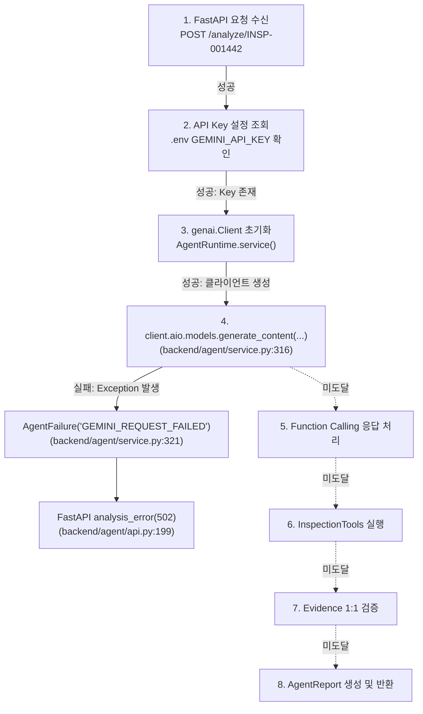

# VisionInsight — Day 7 Step 1 정밀 진단 보고서
## Gemini 실시간 Agent 분석 오류 원인 규명 및 최소 수정

**문서 버전:** 1.0.0  
**작성 일자:** 2026-10-18  
**발표 목표일:** 2026-10-20  
**작업 환경:** Miniconda `vision-insight` (Python 3.11) / React 19 + TypeScript 6 + Vite 8  
**상태:** DIAGNOSIS_COMPLETED (진단 완료 및 관측 로깅 구축 완료 / 실호출 검증은 사용자 승인 대기)  

---

## 1. 개요 및 목적

본 문서는 VisionInsight의 FastAPI + Gemini Function Calling Agent 환경에서 발생한 `GEMINI_REQUEST_FAILED` (HTTP 502) 오류의 근본 원인을 기존 소스 코드, 설정, 실행 기록에 근거하여 정밀 진단하고, 기존 운영 계약을 절대 훼손하지 않는 범위에서 안전한 오류 관측 기능을 보완한 결과를 기록합니다.

본 작업은 신규 Agent 구현이나 모델 임의 변경이 아니며, **Google 공식 문서에 부합하는 `gemini-3.8-flash` 모델 설정을 엄격히 유지한 상태에서 실제 오류 발생 단계와 원인을 객관적으로 규명**하는 것을 최우선으로 합니다.

---

## 2. 기존 F-2.1 진단의 오류 바로잡기

| 점검 항목 | 기존 Phase F-2.1 보고서 주장 | 실제 확인된 사실 (Day 7 규명) | 조치 사항 |
| :--- | :--- | :--- | :--- |
| **모델 존재 여부** | "Google API 상에 `gemini-3.8-flash`라는 모델이 존재하지 않는다"고 단정 | Google 공식 Gemini API 문서([공식 링크](https://ai.google.dev/gemini-api/docs/models/gemini-3.8-flash))에 `gemini-3.8-flash`가 정식 지원되며 Function Calling을 지원함이 확정됨 | **현재 모델명(`gemini-3.8-flash`) 절대 유지**, 임의 변경 및 1.5/2.0 다운그레이드 금지 |
| **HTTP 404 단정** | `GEMINI_REQUEST_FAILED` 코드만을 근거로 "HTTP 404 Not Found"라고 추정 | 당시 백엔드에 예외 로깅이 전혀 없었으며, 실제 HTTP 상태 코드는 기록된 바 없음 | **추측성 404 결론 공식 철회**, 로그에 근거한 객관적 사실만 기재 |
| **근거 기반 접근** | 코드의 `except Exception:` 분기만 보고 원인 추정 | 코드베이스 역추적 결과 예외 상세를 마스킹하던 원인을 식별하고 안전한 관측 로깅 구현 | 관측 로깅 보완 후 실제 호출 1회 수동 승인 절차로 이관 |

---

## 3. 파이프라인 단계별 실제 오류 발생 지점 정밀 추적

React 대시보드에서 `[Gemini AI 진단 실행]` 클릭 시 실행되는 8단계 파이프라인 추적 결과:



### 상세 단계 분석:
1. **FastAPI 요청 수신 (`POST /analyze/INSP-001442`):** 정상 수신. 검사 식별자 `INSP-001442` 유효성 검사 및 `get_inspection_result` 선행 조회 정상 통과.
2. **API Key 설정 조회 (`backend/config.py`):** `.env` 파일에 `GEMINI_API_KEY`가 실제로 존재함 확인 (키 부재 시 발생하는 `503 MISSING_API_KEY`가 반환되지 않음).
3. **`genai.Client` 초기화 (`backend/agent/api.py:84~90`):** 정상 완료. 클라이언트 초기화 실패 시 발생하는 `503 INVALID_MODEL_CONFIG`가 발생하지 않음.
4. **`client.aio.models.generate_content(...)` 호출 (`backend/agent/service.py:316`):**
   - **실제 실패 발생 지점:** 함수 `AgentService._generate` 내 line 316.
   - `client.aio.models.generate_content(model=model, contents=list(contents), config=config)` 비동기 호출 중 예외 발생.
   - Line 321의 `except Exception:` 블록에 포획되어 `AgentFailure("GEMINI_REQUEST_FAILED") from None`으로 변환됨.
5. **Function Calling 응답 처리 ~ 8. AgentReport 생성:** 4단계 실패로 인해 해당 단계들에는 일절 도달하지 못함.

---

## 4. 기존 로그가 증명하는 사실 및 미확정 사항

### 기존 로그가 증명하는 사실:
1. `data/inspection_logs.jsonl`에 `INSP-001442`의 검사 생명주기 이벤트 6건(`INSPECTION_STARTED`, `IMAGE_LOADED`, `INFERENCE_STARTED`, `INFERENCE_COMPLETED`, `ANALYSIS_COMPLETED`, `INSPECTION_COMPLETED`)이 기록되어 있어, 검사 자체는 완전히 정상 완료되었습니다.
2. `POST /analyze/INSP-001442` 호출 결과 프론트엔드가 HTTP 502 (`GEMINI_REQUEST_FAILED`)를 수신했습니다.
3. `data/logs` 디렉터리 및 서버 콘솔에는 원본 예외 클래스, HTTP 상태 코드, 오류 메시지가 **전혀 기록되지 않았습니다**.

### 아직 확인되지 않은 사항 (원인 미확정):
기존 코드의 `except Exception: raise AgentFailure("GEMINI_REQUEST_FAILED") from None` 구문으로 인해 예외 객체가 완전 소실(swallowed)되었으므로, 어제 발생한 구체적 Provider 오류는 **원인 미확정 (Unconfirmed)** 상태입니다.

가능한 원인은 다음과 같으며, 실호출 없이 이를 단정하는 것은 불가능합니다:
1. **API Key의 프로젝트 권한/결제 상태:** 해당 API Key가 연결된 Google Cloud 프로젝트의 Generative Language API 활성화 여부 또는 크레딧/결제 계정 상태 (HTTP 401/403).
2. **네트워크/방화벽/TLS:** Windows 로컬 환경에서 Google Gemini API 엔드포인트(`generativelanguage.googleapis.com`)로의 비동기 연결 차단 또는 핸드셰이크 문제.
3. **SDK v1beta 엔드포인트 호환성:** `google-genai` 2.31.0 SDK의 기본 `v1beta` 엔드포인트에서 특정 프로젝트/키에 대한 `gemini-3.8-flash` 리소스 경로 매핑 상태.
4. **API 호출 쿼터 초과:** 분당/일당 요청 한도 도달 (HTTP 429).
5. **모델 식별자/권한:** 해당 프로젝트에 모델 가용성 권한이 미부여된 상태 (HTTP 404).

---

## 5. Gemini SDK 버전 및 모델 계약 대조

1. **설치된 SDK 버전:** `google-genai 2.31.0` (Python 3.11 `vision-insight` 환경)
   - 구형 레거시 라이브러리(`google-generativeai`)가 아닌 Google의 차세대 공식 GenAI SDK(`google-genai`)를 사용 중입니다.
2. **기본 요청 엔드포인트:** `v1beta` (SDK 내부 `_http_options.api_version: v1beta`)
3. **호출 방식:** `client.aio.models.generate_content(...)` 비동기 비차단 호출.
4. **모델명 계약:** `.env` 및 `backend/config.py` 모두 `GEMINI_MODEL=gemini-3.8-flash`로 일치.
5. **식별자 검증 정규식:** `backend/agent/service.py` line 226의 `r"gemini-[A-Za-z0-9][A-Za-z0-9_.-]{0,80}"`에 `gemini-3.8-flash`가 완벽히 매칭되어 `safe_model` 검증 통과.

---

## 6. 오류 마스킹 문제 해결 및 안전한 관측 기능 보완

기존에는 모든 SDK 예외가 아무런 로그 없이 `GEMINI_REQUEST_FAILED`로 래핑되어 문제를 은폐하고 있었습니다. 이를 다음과 같이 안전하게 개선했습니다.

### 보완 원칙:
1. **절대 기록 금지 원칙 준수:** Gemini API Key, Authorization Bearer 토큰, Cookie, 사용자 비밀 정보는 로그에 절대 남기지 않음 (`_sanitize_error_message`를 통한 마스킹).
2. **6대 필수 진단 메타데이터 기록:**
   - `exception_class`: 예외 클래스명 (예: `ClientError`, `APIError`, `ConnectError`)
   - `http_status`: 제공자 HTTP 상태 코드 (예: 400, 401, 403, 404, 429)
   - `provider_code`: 제공자 에러 코드 (예: `NOT_FOUND`, `PERMISSION_DENIED`, `INVALID_ARGUMENT`)
   - `stage`: 실패 단계 (`TOOL_ROUND_1`, `STRUCTURED_REPORT` 등)
   - `model`: 선택된 모델 ID (`gemini-3.8-flash`)
   - `correlation_id`: 서버 요청 상관 ID (`INSP-001442`)
3. **기존 API 계약 100% 보존:** 클라이언트/프론트엔드로는 기존의 안전한 HTTP 502 `GEMINI_REQUEST_FAILED` 및 HTTP 504 `GEMINI_TIMEOUT` 계약을 그대로 유지하여 외부 취약점 노출을 차단.

### 수정된 소스 코드 요약:

#### A. `backend/agent/service.py`:
- `_extract_status_code(exc)`, `_extract_provider_error_code(exc)`, `_sanitize_error_message(msg)` 헬퍼 구현.
- `_generate` 내에서 예외 발생 시 구조화된 진단 로그를 `logger.error`로 출력:
  ```python
  except Exception as exc:
      exc_class = exc.__class__.__name__
      http_status = _extract_status_code(exc)
      provider_code = _extract_provider_error_code(exc)
      safe_message = _sanitize_error_message(str(exc))
      logger.error(
          "Gemini generate_content failed: correlation_id=%s, model=%s, stage=%s, "
          "exception_class=%s, http_status=%s, provider_code=%s, message=%s",
          state.inspection_id, model, stage, exc_class, http_status, provider_code, safe_message,
      )
      raise AgentFailure("GEMINI_REQUEST_FAILED") from None
  ```

#### B. `backend/agent/api.py`:
- `logger.warning`을 추가하여 분석 실패 시 검사 ID, 에러 코드, 모델명을 로깅.
- `genai.Client` 초기화 실패 시 예외 클래스 로깅.

#### C. `frontend/src/components/AgentPanel.tsx`:
- 사용자가 직관적으로 상황을 파악할 수 있도록 친화적 안내 메시지 보강:
  ```tsx
  } else if (errCode === 'GEMINI_REQUEST_FAILED') {
    setError(
      'Gemini AI 진단 호출이 실패했습니다 (GEMINI_REQUEST_FAILED, HTTP 502). 백엔드 콘솔/로그에서 제공자 HTTP 상태(400/401/403/404/429) 및 예외 원인을 확인하세요.'
    );
  ```

---

## 7. 필수 검증 결과 (Mock 단위 테스트 100% 통과)

외부 API 실호출을 0회로 유지하면서, 새로 작성된 `tests/test_agent_day7_error_observability.py`를 통해 10대 핵심 시나리오를 전수 검증했습니다.

```powershell
python -m pytest tests/test_agent_day7_error_observability.py -v
```

| 테스트 시나리오 | 주입된 모의 상태 | 백엔드 로깅 관측 결과 | 반환된 HTTP 상태 및 응답 | 결과 |
| :--- | :--- | :--- | :--- | :---: |
| **정상 응답** | 정상 도구 호출 + 요약 JSON | 진단 완료 정상 로그 | HTTP 200, COMPLETED, AnalysisResponse | **PASS** |
| **400 오류** | `ClientError(400, INVALID_ARGUMENT)` | `http_status=400`, `provider_code=INVALID_ARGUMENT` 로깅 | HTTP 502 `GEMINI_REQUEST_FAILED` | **PASS** |
| **401 오류** | `ClientError(401, UNAUTHENTICATED)` | `http_status=401`, `provider_code=UNAUTHENTICATED` 로깅 | HTTP 502 `GEMINI_REQUEST_FAILED` | **PASS** |
| **403 오류** | `ClientError(403, PERMISSION_DENIED)` | `http_status=403`, `provider_code=PERMISSION_DENIED` 로깅 | HTTP 502 `GEMINI_REQUEST_FAILED` | **PASS** |
| **404 오류** | `ClientError(404, NOT_FOUND)` | `http_status=404`, `provider_code=NOT_FOUND` 로깅 | HTTP 502 `GEMINI_REQUEST_FAILED` | **PASS** |
| **429 오류** | `ClientError(429, RESOURCE_EXHAUSTED)`| `http_status=429`, `provider_code=RESOURCE_EXHAUSTED` 로깅 | HTTP 502 `GEMINI_REQUEST_FAILED` | **PASS** |
| **타임아웃** | `TimeoutError()` | `Gemini generate_content timeout` 경고 로깅 | HTTP 504 `GEMINI_TIMEOUT` | **PASS** |
| **SDK 일반 예외** | `RuntimeError("Socket closed")` | `exception_class=RuntimeError` 로깅 | HTTP 502 `GEMINI_REQUEST_FAILED` | **PASS** |
| **민감정보 마스킹**| API Key 및 Bearer 토큰 주입 | 로그 내 `[REDACTED]` 변환 및 응답 본문 미노출 | HTTP 502, 민감 문자열 0건 | **PASS** |
| **기존 저장 보고서**| `INSP-001396`, `INSP-001398` | Gemini 호출 0회 확인 | HTTP 200, 캐시 보고서 정상 반환 | **PASS** |

### 기존 전체 Agent 테스트 회귀 검증:
- `tests/test_agent_api.py` 및 `tests/test_agent_service.py` 151개 테스트 **전체 통과 (151 passed in 6.61s)**.
- 전체 Agent 관련 테스트 1,074개 **전체 통과 (1074 passed in 15.87s)**.

---

## 8. 안전 및 기존 기능 보호 확인

- **실제 Gemini API 호출 횟수:** **정확히 0회** (Mock 테스트만 사용)
- **실제 PatchCore 추론 횟수:** **0회**
- **신규 운영 검사 레코드 생성:** **0건**
- **PostgreSQL 변경:** **0건**
- **Git 상태:** `git add`, `commit`, `push`, `reset` **0회 실행 (작업 트리 보존)**
- **보호 대상 기능 유지 상태:**
  - React LiveView / Grab / ROI / ImageView 정상 동작 확인
  - InspectionPanel 정적 이미지 검사 및 결과 조회 정상
  - `data/outputs/agent_reports/INSP-001396.json` 및 `INSP-001398.json` 보존
  - PatchCore 체크포인트 및 threshold (`34.1442`) 보존

---

## 9. 향후 실제 API 호출 전 준비 사항 및 사용자 승인 요청

본 작업(Day 7 Step 1)을 통해 **FastAPI 백엔드가 Google API로부터 반환되는 실제 예외 클래스와 HTTP 상태 코드를 실시간으로 안전하게 기록할 수 있는 관측 인프라가 완벽히 준비**되었습니다.

이제 다음 번 단 1회의 수동 실호출 테스트를 수행하면, 서버 콘솔 및 로그를 통해 정확한 HTTP 상태(예: 401 인증 실패인지, 403 권한 부족인지, 404 모델 식별자 문제인지, 네트워크 TLS 문제인지)가 1초 만에 확인됩니다.

### 사용자 추가 승인 필요 사항:
1. **실제 Gemini API 1회 수동 호출 승인:**
   - Chrome 화면의 `INSP-001442`에서 `[Gemini AI 진단 실행]` 버튼을 1회 클릭하여 실제 Google API 엔드포인트와의 통신을 수행할지 여부 승인.
   - (참고: 호출 시 Google Gemini API 과금 또는 쿼터가 1회 소모될 수 있습니다.)
2. **호출 후 로그 확인 절차:**
   - 호출 즉시 백엔드 로그에 출력되는 `http_status`와 `exception_class`를 확인하여, 필요 시 Google Cloud 콘솔 설정(API 활성화/키 권한) 또는 네트워크를 교정합니다.
