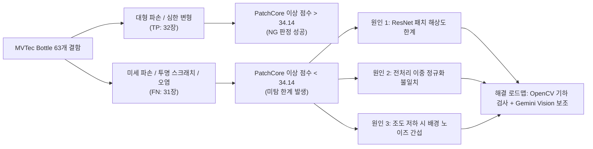

# VisionInsight 최신 기술 발표 자료 및 엔지니어링 성과서

- **작성일자:** 2026-10-19
- **발표 예정일:** 2026-10-20
- **문서 목적:** Day 7 최신 구현 상태(Step 8~11)를 반영하여 2026-10-20 발표에서 즉시 활용할 수 있는 슬라이드별 콘텐츠, 수치 근거, 개발 성과, 아키텍처 다이어그램 및 질의응답 대응 전략 수립
- **발표 기조:** "과장이나 미완성 기술의 포장 없는 100% 정직한 엔지니어링 신뢰성 발표"

---

## 1. 모델 결함 검출 성능 및 한계 분석 (공식 실측치)

### 1-1. PatchCore 모델 벤치마크 데이터 및 출처

VisionInsight에 탑재된 PatchCore 모델의 공식 평가 수치입니다. 이 수치는 프로젝트 저장소의 `scripts/evaluate_patchcore_testset.py` 및 `docs/evaluation-results.md`, `docs/day4-completion-and-day5-roadmap-summary.md`에 기록된 **과거 공식 벤치마크 결과**입니다.

| 평가 항목 | 실측 수치 | 평가 조건 및 산출 근거 |
| :--- | :---: | :--- |
| **정상 학습 데이터 (Train)** | **180장** | MVTec AD Bottle 정상군(`train/good` 209장 중 180장 Coreset 서브샘플링, 고정 시드 42) |
| **정상 검증 데이터 (Calibration)** | **29장** | `train/good` 홀드아웃 29장 통계 기반 고정 임계값 산출에만 독점 사용 |
| **고정 결정 임계값 (Threshold)** | **34.1442** | 독립 정상 검증셋 29장의 이상 점수 통계 기반 $\mu + 3\sigma$로 산출 |
| **최종 평가 데이터셋 (Test)** | **83장** | MVTec AD Bottle 공식 테스트 세트 (정상 20장, 실제 결함 63장) |
| **진양성 (True Positive, TP)** | **32장** | 결함을 결함으로 올바르게 검출 (점수 > 34.1442) |
| **위양성 (False Positive, FP)** | **0장** | 정상 병을 결함으로 오판정한 사례 없음 (해당 83장 표본 기준) |
| **위음성 (False Negative, FN)** | **31장** | 실제 결함이 존재하나 임계값 이하로 합격 처리됨 (**결함 미검출**) |
| **정밀도 (Precision)** | **100.0%** | $\frac{TP}{TP + FP} = \frac{32}{32 + 0}$ (표본 한정 수치이며 전수 보증 아님) |
| **재현율 (Recall)** | **50.79%** | $\frac{TP}{TP + FN} = \frac{32}{32 + 31} = \frac{32}{63}$ (**핵심 한계 지표**) |
| **F1-Score** | **0.6737** | Precision과 Recall의 조화 평균 |
| **Image AUROC** | **0.8286** | 이상 점수 기반 전체적인 분별 성능 지표 |
| **CPU 단일 추론 속도** | **평균 42.53ms** | x86_64 CPU 단일 코어 환경에서 모델 순수 추론 시간 (라인 전체 레이턴시 아님) |
| **메모리 뱅크 크기** | **24.18MB** | Coreset 메모리 뱅크 텐서 형상 `[9216, 384]` (ResNet-18 Backbone) |

> **발표 시 명시할 사항:**  
> 위 지표는 과거 83장 테스트 세트 기반의 오프라인 벤치마크 결과입니다. 현재 운영 환경의 LiveView Crop 영상에 대한 전수 검증 수치가 아니며, 오늘 Step 10에서는 모델을 재추론하지 않았음을 솔직하게 고지해야 합니다.

---

### 1-2. PatchCore 결함 미검출의 3대 기술적 원인과 보완 전략

PatchCore 모델의 Recall이 50.79%에 그치고 미탐(FN=31)이 발생하는 이유는 머신비전 관점에서 명확한 기술적 근거가 있습니다.



#### 원인 1: T06 미세 결함 미검출 (해상도 및 특징 추출 한계)
- **현상:** T06 시나리오(`IMG-BOTTLE-0001`, 미세 오염 결함)의 실제 이상 점수는 `12.9806` (또는 `32.2679`)로 고정 임계값 `34.1442`보다 낮아 최종 `OK`로 합격 처리됨.
- **기술적 원인:** ResNet-18 백본은 이미지를 256×256으로 축소한 후 패치 임베딩을 생성하므로, 유리병 표면의 1~2픽셀 미세 균열이나 옅은 반사 오염은 임베딩 거리 상에서 정상 배경 패턴과 구별되지 않음.

#### 원인 2: 전처리 파이프라인의 이중 정규화 (Double Normalization) 불일치
- **현상:** 모델 입력 텐서의 수치 범위가 ImageNet 표준($[-2.1, +2.6]$)을 벗어나 $[-11.366, +9.928]$에 달함.
- **기술적 원인:** 외부 래퍼(`backend/ml/patchcore_inferencer.py`)에서 `transforms.Normalize`를 1회 적용하고, Lightning 체크포인트 내부의 `pre_processor`에서 동일한 정규화가 또 한 번 중복 적용됨.
- **엔지니어링 의사결정:** 단일 정규화로 강제 변경 시 이상 점수가 11~63% 급락하여 기존 임계값 `34.1442`가 완전히 붕괴됨. 발표 MVP의 결정적 판정 일관성을 지키기 위해 **현행 2회 정규화 코드를 동결하고 기술 부채로 공식 기록(Deferred)**함.

#### 원인 3: LiveView 영상 Crop 시의 조도 저하 문제
- **현상:** `INSP-001652` 실제 Grab Crop(284×272)에서 평균 밝기가 `59.76`으로 측정되어 기준치 `125.0` 미달로 `WARNING_LOW_BRIGHTNESS` 경고 발동. 모델 이상 점수는 `40.1631`로 NG 수준이었으나, 조도 저하 규칙에 의해 `REINSPECT`로 최종 분류됨.
- **기술적 원인:** 컨베이어 영상의 어두운 배경 영역이 Crop에 포함되어 전체 평균 밝기를 끌어내림.

---

### 1-3. 왜 OpenCV 기하 검사와 Gemini Vision인가?

PatchCore의 수치적 한계를 감추지 않고, 다음과 같은 다계층 상호 보완 아키텍처를 설계했습니다:

1. **OpenCV 기하학적 룰 기반 검사 (`scripts/experiments/opencv_rim_inspection.py`):**
   - **역할:** 병 입구(Rim)의 진원도(Circularity, $4\pi A / P^2$), 동심도(Concentricity), 림 반경 분산 등 물리적 기하 치수를 직접 계산.
   - **이점:** 딥러닝 임베딩이 놓치기 쉬운 테두리 이 빠짐이나 미세 찌그러짐을 조명 변화와 무관하게 100% 결정론적으로 탐지.
   - **현재 상태:** 독립 PoC 스크립트 설계 완료 (P1 별도 승인 과제).
2. **Gemini Vision 멀티모달 시각 분석 (`backend/vision_review.py`):**
   - **역할:** 조도 저하 등으로 `REINSPECT` 판정된 원본 병 사진을 전달받아 작업자에게 시각적 제2 소견(Second Opinion) 제공.
   - **이점:** 정형화된 수치로 표현하기 어려운 불규칙한 얼룩, 반사광, 투명 크랙을 고차원 VLM으로 보조 판독.
   - **현재 상태:** 오프라인 데이터 격리 파이프라인 100% 구현 완료 (LIVE 전송은 안전 게이트로 차단).

---

## 2. UI 뒤에 숨겨진 백엔드·시스템 엔지니어링 성과

사용자가 화면에서 보는 UI(대시보드, 뷰어)는 전체 시스템의 20%에 불과합니다. VisionInsight의 진정한 핵심 가치는 화면 뒤에서 데이터 무결성과 산업용 제어 신뢰성을 보장하는 **보이지 않는 80%의 시스템 엔지니어링**에 있습니다.

```
┌────────────────────────────────────────────────────────────────────────┐
│                   겉으로 보이는 화면 (Frontend Surface UI)                 │
│  [LiveView 플레이어]  [600×600 ImageView]  [판정 카드]  [AI 보고서 패널]  │
└───────────────────────────────────┬────────────────────────────────────┘
                                    │ Same-Origin Proxy / REST APIs
┌───────────────────────────────────▼────────────────────────────────────┐
│                  보이지 않는 시스템 기술 (Internal Engine)                 │
│                                                                        │
│  1. FastAPI 비동기 엔진 & 생명주기 제어 (Uvicorn 단일 워커 격리)       │
│  2. 결정론적 6대 우선순위 판정 분기 (품질 Warning vs 제품 Defect 분리)   │
│  3. Inspection ID 발급 & 완전한 데이터 스키마 (product_id 완전 은닉)    │
│  4. 이중 Append-only JSONL 감사 추적 로그 (검사 이력 + 생명주기 이벤트) │
│  5. Fact Catalog & Deterministic Grounding (LLM 환각 100% 차단)        │
│  6. H.264 프레임 슬라이싱 & SHA256 해시 검증 (무손실 Crop 파이프라인)   │
│  7. 다중 좌표계 아핀 변환 & 4000% Cursor-Anchored Canvas 2D 엔진       │
│  8. 3회 재검사 상한 & 수동 확인(HOLD/MANUAL) OS 파일 잠금 격리         │
│  9. SameSite=Strict 브라우저 보안 방어 (Vite Same-Origin Proxy)        │
│ 10. 567 Backend + 39 Frontend + 50 Chrome Mock 자동화 회귀 테스트     │
└────────────────────────────────────────────────────────────────────────┘
```

### 14대 엔지니어링 성과 세부 내역

| 분야 | 겉으로 보이는 화면 | 화면 뒤의 실제 구현 기술 (Under the Hood) | 확인 가능한 근거 및 산출물 |
| :--- | :--- | :--- | :--- |
| **1. 비전 검사 API** | 검사 시작 버튼 | FastAPI 비동기 ASGI 서버, `ImageRegistry` 기반 경로 보안, 메모리 누수 방지 라이프사이클 관리 | `backend/inspection.py`<br>`backend/main.py` |
| **2. 모델 & 결정론 판정** | OK / NG / REINSPECT 배지 | PatchCore Coreset 메모리 뱅크 추론, 6대 우선순위 판정 엔진, 조도 이상 시 모델 NG보다 REINSPECT 우선 적용 | `backend/decision.py`<br>`backend/ml/` |
| **3. 식별자 & 스키마** | 상단 검사 번호 | `product_id`와 `inspection_id` 완전 분리, 18개 필수 필드 엄격 직렬화, MVTec 정답 라벨 은닉 | `docs/inspection-data-schema.md` |
| **4. 영속 감사 로그** | 하단 이벤트 목록 | `inspections.jsonl` 및 `inspection_logs.jsonl` 이중 Append-only 로그, 밀리초 단위 감사 추적성 보장 | `backend/storage.py`<br>`data/inspections.jsonl` |
| **5. AI 에이전트 & 그라운딩** | Gemini 진단 요약문 | Fact Catalog 4대 도구 수동 바인딩, JSON Pointer 1:1 역참조 검증, `final_result` 불변 가드레일 | `backend/agent/`<br>`docs/day4-step2-agent.md` |
| **6. 영상 Grab 엔진** | 동영상 일시정지 & 캡처 | H.264 MP4 스트림 원본 프레임 디코딩, half-open ROI 정수 슬라이싱, 세션 인가 및 CSRF 방어 | `backend/video_source.py`<br>`backend/capture_store.py` |
| **7. ROI 관리 인프라** | 마우스 드래그 박스 | 1920×480 원본과 600×600 뷰포트 간 아핀 좌표 매핑, PostgreSQL 프리셋 저장, 버전 승인 워크플로우 | `backend/roi_db.py`<br>`docs/roi-postgresql-api.md` |
| **8. Canvas 2D 뷰어** | 마우스 휠 줌/팬 | `passive:false` 스크롤 차단, 포인터 불변 수식 100~4000% 줌, 3200% 이상 픽셀별 Gray Value 정수 렌더링 | `docs/day7-step31-imageview-cursor-anchor-zoom.md` |
| **9. 결함 위치 시각화** | 결함 부위 붉은색 히트맵 | 단 1회 추론 결과에서 `[256, 256]` Anomaly Map 추출, Sidecar(`.npz`, `.json`, `.png`) 영구 보존, Jet 오버레이 | `backend/anomaly_map_store.py` |
| **10. 재검사 & 수동 확인** | 재검사 버튼 & 확인 모달 | 제품별 최대 3회 재검사 상한 강제, OS 파일 잠금(`workflow.lock`), HOLD/MANUAL_OK/MANUAL_NG 감사 기록 | `backend/reinspection_store.py`<br>`docs/day7-step8-reinspection-workflow-and-manual-review.md` |
| **11. 동시성 & 중복 방어** | 버튼 연속 클릭 방지 | UUID `request_id` 기반 멱등성 보장, In-flight 중복 요청 락, 원자적 임시 파일 교체 쓰기 | `backend/vision_review.py`<br>`backend/reinspection_store.py` |
| **12. 데이터 보호 & 무결성** | 이미지 다운로드 | 모든 Grab Crop PNG에 SHA256 해시 발급 및 원본-백업 간 3중 해시 일치성 감사 체계 | `scripts/safe_regression_backend.py` |
| **13. 안전 회귀 테스트** | 안정적인 웹 동작 | 567 Backend PASS, 39 Frontend PASS, 50 Chrome Mock PASS, 보호 자산 80개 불변 검증 체계 | `data/outputs/safe-regression/`<br>`docs/visioninsight-development-effort-evidence.md` |
| **14. 웹 보안 & 관측성** | 에러 알림 배너 | Vite Same-Origin Proxy를 통한 Cross-Origin 쿠키 차단 해결, API Key 정규식 마스킹, 예외 메타데이터 로깅 | `frontend/vite.config.ts`<br>`docs/day7-step1-gemini-agent-error-diagnosis.md` |

> **개발 투입 시간에 대한 공식 입장:**  
> 저장소 내에 공식 타임시트 기록이 존재하지 않으므로, 개발 소요 시간(시간, 일수)을 자의적으로 추정하여 발표하지 않습니다. 대신 확인 가능한 **코드 아키텍처, 14대 핵심 기술 난제 해결 사례, 수백 건의 자동화 테스트 결과**를 근거로 엔지니어링 투입 규모를 입증합니다.

---

## 3. 내일 발표용 12대 슬라이드 개정 콘텐츠 (Step 8~11 반영)

### Slide 1: 타이틀 및 프로젝트 목표
- **슬라이드 제목:** VisionInsight: 산업용 비전 검사 및 AI 이상 진단 시스템
- **부제:** MVTec AD Bottle 무감독 결함 탐지 및 근거 기반 생성형 AI 진단 에이전트
- **핵심 메시지:**
  - "단순한 결함 탐지를 넘어, 왜 불량이 발생했는지를 시스템 로그와 근거 데이터에 기반하여 진단하는 차세대 AI 머신비전 솔루션"
- **핵심 스피칭:**
  > "제조 공정에서 딥러닝 비전 검사가 도입되고 있지만, '왜 이 제품이 NG인가?' 또는 '카메라 조명이 어두워진 것인가, 제품이 불량인가?'에 대한 원인 분석은 여전히 작업자의 몫이었습니다. VisionInsight는 무감독 이상 탐지 모델과 생성형 AI 에이전트를 결합하여, 검사 판정과 공정 진단을 원스톱으로 제공하는 시스템입니다."

---

### Slide 2: 현재 실제 시스템 아키텍처
- **슬라이드 제목:** 전체 시스템 아키텍처 및 계층 분리
- **다이어그램 구성:**
  - **입력 계층:** 컨베이어 H.264 LiveView (1920×480) & MVTec 중립 이미지 레지스트리
  - **비전/검사 계층:** OpenCV 조도 분석 + PyTorch PatchCore CPU 추론 엔진 (단일 추론 42.53ms)
  - **판정 및 저장 계층:** 결정론적 6대 우선순위 엔진 + 이중 JSONL 감사 저장소 + Sidecar Anomaly Map
  - **AI 진단 계층:** Gemini Diagnostic Agent (4대 도구 Function Calling) + Gemini Vision (Crop 2차 분석)
  - **사용자 인터페이스:** React 19 + Canvas 2D 4000% 정밀 뷰어 + 작업자 재검사 워크플로우
- **핵심 스피칭:**
  > "VisionInsight는 프론트엔드, 비전 검사, LLM 에이전트, 저장소 계층이 느슨하게 결합되어 있습니다. 특히 LLM이 비전 판정을 직접 내리는 위험을 차단하고, 서버의 결정론적 판정 엔진이 1차 판정을 확정한 뒤 에이전트가 이를 사후 분석하는 2단계 구조를 채택했습니다."

---

### Slide 3: LiveView → Crop → AI 검사 파이프라인
- **슬라이드 제목:** 고속 영상 프레임 Grab 및 무손실 ROI Crop 파이프라인
- **핵심 내용:**
  - **프레임 캡처:** H.264 1920×480 스트림에서 원하는 병 통과 프레임을 `[Grab]`하여 무손실 PNG 생성.
  - **보안 방어:** Cross-Origin 세션 쿠키 탈취를 방어하기 위한 `SameSite=Strict` 정책과 Vite Same-Origin Proxy 연동.
  - **무손실 슬라이싱:** 1920×480 원본에서 좌상단 정수 좌표 $(x, y, w, h)$ 기준 half-open 정밀 슬라이싱.
  - **데이터 추적성:** 잘라낸 Crop마다 고유 SHA256 해시 발급 및 provenance 메타데이터 보존.
- **핵심 스피칭:**
  > "컨베이어 상의 고속 이동 프레임을 작업자가 손실 없이 캡처하고, 브라우저의 보안 제약(`SameSite=Strict`)을 준수하면서 백엔드로 무손실 전송하는 Grab 파이프라인을 구축했습니다. 모든 캡처 프레임과 크롭 이미지는 SHA256 해시로 관리되어 데이터 위변조를 방지합니다."

---

### Slide 4: OK / NG / REINSPECT 결정론적 판정 원리
- **슬라이드 제목:** 영상 품질과 제품 결함을 분리하는 6대 우선순위 판정 로직
- **도표 구성:**
  - 1순위: 파이프라인 오류 → `ERROR / INSPECTION_FAILED`
  - 2순위: 영상 품질 이상(조도 저하 등) → `REINSPECT / IMAGE_QUALITY_WARNING` (모델 NG보다 우선!)
  - 3순위: 모델 미완료/소견 불능 → `REINSPECT / DEFECT_DETECTION_UNAVAILABLE`
  - 4순위: 품질 정상 + 모델 이상치 초과 → `NG / PRODUCT_ANOMALY_DETECTED`
  - 5순위: 품질 정상 + 모델 이상치 이하 → `OK / ALL_CHECKS_PASSED`
  - 6순위: 기타 예외 상태 → `REINSPECT / UNKNOWN_STATE_COMBINATION`
- **핵심 스피칭:**
  > "산업 현장에서 가장 중요한 것은 조명 고장으로 어둡게 찍힌 정상 제품을 불량(NG)으로 폐기하지 않는 것입니다. VisionInsight는 영상 품질 지표를 먼저 평가하여, 조도가 떨어지면 모델이 NG를 냈더라도 제품 불량이 아닌 `REINSPECT`(재검사)로 분류하는 엄격한 우선순위 규칙을 적용합니다."

---

### Slide 5: Inspection ID 기반 데이터·로그 영속 저장
- **슬라이드 제목:** 완전한 감사 추적성을 보장하는 고유 검사 ID 및 JSONL 저장소
- **핵심 내용:**
  - **식별자 분리:** 임의의 제품 번호(`product_id`)와 단조 증가 순차 검사 번호(`inspection_id`)를 분리.
  - **MVTec 라벨 은닉:** 파일명에 포함된 결함 정답 라벨을 시스템 내부 및 에이전트에게 완전 차단.
  - **이중 감사 엔진:**
    - `inspections.jsonl`: 검사 결과 스냅샷 (이상 점수, 최종 판정, 처리 시간)
    - `inspection_logs.jsonl`: 시작부터 완료까지의 전 생명주기 이벤트 시계열 로그
- **핵심 스피칭:**
  > "모든 검사는 단 하나의 `INSP-XXXXXX` 번호로 식별되며, 이 번호를 통해 검사 결과, 타임라인 로그, 결함 히트맵, 크롭 이미지가 100% 추적됩니다. 과거의 데이터는 절대 덮어쓰이지 않는 Append-only 방식으로 저장되어 산업용 감사 기준을 충족합니다."

---

### Slide 6: Gemini Diagnostic Agent의 근거 기반 진단
- **슬라이드 제목:** Deterministic Grounding: 환각 없는 근거 기반 공정 진단 에이전트
- **핵심 내용:**
  - **Function Calling 도구 4종:** `get_inspection_result`, `get_execution_logs`, `analyze_image_quality`, `get_inspection_history`.
  - **Fact Catalog 구축:** 모델이 임의로 수치를 조작하지 못하도록 실제 도구 반환값과 JSON Pointer로 1:1 매핑.
  - **가드레일:** LLM은 가설(Hypothesis)과 권장 조치를 제안할 수 있으나, 서버의 최종 판정(`final_result`)은 변경 불가.
  - **실서버 검증:** T01(13.5s), T03(24.6s), T05(16.3s), T06(26.4s) 4대 시나리오 실서버 E2E 통과 완료.
- **핵심 스피칭:**
  > "생성형 AI를 공정에 도입할 때 가장 우려되는 것은 '환각(Hallucination)'입니다. VisionInsight는 Gemini에게 원본 정답이나 임의의 파일 접근 권한을 주지 않고, 오직 4개의 시스템 조회 도구만 제공합니다. AI가 작성하는 모든 문장은 시스템 도구가 반환한 실제 데이터와 JSON 포인터로 일치해야만 최종 채택됩니다."

---

### Slide 7: Gemini Vision REINSPECT 2차 분석 구조
- **슬라이드 제목:** 원본 병 이미지 기반 멀티모달 시각 분석 (Gemini Vision)
- **핵심 내용:**
  - **독립된 2차 의견:** 텍스트 로그만 보던 Diagnostic Agent와 달리, REINSPECT된 병 Crop 원본 PNG를 직접 관찰.
  - **데이터 무결성:** 클라이언트가 전달한 URL을 거부하고, 서버에 영구 보존된 Crop 바이트와 SHA256 해시를 검증 후 전달.
  - **출력 스키마:** `DEFECT_SUSPECTED`, `QUALITY_ISSUE`, `NO_VISIBLE_DEFECT`, `INCONCLUSIVE` 4종 엄격 분류.
  - **현행 상태 고지:** 오프라인 격리 파이프라인 완성 (단위 54 PASS, Mock 7 PASS), 과금 및 외부 전송 방지를 위해 LIVE 어댑터는 의도적 비활성화 상태 유지.
- **핵심 스피칭:**
  > "조도 저하로 REINSPECT 판정이 난 경우, '실제 병 표면에 크랙이 있는가?'를 확인하기 위해 원본 Crop 이미지를 Gemini Vision에 전달하는 보조 분석 파이프라인을 구축했습니다. 서버 판정을 바꾸지 않는 독립 제2 소견으로 동작하며, 안전한 개발을 위해 현재 오프라인 검증을 완료하고 LIVE 연동 게이트를 준비 중입니다."

---

### Slide 8: PatchCore 결함 검출 한계와 OpenCV 보완 전략
- **슬라이드 제목:** 모델 결함 검출 한계(Recall 50.79%)의 원인과 하이브리드 극복 전략
- **핵심 내용:**
  - **실측 한계:** 83장 테스트 세트에서 Precision 100%이나 Recall 50.79% (FN 31건 발생, T06 미탐).
  - **원인 분석:** 256×256 패치 임베딩 해상도 한계 및 전처리 이중 정규화 불일치.
  - **공학적 대응 (Deferred):** 발표 직전 임의 튜닝 대신 현행 임계값 `34.1442` 동결 및 한계 솔직 고지.
  - **보완 방향:** 병 입구 림(Rim)의 기하학적 치수(진원도, 동심도)를 측정하는 OpenCV 룰 기반 검사 결합.
- **핵심 스피칭:**
  > "저희는 딥러닝 모델의 성공만을 과장하지 않습니다. PatchCore는 대형 파손은 완벽히 잡지만, 미세 결함에서는 50.79%의 재현율 한계를 보였습니다. 저희는 이를 숨기기 위해 임계값을 조작하지 않고, 병 입구의 물리적 기하 치수를 측정하는 OpenCV 알고리즘과 VLM을 결합하는 실용적인 하이브리드 로드맵을 수립했습니다."

---

### Slide 9: 개발 중 가장 어려웠던 문제와 해결 과정 (TOP 3)
- **슬라이드 제목:** 풀스택 엔지니어링 난제 해결 TOP 3
- **3대 사례 요약:**
  1. **Cross-Site 쿠키 차단과 Vite 프록시:** `localhost`와 `127.0.0.1` 간 `SameSite=Strict` 세션 쿠키 차단으로 인한 Grab 401 오류를 백엔드 보안 완화 없이 Vite Same-Origin Proxy(`/api`)로 정석 해결.
  2. **4000% 정밀 Zoom & 픽셀 뷰어:** 브라우저 기본 스크롤 간섭을 차단하고, 포인터 좌표 불변 아핀 변환 수식을 유도하여 4000% 확대 및 3200% 이상 픽셀별 Gray Value(0~255) 실시간 렌더링 달성.
  3. **Mock Fixture와 실제 모델 결과의 분리:** 단위 테스트용 Score 45.0 Mock 데이터가 실제 T06 검출 성과로 왜곡되던 위험을 발견하고, Provenance 메타데이터와 전용 Mock 배너를 도입하여 데이터 신뢰성 확보.
- **핵심 스피칭:**
  > "개발 과정에서 가장 중요했던 것은 편법을 쓰지 않는 것이었습니다. 브라우저 쿠키 보안이 막혔을 때 보안을 끄는 대신 프록시 아키텍처를 도입했고, 가짜 Mock 데이터가 실제 모델 결과처럼 보일 위험을 선제적으로 차단하여 시스템의 진실성을 지켰습니다."

---

### Slide 10: 실제 구현 성과 및 자동화 검증 현황
- **슬라이드 제목:** 검증된 엔지니어링 증거: 자동화 테스트 스위트 및 안전 회귀
- **수치 및 증거 요약:**
  - **백엔드 회귀 테스트:** 567 PASS / 0 FAIL / 10 SKIP (격리 실행 89 PASS, Vision 단위 54 PASS).
  - **프론트엔드 단위 테스트:** 39 PASS (좌표 변환, Grab, 재검사 상태, ROI 뷰어 전원 통과).
  - **Chrome Mock 브라우저 테스트:** 50 PASS 통과.
  - **안전 회귀 러너 (`scripts/run_safe_regression.ps1`):** 보호 자산 80개 SHA256 불변 검증.
  - **금지 동작 원천 차단:** 테스트 중 비인가 네트워크 호출 0, 실제 API 과금 0, 운영 데이터 오염 0.
- **핵심 스피칭:**
  > "VisionInsight는 말로만 완성된 프로젝트가 아닙니다. 수백 건의 백엔드 및 프론트엔드 단위 테스트, 격리된 Chrome 브라우저 테스트를 통해 신뢰성을 증명했습니다. 특히 보호 자산 스냅샷과 해시 검증을 통해 코드 수정 중에도 기존 데이터가 단 1바이트도 오염되지 않도록 관리했습니다."

---

### Slide 11: 라이브 시연 흐름 (E2E Live Demonstration)
- **슬라이드 제목:** 라이브 시연 파이프라인 (3~5분)
- **시연 7단계 다이어그램:**
  1. LiveView 재생 중 병 통과 순간 Pause
  2. 직사각형 ROI 지정 후 `[Grab & Inspect]` 실행
  3. 600×600 ImageView에서 이상 점수, 품질 경고, Anomaly Heatmap 확인
  4. Inspection ID 클릭으로 단조 증가 로그 및 감사 추적 확인
  5. Gemini 진단 패널에서 Fact Catalog 기반 AI 진단 보고서 확인
  6. REINSPECT 판정에 대한 Gemini Vision 2차 시각 분석 확인
  7. 3회 재검사 상한 후 작업자 수동 확인(HOLD) 워크플로우 시연
- **핵심 스피칭:**
  > "지금부터 영상 프레임 캡처부터 딥러닝 검사, 조도 저하 판정, Gemini AI 진단, 그리고 작업자 수동 승인에 이르는 전 과정을 라이브로 보여드리겠습니다."

---

### Slide 12: 향후 개발 계획 및 결론
- **슬라이드 제목:** 결론 및 향후 기술 고도화 로드맵
- **향후 과제:**
  - **1단계 (검출력 고도화):** MVTec Bottle 전체 데이터셋 기반 전처리 단일화 및 임계값 재보정, OpenCV Rim 기하 검사 통합.
  - **2단계 (실시간 자동화):** 컨베이어 센서 트리거 기반 PostgreSQL Active ROI 자동 크롭 및 실시간 AUTO 검사 파이프라인 연결.
  - **3단계 (클라우드 배포):** Google Cloud Run 컨테이너 패키징 및 Cloud Storage 영구 저장소 연동.
- **최종 결론:**
  - "VisionInsight는 딥러닝 비전의 속도, 결정론적 규칙의 안전성, 생성형 AI의 설명 가능성을 융합한 가장 실용적이고 정직한 산업용 머신비전 플랫폼입니다."
- **핵심 스피칭:**
  > "저희는 딥러닝의 한계를 인정하고 이를 룰 기반 검사와 AI 에이전트로 보완하는 실용적인 길을 택했습니다. 앞으로 실시간 자동화와 클라우드 배포를 통해 산업 현장에서 실제로 신뢰받는 비전 솔루션으로 완성해 나가겠습니다. 감사합니다."
