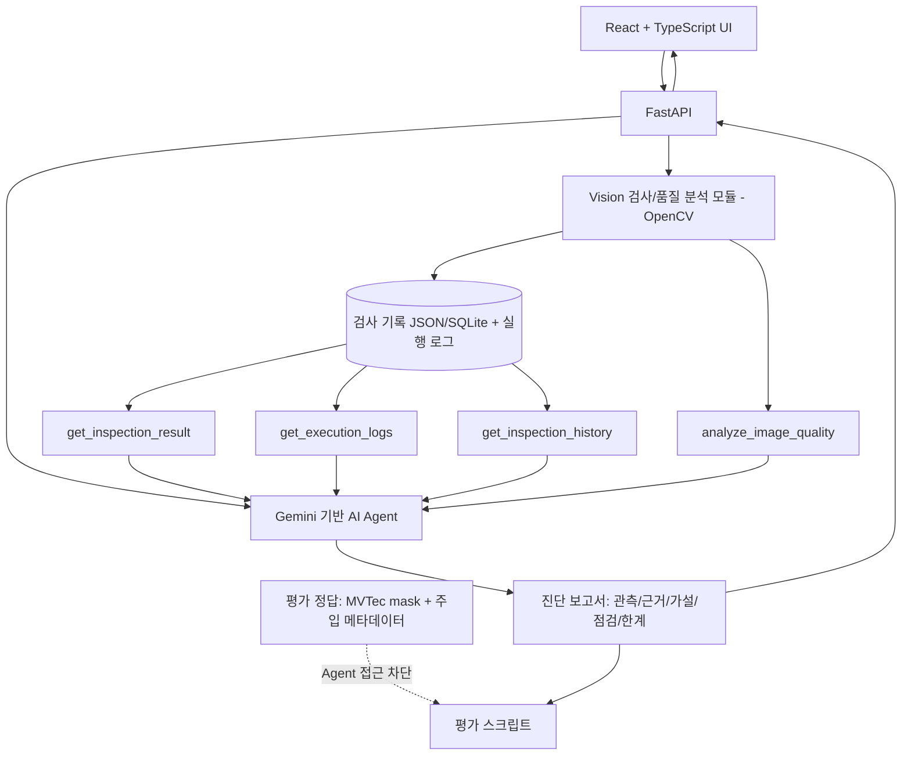
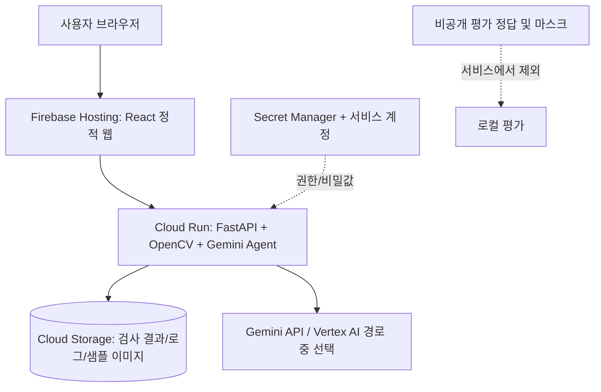

# AI Agent 기반 산업용 Vision 검사 이상 진단 및 엔지니어 지원 시스템

> **MVTec AD Bottle 기반 | AI Agent 70% + Vision 30% | 7일 MVP 개발 기획안**  
> 작성 기준일: 2026-10-13  
> 일정 예시: 2026-10-14(수) ~ 2026-10-20(화), 7일 연속 개발. 실제 착수일이 바뀌면 Day 기준으로 이동.
> **배포 목표:** Google Cloud Run에 FastAPI + Gemini Agent를 배포하고, React 웹 UI에서 배포된 API를 호출하는 공개/제한 데모를 구현한다.

---

## 1. 프로젝트 개요

### 1.1 프로젝트명

**AI Agent 기반 산업용 Vision 검사 이상 진단 및 엔지니어 지원 시스템**

### 1.2 한 줄 소개

산업용 Vision 검사 이미지와 실행 로그를 AI Agent가 분석하여 검사 이상을 진단하고, 근거와 점검 방향을 제시하는 엔지니어 지원 시스템.

### 1.3 기획 배경

산업용 Vision 검사에서는 NG 이미지 자체뿐 아니라 검사 실행 로그, 밝기·정렬 상태, 과거 검사 이력을 함께 확인해야 문제가 제품 결함인지, 입력 이미지/검사 과정의 이상인지 구분할 수 있다. 본 프로젝트는 이러한 **Vision 엔지니어의 문제 조사 과정을 도구 호출형 AI Agent로 구현**하는 PoC다.

### 1.4 목표와 성공 기준

- MVTec AD **Bottle 한 카테고리**를 대상으로 검사 및 진단 흐름 구현
- 간단한 Vision 검사/품질 분석 모듈을 실제로 실행하고 **실제 실행 로그** 생성
- 테스트용 이미지 변형·실행 오류를 주입하여 **원인이 알려진 재현 가능한 시나리오** 구성
- Agent가 검사 결과·이미지 품질·로그·이력을 **도구로 조회하고 필요 시 추가 조사**
- 결과에 **관측 사실 / 가능한 원인 / 근거 / 추가 점검 / 불확실성** 구분
- 정상/NG, 품질 이상/제품 결함, 관련 없는 경고를 혼동하지 않는지 평가

**중요한 목표 정의:** 실제 병 파손의 물리적 발생 원인을 확정하는 시스템이 아니라, **검사 및 입력 영상 이상을 증거 기반으로 진단하고 엔지니어의 조사 방향을 제안하는 시스템**이다.

---

## 2. 데이터셋과 데이터 신뢰성

### 2.1 MVTec AD Bottle 활용

- `train/good/`: 정상 기준 이미지로 참고
- `test/good/`: 정상 검사 평가
- `test/broken_large/`, `test/broken_small/`, `test/contamination/`: 불량 이미지 평가
- `ground_truth/`: 불량 영역의 평가용 정답 마스크(사용 가능한 해당 불량 샘플)
- 공개 데이터셋 이용 조건은 공식 배포 페이지에서 확인: https://www.mvtec.com/research-teaching/datasets/mvtec-ad

**원칙:** 데이터셋 폴더명이나 `ground_truth`를 검사 알고리즘 또는 Agent의 입력 정답으로 사용하지 않는다. 정답은 **오프라인 평가 전용**으로 분리한다.

### 2.2 세 종류의 데이터 구분

| 구분                  | 생성 방식                                           | 사용 목적                       | 표시 방식                           |
| --------------------- | --------------------------------------------------- | ------------------------------- | ----------------------------------- |
| 원본 이미지 및 마스크 | MVTec AD 공개 데이터                                | Vision 입력 및 평가             | `source=mvtec_ad`                   |
| 검사 실행 로그        | 직접 만든 검사 프로그램이 실제 실행하면서 기록      | 조회·장애 진단의 실제 관측 자료 | `source=runtime`                    |
| 오류 주입 정보        | 밝기·이동 변형, 잘못된 경로 등 테스트 하네스가 기록 | 재현 및 평가용 정답             | `source=injected`, **Agent 비공개** |
| 선택적 설비 이벤트    | 명시적으로 합성한 PLC/조명 경고 시나리오            | 확장 데모                       | `source=synthetic`; MVP 필수 아님   |

MVTec AD에는 해당 이미지에 매칭된 실제 PLC·카메라·설비 로그가 없다. 따라서 임의 이벤트를 실제 촬영 당시 원인으로 주장하지 않는다.

### 2.3 오류 주입 시 주의

- 밝기를 낮춘 이미지는 **입력 이미지 밝기 저하** 사례이지 실제 조명 하드웨어 고장 증거가 아님.
- 위치 이동 이미지는 **입력 위치 편차** 사례이지 PLC Indexing 고장 증거가 아님.
- 파일 열기 실패는 **검사 프로그램의 파일 로드 실패**를 확인할 수 있으나 실제 카메라 통신 장애와 같지 않음.
- 제품 파손/오염은 이미지에서 관측 가능해도 **파손·오염의 물리적 원인**은 자료가 부족할 수 있음.

---

## 3. 문제 정의 및 사용자 흐름

### 3.1 주요 사용자

Vision 검사 장비를 유지보수하고 검사 이상을 조사하는 엔지니어 및 개발자.

### 3.2 주요 사용 시나리오

1. 사용자가 검사 목록에서 `inspection_id`를 선택하거나 테스트 검사를 실행한다.
2. 검사 모듈이 이미지 품질 지표·이상 점수(가능한 경우)·판정을 산출하고 실행 로그를 기록한다.
3. 사용자가 **원인 분석 요청**을 누른다.
4. AI Agent가 `get_inspection_result` 도구로 시작해 로그·이미지 품질·이력 도구 중 필요한 것을 호출한다.
5. 검사 결과와 로그 간 모순 또는 추가 점검 필요 여부를 판단하고 추가 조회한다.
6. UI에 진단 보고서와 사용된 근거/호출 도구를 표시한다.

### 3.3 제품 결함과 검사 이상 구분

- **제품 결함:** Bottle의 파손/오염 등 실제 이미지에 나타난 이상. 해당 이상이 발생한 *물리적 원인*까지 단정하지 않는다.
- **검사/입력 이상:** 밝기 저하, 위치 편차, 이미지 로딩 오류 등 직접 재현 및 기록 가능한 상황.
- **판단 불가:** 검사 정보나 로그가 부족해 원인을 좁히기 어려운 상황. 이때 근거 부족을 명확히 표시한다.

---

## 4. 시스템 아키텍처



### 4.1 기술 스택

| 영역              | 선정                                                       | 이유                                         |
| ----------------- | ---------------------------------------------------------- | -------------------------------------------- |
| Frontend          | React + TypeScript                                         | 검사 이미지/로그/진단 보고서 화면            |
| Backend           | Python + FastAPI                                           | 검사 실행 API와 Agent API                    |
| Vision            | OpenCV + NumPy                                             | 밝기, 대비, 위치, 기준 이미지 비교           |
| Agent             | Gemini + 수업에서 요구하는 Agent 프레임워크/도구 호출 방식 | 도구 선택 및 증거 기반 진단                  |
| 저장              | JSON/JSONL 우선, 필요하면 SQLite                           | 7일 MVP에서 구축 부담 최소화                 |
| 테스트            | pytest + 고정 시나리오 평가                                | 재현성 확인                                  |
| 백엔드 배포       | Google Cloud Run                                           | FastAPI + Agent 서비스 배포, 배포 URL로 검증 |
| 영구 저장(배포용) | Google Cloud Storage(선택: Firestore)                      | Cloud Run 인스턴스 재시작 후에도 기록 유지   |
| 비밀값 관리       | Secret Manager / Cloud Run 서비스 계정                     | API 키와 데이터 접근 권한 관리               |
| 프론트엔드 배포   | Firebase Hosting(권장) 또는 별도 정적 호스팅               | React 빌드 결과물 배포                       |
| 시각화            | 기본 이미지 및 ROI/이상영역 오버레이                       | 3D/Babylon.js는 MVP 제외                     |

**권장 구현 원칙:** 첫 주에는 학습형 이상 탐지 모델과 3D 시뮬레이션을 필수 조건으로 넣지 않는다. 이미지 품질 분석과 **정상 기준 이미지 차이**를 먼저 구현하며, 모델 고도화는 후속 작업으로 분리한다.

### 4.2 Google Cloud 배포 아키텍처



- **일주일 MVP 배포 방식:** FastAPI와 Agent를 **단일 Cloud Run 서비스**로 배포한다. React 정적 파일은 Firebase Hosting 등에서 별도로 호스팅한다. 프론트엔드에 백엔드 URL을 환경변수로 설정하고 허용 Origin만 CORS에 추가한다.
- **개발 환경:** JSON/JSONL 로컬 저장으로 빠르게 구현한다.
- **배포 환경:** Cloud Run 로컬 파일시스템에 쓴 파일은 영구 저장되지 않는다. 배포용 핵심 데이터는 **Cloud Storage 객체**로 저장·읽기하도록 스토리지 인터페이스를 분리한다. 소량의 고정 데모 데이터만 읽는 대안도 가능하지만, 그 경우 재시작 후 검사 이력 보존은 MVP 범위에서 제외했다고 명시한다.
- **대형 원본 데이터셋:** Bottle 원본 전체를 컨테이너나 공개 GitHub 저장소에 포함하지 않는다. 이용 조건을 확인해 소량의 허가된 예시 또는 사용자가 별도로 준비한 입력을 처리한다. MVTec 정답 마스크·주입 정답 파일은 온라인 Agent 접근 대상에서 제외한다.
- **보안:** Gemini API 키를 소스/React 코드에 넣지 않고 Secret Manager와 Cloud Run 비밀값 연결을 사용한다. 서비스 계정에는 필요한 Cloud Storage 최소 권한만 부여한다. 공개 데모를 열면 요청량 제한·예산 알림·비용 확인을 적용한다.
- **실행:** Cloud Run 컨테이너 서버는 `0.0.0.0`과 Cloud Run의 `PORT` 환경변수에 바인딩해야 한다. `/health`를 제공하고 이미지 처리·Agent API가 HTTPS URL에서도 정상 동작하는지 확인한다.
- **비용/제약:** Cloud Run, Cloud Build, Artifact Registry, Cloud Storage, Gemini 호출은 설정·사용량에 따라 과금될 수 있다. 출시 전 Google Cloud 결제계정·쿼터·예산 알림을 확인한다.

**Cloud Run 간단 배포 예시(프로젝트/리전/서비스명 변경):**

```bash
# backend/ 에 FastAPI 소스와 의존성 정의 또는 Dockerfile 준비
cd backend
gcloud config set project YOUR_PROJECT_ID
gcloud run deploy vision-diagnostic-api \
  --source . \
  --region asia-northeast3 \
  --allow-unauthenticated
```

> `--allow-unauthenticated`는 **공개 데모를 의도할 때만** 사용한다. 제한 공개가 목적이면 인증이 필요한 서비스로 배포한다. Gemini 자격 증명, Cloud Storage 권한, CORS 설정은 별도 구성해야 하며 위 명령만으로 모든 기능이 완성되지는 않는다.

**참고 문서:**

- Cloud Run 소스 배포: https://cloud.google.com/run/docs/deploying-source-code
- Cloud Run 컨테이너/파일시스템 동작: https://cloud.google.com/run/docs/container-contract
- Cloud Run 설정: https://cloud.google.com/run/docs/configuring

### 4.3 Agent 도구 설계

| 도구                        | 인자 예시                     | 반환 내용                               | 호출 이유                |
| --------------------------- | ----------------------------- | --------------------------------------- | ------------------------ |
| `get_inspection_result`     | `inspection_id`               | 검사 상태, 이상 점수, 검사 시간, 판정   | 최초 상황 파악           |
| `get_execution_logs`        | `inspection_id`, `window_sec` | 실제 실행 이벤트 및 경고                | 취득/분석 단계 문제 조사 |
| `analyze_image_quality`     | `inspection_id`               | 평균 밝기, 대비, 중심/이동량, 기준 비교 | 이미지 입력 품질 확인    |
| `get_inspection_history`    | `product_type`, `limit`       | 최근 검사 이력, 품질 지표 추이          | 일시적/반복적 이상 구분  |
| `get_defect_regions` (선택) | `inspection_id`               | 예측된 이상 영역                        | NG 위치 근거 제공        |

도구는 **실제 Python 함수**로 동작하며, LLM이 계산값을 임의 생성하지 않도록 한다. Agent는 도구 결과를 활용해 보고서를 작성하고 가능하면 호출 근거를 남긴다.

### 4.4 진단 보고서 출력 규격

```json
{
  "inspection_id": "B-0007",
  "observation": ["입력 이미지 평균 밝기가 기준 대비 낮음"],
  "diagnosis_type": "image_quality_issue",
  "hypotheses": [
    {
      "cause": "입력 영상 밝기 저하",
      "confidence": "high",
      "evidence_ids": ["quality:B-0007", "log:B-0007:3"]
    }
  ],
  "checks": ["조명 설정 및 카메라 노출값 점검", "이전 검사 밝기 추세 확인"],
  "limitations": ["실제 조명 하드웨어 고장은 확인되지 않음"],
  "tools_used": [
    "get_inspection_result",
    "analyze_image_quality",
    "get_execution_logs",
    "get_inspection_history"
  ]
}
```

`confidence`는 객관적 확률로 오해되지 않도록 처음에는 정성적 등급만 사용한다.

---

## 5. MVP 범위와 제외 범위

### 5.1 MVP 필수 기능

- [ ] Bottle 이미지 입력 및 검사 실행
- [ ] 검사 ID별 결과 저장(정상/NG 또는 이상 점수, 밝기/대비/위치 지표)
- [ ] 실제 검사 실행 로그 기록(성공/실패 포함)
- [ ] 최소 **4개** 고정 오류/정상 테스트 시나리오 실행
- [ ] Gemini Agent가 최소 **3개 이상의 조회 도구** 사용 가능
- [ ] Agent가 필요에 따라 검사 이력 또는 품질 지표 추가 조회
- [ ] 근거/가설/점검 사항/불확실성을 나눈 보고서 출력
- [ ] React 화면에서 이미지·로그·보고서를 한 번에 확인
- [ ] 평가 스크립트로 기대 진단과 결과 대조
- [ ] FastAPI + Gemini Agent를 Cloud Run에 배포하고 HTTPS URL에서 `/health` 및 분석 API 검증
- [ ] 프론트엔드에서 배포 API 호출 확인; API 키는 브라우저에 노출하지 않기

### 5.2 MVP에서 제외

- 실제 PLC 및 카메라 장비 연동
- 실제 설비의 물리적 고장 원인 예측 및 검증
- MVTec 전 카테고리 확장, Zipper 추가
- 3D 시뮬레이터·실시간 공정 제어
- 대규모 ML 모델 자체 학습·배포
- 자동 설비 제어 또는 조치 실행

### 5.3 MVP 완료 정의(DoD)

1. 정상 및 주입 오류를 포함한 최소 4개 시나리오를 UI 또는 API로 반복 실행할 수 있다.
2. 검사 결과와 로그에 **동일한 `inspection_id`**가 저장된다.
3. Agent가 정적 문장을 반환하는 대신 실제 조회 도구를 호출한다(호출 추적 가능).
4. 근거가 없는 물리적 원인 단정을 피하고, 부족한 정보는 부족하다고 명시한다.
5. 평가 데이터가 Agent 입력으로 유출되지 않는다.
6. 한 번의 전체 데모를 처음부터 끝까지 재현할 수 있다.
7. Cloud Run HTTPS 엔드포인트에서 상태 조회 및 대표 시나리오 분석이 정상 동작한다.
8. 검사/로그의 저장 방식을 로컬과 배포 환경에서 구분하고 재시작 시 데이터 보존 여부를 문서화한다.

---

## 6. 고정 테스트 시나리오

| ID  | 입력 이미지/주입 동작            | 실제 프로그램 로그로 관측할 신호   | 기대 진단                          | 주의점                                  |
| --- | -------------------------------- | ---------------------------------- | ---------------------------------- | --------------------------------------- |
| T01 | `test/good` 원본                 | 이미지 로딩 및 검사 정상 완료      | 특별한 실행 이상 없음              | 정상이라고 설비 전체가 정상인 것은 아님 |
| T02 | `test/broken_large` 원본         | 검사 완료, 이미지 이상 징후        | Bottle 파손 징후 설명 및 추가 점검 | 실제 파손 원인은 확인 불가              |
| T03 | 원본 복사본에 밝기 감소 주입     | 밝기 지표 저하 경고                | 입력 영상 밝기 이상                | 실제 조명 고장으로 단정 금지            |
| T04 | 원본 복사본에 X/Y 위치 이동 주입 | 중심/정렬 편차 경고                | 입력 위치 이상 및 ROI 점검         | PLC Indexing 고장으로 단정 금지         |
| T05 | 존재하지 않는 이미지 경로 호출   | 이미지 로드 실패 오류              | 파일 경로/입력 단계 실패           | 카메라 통신 장애와 구분                 |
| T06 | 불량 원본 + 실행 경고 없음       | 검사 정상 종료 + NG 또는 이상 점수 | 제품 이상과 검사 실행 오류 구분    | NG=설비 고장이라고 하지 않기            |

**필수 4개:** T01, T03, T05, T06. **권장 확장:** T02, T04. T02·T06의 NG 판정은 실제 검사 로직이 그 이상을 탐지할 때만 사용하며, 그렇지 않으면 데이터셋 정답과 예측 결과가 다를 수 있음을 기록한다.

### 6.1 평가용 데이터와 Agent 입력 분리

```text
project/
├── dataset/mvtec_ad/bottle/    # 원본 데이터; git 대용량 업로드 주의
├── data/
│   ├── inspections.json
│   └── logs.jsonl
├── test_data/
│   ├── scenarios_public.json   # 실행용: 이미지 경로, 검사 ID
│   └── evaluation_private.json # 주입 유형/기대 진단: Agent 비공개
├── generated_images/          # 밝기·이동 변형 이미지
├── backend/
│   ├── main.py
│   ├── vision.py
│   ├── agent.py
│   ├── tools.py
│   └── storage.py
├── frontend/
└── tests/
```

**로그 항목 권장:** `timestamp`, `inspection_id`, `level`, `stage`, `event_code`, `message`, `metrics`, `source`. **주입 유형·원인 정답은 실행 로그에 직접 노출하지 않는다**(실행 환경 분리). 다만 테스트 로그로 관측되는 결과는 Agent가 읽을 수 있다.

---

## 7. 날짜별 구현 계획(7일)

> 날짜는 2026-10-14 시작 기준 예시. **Day 1~Day 7 순서**가 중요하며, 일정이 밀리면 기능 우선순위를 유지한다.

### Day 1 — 10/14(수): 데이터셋 확보 및 실행 구조 확정

**목표:** 이미지 1장을 읽고 검사 ID를 붙이는 최소 백엔드 준비.

1. MVTec AD Bottle 데이터셋 다운로드 및 라이선스 확인.
2. `good`, `broken_large`, `contamination` 샘플을 선별하고 평가 정답 폴더 분리.
3. FastAPI 기본 실행 및 `GET /health`, `POST /inspections` 뼈대 구현.
4. `inspection_id`, 이미지 경로, 실행 상태 저장 규격 확정.
5. 깃 저장소/README/가상환경 구성; 원본 데이터셋은 `.gitignore` 처리.

**완료 기준:** API에서 Bottle 이미지 파일 1개를 정상 로드하고 검사 ID 반환.

### Day 2 — 10/15(목): Vision 지표와 실제 실행 로그

**목표:** 입력 이미지의 상태를 수치로 분석하고 실행 기록 남기기.

1. OpenCV로 평균 밝기·표준편차/대비·이미지 크기 계산.
2. 단순 기준 이미지 비교와 중심/이동량 측정(가능 범위부터).
3. 검사 시작/이미지 로드/분석 완료/실패 이벤트를 JSONL에 기록.
4. 검사 결과와 측정값을 `inspections.json`에 저장.
5. 단위 테스트: 정상 이미지 처리, 잘못된 파일 경로 처리.

**완료 기준:** 이미지 1회 검사 시 측정값과 `inspection_id` 연결 로그가 자동 저장.

### Day 3 — 10/16(금): 오류 주입 및 재현 가능한 시나리오

**목표:** 합성 설비 원인 로그 대신 실제 실행 가능한 테스트 구성.

1. 밝기 감소 이미지 생성(T03); 원본은 보존.
2. 파일 로드 실패(T05) 테스트 생성.
3. 정상(T01), 불량 원본 + 정상 실행(T06) 시나리오 추가.
4. 여유 있으면 위치 이동(T04) 구현.
5. 주입 정답은 `evaluation_private.json`에 별도 저장.

**완료 기준:** 최소 T01/T03/T05/T06을 같은 방법으로 반복 실행하고, 각각 로그 차이가 확인됨.

### Day 4 — 10/17(토): Agent 도구 구현 및 첫 분석

**목표:** Agent가 실제 함수를 호출해 검사 정보를 수집.

1. `get_inspection_result`, `get_execution_logs`, `analyze_image_quality` 구현.
2. `get_inspection_history` 구현(최초에는 간단한 최근 N건 조회).
3. Gemini + 강의 요구 프레임워크의 도구 호출 연결.
4. 초기 프롬프트: 관측/가설 분리, 추측 제한, 근거 ID 필수.
5. `POST /analyze/{inspection_id}` 구현.

**완료 기준:** Agent가 로그와 품질 정보를 **실제 도구 호출**로 읽고 구조화된 보고서 반환.

### Day 5 — 10/18(일): 추가 조사 로직과 반례 검증

**목표:** 일괄 조회가 아닌 상황별 조사 동작 구현.

1. 밝기 경고 시 최근 검사 밝기 추이 추가 조회.
2. 파일 로드 실패 시 분석 지표 부재를 인식하고 실행 로그 우선 조회.
3. 불량 이미지 + 정상 실행 로그에서 제품 이상과 프로그램 오류를 구분.
4. 관련 없는 로그를 근거로 과잉 추론하지 않는 반례 1건 추가.
5. 도구 호출 기록을 디버그 패널용 데이터로 반환.

**완료 기준:** 서로 다른 시나리오에서 호출 도구 또는 조사 흐름의 차이가 나타나고, 근거 없는 단정 없음.

### Day 6 — 10/19(월): React 데모 화면 및 통합

**목표:** 엔지니어가 하나의 화면에서 검사부터 진단까지 실행.

1. 검사 ID/시나리오 선택 UI.
2. 원본 이미지와 측정값/판정 표시.
3. 검사 실행 로그 시간순 표시.
4. Agent 분석 버튼과 보고서 표시(근거·가설·점검·한계).
5. 로딩·오류·분석 실패 상태 처리.
6. `Dockerfile` 또는 Cloud Run 소스 빌드 설정과 `requirements.txt` 확인.
7. 저장소를 로컬 JSONL과 Cloud Storage로 구분할 수 있도록 환경변수/어댑터 정리.
8. Cloud Run 서비스 계정, Secret Manager, 허용 CORS Origin, 프론트엔드 API URL 준비.

**완료 기준:** 로컬 브라우저에서 시나리오 선택 → 검사 → Agent 분석 → 결과 확인 end-to-end 성공하며 Cloud Run 배포 설정이 준비됨.

### Day 7 — 10/20(화): Cloud Run 배포·평가·발표 자료

**목표:** 클라우드에서 재현 가능한 데모와 포트폴리오 설명력 확보.

1. FastAPI/Agent를 **Google Cloud Run**에 배포하고 공개 또는 인증 기반 서비스 URL 확보.
2. 배포 URL의 `/health`와 대표 검사·Agent 분석 API를 실제 호출해 검증.
3. React 화면에서 Cloud Run API 연동 확인; 시간 부족 시 프론트엔드는 로컬 실행하고 백엔드만 Cloud Run 사용.
4. 4개 필수 시나리오 평가 및 도구 호출·근거 정확성·과잉 단정 여부 기록.
5. README에 배포 URL, 배포 아키텍처, 비밀값 설정, 저장소 제약, 실행법, 데이터 출처 명시.
6. 실패 사례·비용·보안 제약과 3분 시연 스크립트 정리.

**완료 기준:** Cloud Run HTTPS API에서 실제 Agent 분석이 성공하고, README와 3분 데모를 재현할 수 있음.

---

## 8. 개발 우선순위 및 일정 지연 대응

**P0 — 반드시 완성:** Bottle 이미지 처리 → 실제 실행 로그 → 4개 시나리오 → 3개 이상 Agent 도구 → 보고서 → 최소 UI → **Cloud Run 백엔드 배포 및 API 호출 검증**.

**P1 — 시간이 있으면:** 검사 이력 추세 분석 고도화, 위치 편차, 불량 영역 오버레이, 추가 평가 케이스.

**P2 — 1주 후 확장:** PatchCore/PaDiM 기반 이상 탐지, Zipper 추가, SQLite/DB 관리, 실제 장비 로그 연동, 3D 시뮬레이션.

일정 지연 시 모델 학습이나 3D 화면을 추가하지 말고 **Agent 도구 호출 및 평가**를 먼저 완성한다.

---

## 9. 평가 설계

### 9.1 Agent 평가 항목

| 항목           | 방법                           | MVP 목표(초기 제안)                      |
| -------------- | ------------------------------ | ---------------------------------------- |
| 도구 사용      | 도구 호출 기록 확인            | 4개 필수 테스트 모두 실제 조회 발생      |
| 진단 적합성    | 시나리오별 기대 진단과 비교    | 4개 필수 테스트 모두 핵심 이상 범주 설명 |
| 근거 추적성    | 보고서 `evidence_ids` 검증     | 모든 주요 가설에 조회 근거 연결          |
| 과잉 추론 억제 | 실제 설비 고장 단정 여부 검토  | 금지 단정 0건 목표                       |
| 재현성         | 동일 데이터·설정으로 반복 실행 | 주요 흐름 재현 가능                      |

위 목표는 **프로젝트 자체 기준**이며 공개 벤치마크 성능을 의미하지 않는다. 반복 실행에 따른 Agent 출력 차이도 기록한다.

### 9.2 Vision 평가 항목

- 입력 품질 이상 검출: 주입한 밝기 저하/이동 시나리오를 기준으로 측정 지표 검증
- 정상/불량 판정: 구현한 검출기가 실제로 예측한 값만 사용, `test` 정답과 분리해 오프라인 비교
- 영역 평가: 불량 영역 예측 기능이 있을 때만 `ground_truth` 마스크와 비교
- 실제 불량 탐지 성능이 충분하지 않다면 **이미지 품질 진단 PoC**와 **제품 불량 탐지 연구 과제**를 분리해 설명

---

## 10. 리스크 및 대응

| 리스크                                | 대응                                                                       |
| ------------------------------------- | -------------------------------------------------------------------------- |
| 실제 설비 로그 없음                   | 실제 검사 실행 로그 중심, 설비 이벤트는 명확히 합성·선택 기능으로 표기     |
| MVTec의 실제 원인 레이블 없음         | 물리적 원인 확정 대신 검사 이상·점검 지원으로 문제 정의                    |
| OpenCV로 모든 Bottle 불량 검출 어려움 | 초기 목표를 품질 진단/기준 비교로 한정, 불량 모델은 후속 작업              |
| 데이터 누수                           | `ground_truth` 및 주입 정답 파일의 Agent 접근 차단                         |
| Agent 환각                            | 도구 응답 기반 근거 ID, 불확실성 필수, 반례 평가                           |
| 개발 기간 초과                        | P0 고정, 3D/대규모 학습/실제 PLC 연동 제외                                 |
| 데이터셋 라이선스 및 배포 용량        | 공식 조건 준수, 데이터 직접 재배포 대신 다운로드 안내                      |
| Cloud Run 인스턴스 종료로 로그 소실   | 배포용 기록은 Cloud Storage에 저장; 로컬 JSONL과 분리                      |
| 배포 환경 API 키 노출                 | Secret Manager/서비스 계정 사용, React에 키 포함 금지                      |
| Cloud 비용 및 공개 URL 악용           | 예산 알림, 호출량 제한, 최소 권한, 공개 여부 재확인                        |
| Day 7 배포 시간 부족                  | Day 6에 빌드/환경변수 준비; 백엔드 Cloud Run 우선, 프론트는 로컬 데모 허용 |

---

## 11. 최종 데모 구성(약 3분)

1. **문제 소개(20초):** Vision 엔지니어는 NG 원인 조사 시 이미지·로그·이력을 번갈아 확인함.
2. **정상 검사(30초):** Bottle 정상 이미지를 검사하고 실행 로그 확인.
3. **밝기 저하 주입(45초):** 같은 이미지로 품질 이상을 재현하고 측정 지표 변화 확인.
4. **Agent 진단(50초):** 검사 결과 → 밝기 분석 → 로그/이력 조회 → 점검 제안 과정을 도구 호출 내역과 함께 제시.
5. **반례(20초):** 불량 이미지이지만 실행 로그가 정상이면 설비 고장으로 단정하지 않음을 보여줌.
6. **Cloud Run 배포 확인(15초):** 공개/제한된 배포 URL과 응답 확인.
7. **한계·향후 계획(15초):** MVTec에 실제 설비 로그가 없고, 추후 모델/장비 연동 필요 설명.

---

## 12. 바로 착수할 체크리스트

- [ ] Bottle 데이터셋 확보 및 사용 조건 확인
- [ ] 이미지/마스크/주입 정답의 저장 경로 분리
- [ ] 검사 ID와 JSONL 로그 스키마 결정
- [ ] FastAPI 실행 및 Bottle 이미지 로드 테스트
- [ ] Brightness 기준 지표와 오류 주입 방법 정의
- [ ] Agent가 조회할 첫 3개 도구의 입출력 정의
- [ ] Google Cloud 프로젝트/결제 계정/Cloud Run 사용 가능 여부 확인
- [ ] 로컬 로그(JSONL)와 클라우드 영구 저장(Cloud Storage) 방식 구분
- [ ] Gemini 인증 및 Secret Manager/서비스 계정 적용 방식 결정

**프로젝트 핵심 메시지:** “불량 원인을 아는 척하는 AI”가 아니라, **Vision 검사 시스템에서 확인 가능한 증거를 수집해 조사와 점검을 돕는 AI Agent**를 구현한다.
