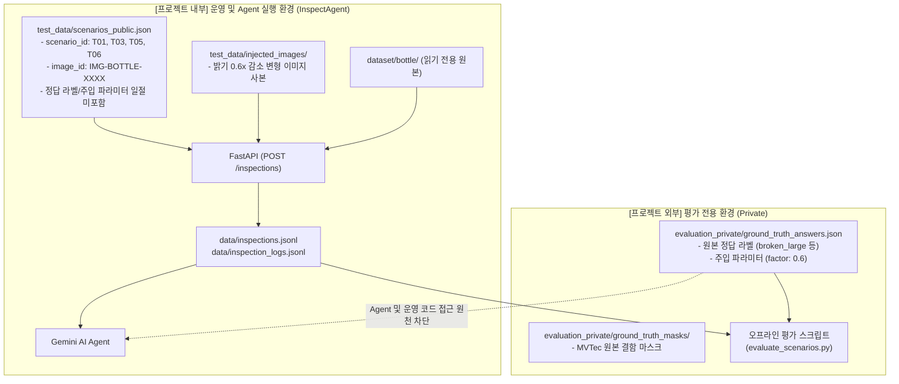

# VisionInsight 테스트 시나리오 및 평가 데이터 격리 명세 (`docs/test-scenarios.md`)

> **프로젝트:** VisionInsight — MVTec AD Bottle 기반 Vision 검사 이상 진단 AI Agent  
> **문서 버전:** 1.0.0 (Day 3 - Step 1 기준)  
> **상태:** 활성 (Active)

---

## 1. 개요

본 문서는 VisionInsight 시스템의 **Day 3 (오류 주입 및 재현 가능한 시나리오)** 개발을 위해 정의된 4개 핵심 테스트 시나리오(T01, T03, T05, T06)의 실행 구조와, **운영용 검사 데이터(Public)** 및 **오프라인 평가 정답(Private Ground Truth)**의 엄격한 분리 아키텍처를 정의합니다.

---

## 2. 핵심 시나리오 정의 (T01, T03, T05, T06)

| 시나리오 ID | 시나리오 명칭 | 입력 이미지 및 주입 동작 | 실제 프로그램 로그 관측 신호 | 시스템 품질 판정 | 기대 진단 (Agent) | 주의사항 (`AGENTS.md`) |
| :---: | :--- | :--- | :--- | :---: | :--- | :--- |
| **T01** | 정상 Bottle 검사 | `train/good` 또는 `test/good` 원본 사본 | `INSPECTION_STARTED`<br>`IMAGE_LOADED`<br>`ANALYSIS_COMPLETED` (INFO)<br>`INSPECTION_COMPLETED` | `NORMAL` | 실행 및 품질 이상 없음 | 정상이라고 설비 전체가 정상인 것은 아님 |
| **T03** | 조도 저하 오류 주입 | 정상 원본 복사본에 NumPy 0.6배 밝기 감쇄 주입 | `ANALYSIS_COMPLETED` (WARN)<br>밝기 지표 저하 경고 | `WARNING_LOW_BRIGHTNESS` | 입력 영상 밝기 이상 의심 | **실제 조명 하드웨어 고장으로 단정 금지** (관측/가설 분리) |
| **T05** | 입력 로드 실패 | 존재하지 않는 neutral image_id 호출 (`IMG-BOTTLE-NONEXISTENT`) | `IMAGE_LOAD_FAILED` (ERROR)<br>`INSPECTION_FAILED` (ERROR) | `ERROR` | 파일 경로/입력 단계 실패 | 카메라 통신 장애로 단정 금지, **ANALYSIS_COMPLETED 절대 미발생** |
| **T06** | 불량 원본 + 정상 실행 | MVTec AD Bottle 불량 원본(`test/broken_large` 등) | 검사 파이프라인 정상 종료 (INFO 로그 4건) | `NORMAL` (영상 품질) | 제품 이상 징후 조사 및 추가 점검 | **제품 결함과 실행 오류 엄격 분리**, 결함 분류기 미연동 시 `UNKNOWN` 유지 |

---

## 3. 데이터 저장소 2단계 격리 아키텍처

AI Agent의 데이터 누출(Data Leakage) 및 환각을 원천 차단하기 위해 데이터 저장 공간을 **운영용 공개 영역(Project 내부)**과 **평가용 비공개 영역(Project 외부)**으로 물리적으로 격리합니다.



### 3.1 프로젝트 내부: 운영용 공개 데이터 (`test_data/`)
- **위치:** `InspectAgent/test_data/`
- **접근 권한:** FastAPI 서버, 테스트 러너, 향후 Gemini AI Agent 조회 도구
- **구성 요소:**
  1. `test_data/scenarios_public.json`: 시나리오별 실행 명세. 중립적 식별자(`IMG-BOTTLE-0001`, `IMG-BOTTLE-INJ-0001` 등)만 포함하며, 정답 라벨이나 인위적 주입 여부를 기록하지 않습니다.
  2. `test_data/injected_images/`: T03 오류 주입에 사용할 변형 이미지 보관 폴더 (`.gitignore`에 의해 저장소 추적 제외).

### 3.2 프로젝트 외부: 평가 전용 비공개 데이터 (`evaluation_private/`)
- **위치:** `c:\Users\USER\AI-NativeAgent\Project\evaluation_private`
- **접근 권한:** 오프라인 평가 하네스 전용 (운영 코드 및 AI Agent 접근 원천 차단)
- **구성 요소:**
  1. `evaluation_answers.json`: 시나리오별 실제 정답 레이블, 주입 알고리즘, 파라미터, 기대 관측 결과가 기록된 마스터 평가 파일.
  2. `README.md` & `evaluation_answers.template.json`: 정답 등록 가이드 및 스키마 템플릿.

---

## 4. 평가 정답 데이터 스키마 명세 (`evaluation_answers.json`)

외부 평가 디렉터리에 저장될 JSON 객체 배열의 필드 명세입니다:

| 필드명 | 타입 | 필수 여부 | 설명 | 예시 |
| :--- | :---: | :---: | :--- | :--- |
| `scenario_id` | string | 필수 | 시나리오 고유 식별자 | `"T01"`, `"T03"`, `"T05"`, `"T06"` |
| `source_identifier` | string | 필수 | 원본 이미지 경로 또는 의도된 입력 상태 | `"dataset/bottle/train/good/000.png"` |
| `ground_truth_label` | string | 필수 | MVTec AD 실제 결함 라벨 (Agent 비공개) | `"good"`, `"broken_large"`, `"none"` |
| `injection_type` | string | 필수 | 인위적 주입 오류 유형 | `"none"`, `"brightness_reduction"`, `"missing_image_path"`, `"raw_defect_normal_execution"` |
| `injection_parameters` | object | 필수 | 주입된 파라미터 상세 | `{"factor": 0.6, "target_brightness_range": [70.0, 95.0]}` |
| `expected_observation` | object | 필수 | 검사 파이프라인에서 관측되어야 할 기대 결과 | `{ "image_load_status": "SUCCESS", "expected_quality_status": "WARNING_LOW_BRIGHTNESS", ... }` |

### 스키마 예시
```json
[
  {
    "scenario_id": "T03",
    "source_identifier": "dataset/bottle/train/good/000.png",
    "ground_truth_label": "good",
    "injection_type": "brightness_reduction",
    "injection_parameters": {
      "factor": 0.6,
      "target_brightness_range": [70.0, 95.0]
    },
    "expected_observation": {
      "image_load_status": "SUCCESS",
      "expected_quality_status": "WARNING_LOW_BRIGHTNESS",
      "expected_warning_triggered": true,
      "expected_logs": [
        "INSPECTION_STARTED",
        "IMAGE_LOADED",
        "ANALYSIS_COMPLETED",
        "INSPECTION_COMPLETED"
      ]
    }
  }
]
```

---

## 5. 시나리오별 입력과 정답 데이터 매핑 관계

| 시나리오 | 공개 입력 (`test_data/scenarios_public.json`) | 비공개 평가 정답 (`evaluation_private/`) | 격리 및 은닉 전략 |
| :---: | :--- | :--- | :--- |
| **T01** | `image_id`: `IMG-BOTTLE-0084`<br>`product_id`: `PROD-BOTTLE-T01` | `ground_truth_label`: `good`<br>`injection_type`: `none` | 정상 기준 이미지와 일치 |
| **T03** | `image_id`: `IMG-BOTTLE-INJ-0001`<br>`product_id`: `PROD-BOTTLE-T03` | `ground_truth_label`: `good`<br>`injection_type`: `brightness_reduction`<br>`factor`: `0.6` | Agent에는 조도 저하 수치(`0.6`)가 전달되지 않으며, 오직 `WARNING_LOW_BRIGHTNESS` 관측 사실만 전달됨 |
| **T05** | `image_id`: `IMG-BOTTLE-NONEXISTENT`<br>`product_id`: `PROD-BOTTLE-T05` | `ground_truth_label`: `none`<br>`injection_type`: `missing_image_path` | 존재하지 않는 식별자로 이미지 디코딩 실패 유발 |
| **T06** | `image_id`: `IMG-BOTTLE-0001`<br>`product_id`: `PROD-BOTTLE-T06` | `ground_truth_label`: `broken_large`<br>`injection_type`: `raw_defect_normal_execution` | `broken_large`라는 원본 폴더명이 은닉되고 중립 식별자만 노출 |

---

## 6. 안전 및 무결성 원칙 준수 확인

1. **원본 데이터셋 불변성**: `dataset/bottle/` 내의 모든 원본 파일 및 `ground_truth` 마스크는 절대 수정되거나 덮어써지지 않습니다.
2. **식별자 분리**: `product_id`와 `inspection_id`가 명확히 분리되며, 재검사 시마다 고유한 새 ID가 발급됩니다.
3. **정답 누출 차단**: `broken_large`, `contamination`, `good` 등의 단어는 운영 API 응답, 에러 메시지, 로그에 일절 포함되지 않습니다.
4. **미발생 이벤트 차단**: T05(로드 실패) 시 `ANALYSIS_COMPLETED`는 절대로 기록되지 않습니다.
5. **원인 단정 금지**: T03의 밝기 저하는 '입력 영상 조도 저하 의심'으로만 기록되며 '조명 기기 하드웨어 고장'으로 단정하지 않습니다.

---

## 7. 시나리오 실행 및 검증 결과 (Day 3 통합 검증)

| 항목 | T01 정상 검사 | T03 밝기 저하 | T05 로드 실패 | T06 불량 원본 정상 실행 |
| :--- | :--- | :--- | :--- | :--- |
| **입력 image_id** | `IMG-BOTTLE-0084` | `IMG-BOTTLE-INJ-0001` | `IMG-BOTTLE-NONEXISTENT` | `IMG-BOTTLE-0001` |
| **실제 측정 mean** | **135.86** | **81.24** (감소율 ~40.2%) | 측정 불가 (`metrics={'error': ...}`) | **138.37** |
| **실제 측정 std** | 92.66 | 55.79 | 측정 불가 | 92.08 |
| **image_quality_status** | `NORMAL` | `WARNING_LOW_BRIGHTNESS` | `ERROR` | `NORMAL` |
| **검사 실행 status** | `COMPLETED` | `COMPLETED` | `FAILED` | `COMPLETED` |
| **제품 판정 result** | `UNKNOWN` | `UNKNOWN` | `UNKNOWN` | `UNKNOWN` |
| **주요 발생 event_code** | `INSPECTION_STARTED`<br>`IMAGE_LOADED`<br>`ANALYSIS_COMPLETED` (INFO)<br>`INSPECTION_COMPLETED` | `INSPECTION_STARTED`<br>`IMAGE_LOADED`<br>`ANALYSIS_COMPLETED` (**WARN**)<br>`INSPECTION_COMPLETED` | `INSPECTION_STARTED`<br>`IMAGE_LOAD_FAILED`<br>`INSPECTION_FAILED`<br>*(ANALYSIS_COMPLETED 미발생)* | `INSPECTION_STARTED`<br>`IMAGE_LOADED`<br>`ANALYSIS_COMPLETED` (INFO)<br>`INSPECTION_COMPLETED` |
| **API 응답 코드** | 201 Created | 201 Created | 404 Not Found | 201 Created |
| **통합 검증 결과** | **PASS** | **PASS** | **PASS** | **PASS** |

### 실행 및 검증 명령
```bash
# 1. T03 오류 주입 이미지 생성 및 원본 SHA-256 검증
python scripts/generate_t03_fault.py

# 2. T01, T03, T05, T06 시나리오 2회 반복 자동 검증 러너
python scripts/verify_day3_scenarios.py

# 3. 전체 pytest 회귀 테스트 (총 57개 테스트)
pytest tests -v
```
