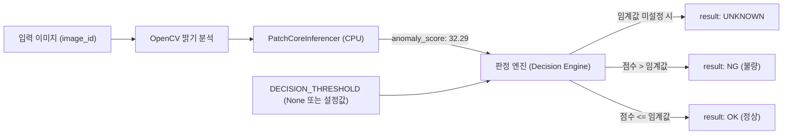

# VisionInsight — PatchCore Anomaly Threshold Calibration Plan (`docs/threshold-calibration-plan.md`)

> **프로젝트:** VisionInsight — MVTec AD Bottle 기반 Vision 검사 이상 진단 AI Agent  
> **단계:** Day 3.5 - Step 3 (FastAPI 파이프라인 연동 및 임계값 설계)  
> **작성 일자:** 2026-10-14  
> **상태:** 계획 수립 완료 (Step 4 실행 대기)

---

## 1. 개요 및 원칙

VisionInsight에 연동된 **PatchCore** 모델은 사전학습된 ResNet-18의 패치 임베딩 메모리 뱅크로부터 최근접 이웃 거리 기반 **비정규화 이상치 점수(`anomaly_score`)**를 산출합니다.

현재 실측된 점수 분포는 다음과 같습니다:
* **정상 Bottle (학습 및 미지 정상):** 약 `30.5 ~ 31.2`
* **불량 Bottle (대형 파손 등):** 약 `32.2 ~ 32.5+`

### 1.1. 안전 및 무결성 원칙 (Safety Rules)
1. **최종 테스트 정답 오염 금지 (Zero Data Leakage):**
   * 프로젝트 외부(`evaluation_private/`)에 보관된 평가 정답 파일이나 원본 결함 레이블을 사전에 조회하여 임계값을 인위적으로 맞추는 행위를 절대 금지합니다.
2. **추론(Inference)과 판정(Decision)의 엄격한 분리:**
   * 모델 추론 엔진(`PatchCoreInferencer`)은 순수 이상치 거리 점수(`anomaly_score`)와 히트맵(`anomaly_map`)만을 반환합니다.
   * OK/NG 판정 로직은 판정 레이어에서 독립적으로 관리됩니다.
3. **미보정 상태에서의 판정 보호:**
   * 통계적으로 검증된 공식 임계값이 등록되기 전까지, FastAPI 검사 결과의 `result`는 항상 **`UNKNOWN`**을 유지합니다. (점수가 높다는 이유만으로 NG를 하드코딩하지 않음)

---

## 2. 독립 정상 검증 데이터 구성 방안

임계값을 통계적으로 안전하게 도출하기 위해, 최종 테스트 데이터가 아닌 **독립된 검증 데이터**를 활용합니다.

| 데이터 구분 | 데이터 수량 및 구성 | 활용 목적 |
| :--- | :--- | :--- |
| **학습 데이터 (Train)** | `dataset/bottle/train/good` 209장 중 180장 | PatchCore 메모리 뱅크 구축 (완료) |
| **정상 검증 데이터 (Val-Normal)** | `dataset/bottle/train/good` 홀드아웃 29장 + 정상 변형본 | 정상 제품의 점수 상한선(False Positive 방지 기준) 측정 |
| **오류 주입 검증 데이터 (Val-Fault)** | 밝기 변화(T03) 및 합성 노이즈 이미지 | 환경 변화에 따른 이상치 점수 변동 폭 측정 |
| **최종 평가 데이터 (Test)** | `dataset/bottle/test/**` (83장) | 최종 모델 성능 검증 시에만 블라인드 평가 수행 |

---

## 3. 임계값(Threshold) 선정 방법론

### 3.1. 방법 A: Normal Max + Safety Margin (FP Rate 0% 우선 정책)
* **산출식:** $Threshold = \max(\text{Val\_Normal Scores}) + k \times \sigma_{\text{val}}$
* **특징:** 정상 제품을 불량(NG)으로 오판하여 양품 라인을 중단시키는 오경보(False Alarm)를 원천 차단하는 보수적 접근법입니다.
* **적용 계수:** $k = 3.0$ (약 $3\sigma$ 안전 여유도)

### 3.2. 방법 B: 극단치 이론(Extreme Value Theory) 기반 Quantile 추정
* **산출식:** 정상 검증 점수 분포의 99.5 백분위수($P_{99.5}$)를 기준 임계값으로 산출
* **특징:** 이상치 점수가 가우시안 정규분포를 따르지 않더라도 극단 영역을 수학적으로 안정되게 추정 가능합니다.

### 3.3. 권장 선정 기준 (Proposed Default)
* 정상 점수의 최대치가 약 `31.2` 수준이고 불량 점수가 `32.2` 이상인 현재 관측 분포를 고려할 때,
  독립 검증 셋 30장에서 도출되는 정상 점수 최대치에 안전 마진(+0.3~0.5)을 더한 **약 `31.7 ~ 31.8` 구간**이 유력한 임계값 후보로 예상됩니다.
* 단, 실제 값은 Day 3.5 Step 4의 정식 검증 스크립트 실행을 통해서만 공식 확정합니다.

---

## 4. 임계값 설정 아키텍처 및 연동 흐름

* **설정 관리:** `backend/config.py`에 `DECISION_THRESHOLD: Optional[float] = None`로 관리
* **메타데이터 저장:** `models/patchcore/model_metadata.json`에 `calibrated_threshold` 필드 추가
* **API 응답 반영:** `InspectionResponse.decision_threshold`에 적용된 임계값이 투명하게 공개됨

---

## 5. Day 3.5 Step 4 실행 절차

1. `scripts/calibrate_threshold.py` 구현
   * 독립 정상 검증 데이터 수집 및 Anomaly Score 분포 산출
   * 통계 지표(Mean, Std, Min, Max, P95, P99) 분석
2. 최적 임계값 도출 및 `backend/config.py` / `model_metadata.json` 반영
3. `result: UNKNOWN -> OK / NG` 판정 로직 정식 활성화
4. T01(정상->OK), T06(불량->NG) 엔드투엔드 판정 검증 및 보고
