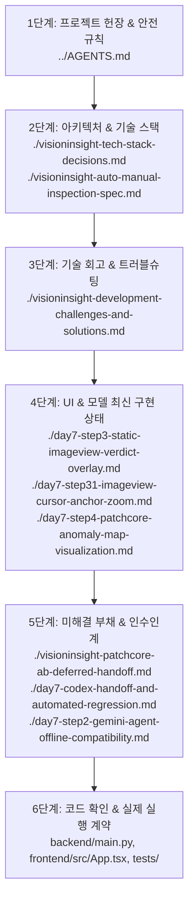

# VisionInsight 프로젝트 문서 통합 인덱스
## docs/ 내부 51개 문서 및 프로젝트 관련 문서 14개 통합 체계화 · 인수인계 가이드

- **작성일자:** 2026-10-18 (최종 보정)
- **발표 예정일:** 2026-10-20
- **프로젝트 루트:** `C:\Users\USER\AI-NativeAgent\Project\InspectAgent`
- **관리 원칙:** 물리적 파일 이동 및 삭제 **0건** (기존 파일명 및 위치 100% 보존), 상대 경로 링크 적용, 논리적 메타데이터 인덱싱 및 관계 매핑

---

# 1. 인덱스 개요 및 문서 체계 원칙

### 1-1. 전체 문서 현황
VisionInsight 프로젝트는 Day 1부터 Day 7까지 FastAPI 백엔드, CPU PatchCore 비전 모델, Google Gemini Function Calling 에이전트, React 머신비전 UI, PostgreSQL ROI 영속화, H.264 LiveView 스트리밍 등 다양한 서브시스템을 구축하면서 다수의 마크다운 기술 문서를 생성했습니다.

본 인덱스는 **`docs/` 디렉터리 내부의 실제 51개 문서**를 전수 인덱싱하고, 프로젝트 루트 및 `presentation/`, `design/`, `frontend/` 등 **별도 디렉터리에 위치한 14개 연관 문서**를 명확히 구분하여 총 **65개의 문서**를 체계적으로 분류합니다.

### 1-2. 문서 상태(Status) 분류 정의
본 인덱스에서는 각 문서의 기술적 신뢰도와 유효성을 다음 5가지 상태로 엄격히 구분합니다:

- **`CURRENT` (현재 유효):** 현재 시스템의 최신 구현 및 아키텍처를 정확하게 대표하는 최우선 참조 문서.
- **`HISTORICAL` (역사적 기록):** 당시 시점의 설계 의사결정, 실험 수치, 감사 로그를 충실히 기록한 문서. 현재와 차이가 있을 수 있으나 문제 해결 맥락 및 데이터 근거로서 영구 보존 가치가 높음.
- **`PARTIALLY OUTDATED` (부분적 구버전):** 문서 내 핵심 개념은 유효하나, 이후 마일스톤의 기능 개선이나 UI 변경 사항이 반영되지 않아 주의 깊은 읽기가 필요한 문서.
- **`NEEDS VERIFICATION` (실검증 대기/진행):** 코드 구현 및 단위 테스트는 통과했으나, 실제 모델 추론이나 브라우저 라이브 환경에서의 전수 조건 검증이 진행 중인 문서.
- **`SUPERSEDED` (대체됨):** 후속 종합 문서나 상위 명세서로 완전히 흡수되어, 개요 파악 시 후속 문서를 우선 읽도록 권장되는 문서.

---

# 2. 가장 먼저 읽어야 할 핵심 문서 TOP 10

시스템 전체 파악, 실시간 데모 준비, 코드 인수인계 시 가장 먼저 읽어야 할 10개 핵심 문서입니다. (모든 링크는 프로젝트 상대 경로입니다.)

| 순번 | 문서 경로 | 역할 및 핵심 내용 | 상태 | 최신 여부 및 우선 참고 이유 |
|---|---|---|---|---|
| **1** | [../AGENTS.md](../AGENTS.md) | 프로젝트 헌장 및 개발 지침 | `CURRENT` | 프로젝트 목표(AI 70%/Vision 30%), 절대 안전 규칙, 데이터 격리 원칙 규정 |
| **2** | [./visioninsight-tech-stack-decisions.md](./visioninsight-tech-stack-decisions.md) | 전체 기술 스택 및 아키텍처 결정서 | `CURRENT` | FastAPI, React 19, PatchCore CPU, Gemini SDK 등 기술 선정 이유와 제약조건 |
| **3** | [./visioninsight-auto-manual-inspection-spec.md](./visioninsight-auto-manual-inspection-spec.md) | MANUAL MVP 및 AUTO 검사 명세 | `CURRENT` | 현재 완성된 정적 MANUAL 검사와 향후 비디오 AUTO 검사의 경계 명확화 |
| **4** | [./visioninsight-development-challenges-and-solutions.md](./visioninsight-development-challenges-and-solutions.md) | 기술적 어려움 및 해결 사례 회고 | `CURRENT` | 개발 과정 12대 문제, SameSite 쿠키, 4000% 줌, Mock 분리 등 상세 회고 |
| **5** | [./day7-gemini-independent-qa-and-demo-plan.md](./day7-gemini-independent-qa-and-demo-plan.md) | 독립 QA 검증표 및 3~5분 시연 대본 | `CURRENT` | 12대 독립 검증 매트릭스, 완결형 발표 대본, 9대 장애 대응 시나리오 |
| **6** | [./day7-step3-static-imageview-verdict-overlay.md](./day7-step3-static-imageview-verdict-overlay.md) | 정적 이미지 뷰어 및 판정 오버레이 | `CURRENT` | 600×600 뷰포트, OK/NG/REINSPECT 오버레이, Mock Fixture 분리 구현 |
| **7** | [./day7-step31-imageview-cursor-anchor-zoom.md](./day7-step31-imageview-cursor-anchor-zoom.md) | 포인터 기준 줌 및 픽셀 GV 그리드 | `CURRENT` | 100~4000% 아핀 변환 줌, 3200% 정수 GV 숫자 렌더링, Chrome 3/3 PASS |
| **8** | [./day7-codex-handoff-and-automated-regression.md](./day7-codex-handoff-and-automated-regression.md) | Codex 자동화 회귀 및 인수인계 | `CURRENT` | Backend 303 PASS, 10 SKIP / Frontend 21 PASS / Chrome Mock E2E 12 PASS |
| **9** | [./day7-step4-patchcore-anomaly-map-visualization.md](./day7-step4-patchcore-anomaly-map-visualization.md) | PatchCore Anomaly Map 시각화 | `NEEDS VERIFICATION` | 2D 맵 Sidecar 영구 저장, Heatmap 오버레이, Pixel Inspector 보호, 핵심 5/5 PASS |
| **10** | [./visioninsight-patchcore-ab-deferred-handoff.md](./visioninsight-patchcore-ab-deferred-handoff.md) | PatchCore 전처리 A/B 보류 인수인계 | `CURRENT` | 이중 정규화 불일치, 임계값 34.1442 보호, 미해결 기술 부채 기록 |

---

# 3. 분야별 문서 인덱스

---

## [파트 3-A] `docs/` 디렉터리 내부 문서 (정확히 51개)

### 3-1. 프로젝트 개요 및 아키텍처 (5개)
| 문서 경로 | 분야 | 핵심 내용 | 상태 | 우선순위 |
|---|---|---|---|---|
| [./architecture.md](./architecture.md) | 아키텍처 | VisionInsight 전체 시스템 컴포넌트 구조 및 데이터 흐름 | `CURRENT` | 높음 |
| [./visioninsight-tech-stack-decisions.md](./visioninsight-tech-stack-decisions.md) | 아키텍처 | 기술 스택 의사결정 기록 및 트레이드오프 분석 | `CURRENT` | 높음 |
| [./visioninsight-auto-manual-inspection-spec.md](./visioninsight-auto-manual-inspection-spec.md) | 시스템 설계 | MANUAL MVP 검사와 AUTO 실시간 검사 파이프라인 명세 | `CURRENT` | 높음 |
| [./implementation-status.md](./implementation-status.md) | 프로젝트 관리 | Day 1~Day 4 시점의 구현 완료 및 미완료 기능 상태 | `PARTIALLY OUTDATED` | 중간 |
| [./plan.md](./plan.md) | 프로젝트 관리 | 초기 7일 개발 로드맵 및 일자별 작업 계획 | `HISTORICAL` | 낮음 |

### 3-2. 데이터셋 및 비전 이미지 처리 (2개)
| 문서 경로 | 분야 | 핵심 내용 | 상태 | 우선순위 |
|---|---|---|---|---|
| [./vision_inspection_data_naming_schema.md](./vision_inspection_data_naming_schema.md) | 데이터셋 | 검사 ID, 이미지 ID, 캡처 ID, 제품 ID 명명 규칙 | `CURRENT` | 높음 |
| [./baseline_brightness_statistics.md](./baseline_brightness_statistics.md) | 영상 품질 | MVTec Bottle 정상 이미지 밝기 통계 및 저조도 기준치 산출 | `HISTORICAL` | 중간 |

### 3-3. PatchCore 모델 / 학습 / Calibration / 전처리 (7개)
| 문서 경로 | 분야 | 핵심 내용 | 상태 | 우선순위 |
|---|---|---|---|---|
| [./visioninsight-patchcore-ab-deferred-handoff.md](./visioninsight-patchcore-ab-deferred-handoff.md) | 모델/전처리 | 이중 정규화 불일치, 임계값 34.1442 보호, A/B 보류 인수인계 | `CURRENT` | **최우선** |
| [./day7-step4-patchcore-anomaly-map-visualization.md](./day7-step4-patchcore-anomaly-map-visualization.md) | 모델/시각화 | 2D Anomaly Map Sidecar 영구 저장 및 Canvas Heatmap 오버레이 (핵심 5/5 PASS) | `NEEDS VERIFICATION` | 높음 |
| [./day5-step3-phaseb2a-patchcore-preprocessing-audit.md](./day5-step3-phaseb2a-patchcore-preprocessing-audit.md) | 모델/전처리 | PatchCore 전처리 경로 읽기 전용 감사 보고서 (1회 vs 2회) | `HISTORICAL` | 중간 |
| [./day5-step3-phaseb2b-patchcore-ab-experiment.md](./day5-step3-phaseb2b-patchcore-ab-experiment.md) | 모델/실험 | 실제 정상 이미지 선정 게이트 중단 보고서 | `HISTORICAL` | 낮음 |
| [./day5-step3-phaseb2b-r-synthetic-ab-results.md](./day5-step3-phaseb2b-r-synthetic-ab-results.md) | 모델/실험 | 중립 합성 이미지 3종 A/B 측정 수치 결과 보고서 | `HISTORICAL` | 중간 |
| [./threshold-calibration-plan.md](./threshold-calibration-plan.md) | 모델/평가 | 초기 임계값 34.1442 산출 절차 및 통계 계획 | `HISTORICAL` | 낮음 |
| [./patchcore-cpu-benchmark.md](./patchcore-cpu-benchmark.md) | 모델/성능 | CPU 환경에서의 PatchCore 인퍼런스 레이턴시 벤치마크 | `HISTORICAL` | 중간 |

### 3-4. 검사 API 및 결정적 판정 (2개)
| 문서 경로 | 분야 | 핵심 내용 | 상태 | 우선순위 |
|---|---|---|---|---|
| [./inspection-data-schema.md](./inspection-data-schema.md) | 검사 API | `POST /inspections`, `GET /inspections/{id}` 입출력 JSON 스키마 | `CURRENT` | 높음 |
| [./day4-step3-api.md](./day4-step3-api.md) | 검사 API | Day 4 시점의 검사 API 라우터 구현 및 저장소 연동 | `HISTORICAL` | 낮음 |

### 3-5. Gemini Function Calling Agent (7개)
| 문서 경로 | 분야 | 핵심 내용 | 상태 | 우선순위 |
|---|---|---|---|---|
| [./day7-step2-gemini-agent-offline-compatibility.md](./day7-step2-gemini-agent-offline-compatibility.md) | AI Agent | 단일 요청과 Agent 요청 비교, `v1beta` 명시, 오프라인 Mock 검증 | `CURRENT` | **최우선** |
| [./day7-step1-gemini-agent-error-diagnosis.md](./day7-step1-gemini-agent-error-diagnosis.md) | AI Agent | `GEMINI_REQUEST_FAILED` 오류 원인 추적 및 구조화 로깅 도입 | `CURRENT` | 높음 |
| [./day5-step1-agent-counterexample-audit.md](./day5-step1-agent-counterexample-audit.md) | AI Agent | T06 결함 미검출 한계 사례 및 반례 감사 보고서 | `CURRENT` | 높음 |
| [./day5-step1b-counterexample-mock-validation.md](./day5-step1b-counterexample-mock-validation.md) | AI Agent | 반례 시나리오 Mock 환경 유효성 검증 | `HISTORICAL` | 낮음 |
| [./day5-step1c-t03-history-comparison.md](./day5-step1c-t03-history-comparison.md) | AI Agent | T03 저조도 검사 이력 비교 도구 및 가설 검증 | `HISTORICAL` | 중간 |
| [./day4-step2-agent.md](./day4-step2-agent.md) | AI Agent | Gemini Function Calling Agent 서비스 초기 설계 및 구현 | `HISTORICAL` | 중간 |
| [./day4-step4-gemini-validation.md](./day4-step4-gemini-validation.md) | AI Agent | Day 4 시점의 Gemini 실제 API 호출 및 구조화 보고서 검증 로그 | `HISTORICAL` | 중간 |

### 3-6. Evidence Store / Fact Catalog (1개)
| 문서 경로 | 분야 | 핵심 내용 | 상태 | 우선순위 |
|---|---|---|---|---|
| [./agent-data-access-policy.md](./agent-data-access-policy.md) | 보안/격리 | 에이전트의 Ground Truth 접근 금지 및 중립 Image ID 정책 | `CURRENT` | 높음 |

### 3-7. React Frontend / LiveView / ImageView (12개)
| 문서 경로 | 분야 | 핵심 내용 | 상태 | 우선순위 |
|---|---|---|---|---|
| [./day7-step3-static-imageview-verdict-overlay.md](./day7-step3-static-imageview-verdict-overlay.md) | 프론트엔드 | 600×600 ImageView, Verdict Overlay, Mock Fixture 분리 | `CURRENT` | **최우선** |
| [./day7-step31-imageview-cursor-anchor-zoom.md](./day7-step31-imageview-cursor-anchor-zoom.md) | 프론트엔드 | 마우스 포인터 중심 확대, 100~4000% 줌, 3200% GV 숫자 렌더링 | `CURRENT` | **최우선** |
| [./day6-phase-f1-browser-grab-hotfix.md](./day6-phase-f1-browser-grab-hotfix.md) | 프론트엔드 | Vite Same-Origin Proxy 도입 및 Grab 401 오류 해결 | `CURRENT` | 높음 |
| [./day6-phase-f21-inspection-agent-verification.md](./day6-phase-f21-inspection-agent-verification.md) | 프론트엔드 | Chrome F-2.1 검증, T06 한계사례 vs Mock NG 분리 확인 | `CURRENT` | 높음 |
| [./day6-phase-f1-react-liveview-grab.md](./day6-phase-f1-react-liveview-grab.md) | 프론트엔드 | LiveView 비디오 재생 및 Grab 버튼 UI 구현 | `HISTORICAL` | 낮음 |
| [./day6-phase-f2-static-inspection-agent-ui.md](./day6-phase-f2-static-inspection-agent-ui.md) | 프론트엔드 | 검사 패널 및 에이전트 보고서 UI 초기 구현 | `HISTORICAL` | 낮음 |
| [./day6-phase-f3-liveview-roi-imageview.md](./day6-phase-f3-liveview-roi-imageview.md) | 프론트엔드 | 600×600 ImageView 뷰포트 및 ROI 크롭 연동 초기 구현 | `HISTORICAL` | 낮음 |
| [./day6-phase-f31-liveview-imageview-ux-hotfix.md](./day6-phase-f31-liveview-imageview-ux-hotfix.md) | 프론트엔드 | ImageView 줌/팬 1차 UX 핫픽스 (버튼 중심 확대) | `HISTORICAL` | 낮음 |
| [./day5-step2-phaseb-video-grab-implementation.md](./day5-step2-phaseb-video-grab-implementation.md) | 비디오 | 비디오 Grab 백엔드 API 및 CaptureStore 초기 구현 | `HISTORICAL` | 낮음 |
| [./day5-step2a-clean-video-validation.md](./day5-step2a-clean-video-validation.md) | 비디오 | 테스트 비디오 파일 무결성 검증 | `HISTORICAL` | 낮음 |
| [./day5-step2a-h264-browser-validation.md](./day5-step2a-h264-browser-validation.md) | 비디오 | H.264 브라우저 재생 호환성 검증 보고서 | `HISTORICAL` | 중간 |
| [./day5-step2a-mp4v-retry-validation.md](./day5-step2a-mp4v-retry-validation.md) | 비디오 | 구형 MP4V 코덱 실패 및 H.264 재인코딩 검증 기록 | `HISTORICAL` | 낮음 |

### 3-8. ROI / PostgreSQL / 승인 및 영속화 (5개)
| 문서 경로 | 분야 | 핵심 내용 | 상태 | 우선순위 |
|---|---|---|---|---|
| [./roi-postgresql-api.md](./roi-postgresql-api.md) | DB / ROI | PostgreSQL ROI 프리셋, 버전 관리, 승인 API 명세 | `CURRENT` | 높음 |
| [./day5-step3-phaseb1-db-postgresql-roi-completion.md](./day5-step3-phaseb1-db-postgresql-roi-completion.md) | DB / ROI | PostgreSQL ROI 영속화 인프라 및 마이그레이션 완성 보고 | `CURRENT` | 높음 |
| [./day5-step3-phaseb1-postgresql-roi-implementation.md](./day5-step3-phaseb1-postgresql-roi-implementation.md) | DB / ROI | PostgreSQL ROI 테이블 스키마 및 CRUD 구현 상세 | `HISTORICAL` | 중간 |
| [./day5-step3-phaseb1-db-regression-fix.md](./day5-step3-phaseb1-db-regression-fix.md) | DB / ROI | DB 롤백 및 동시성 트랜잭션 회귀 수정 기록 | `HISTORICAL` | 낮음 |
| [./day5-step3-phasea-roi-patchcore-audit.md](./day5-step3-phasea-roi-patchcore-audit.md) | ROI/모델 | 비디오 ROI를 PatchCore에 투입하기 위한 초기 타당성 감사 | `HISTORICAL` | 중간 |

### 3-9. 보안 및 배포 인프라 (1개)
| 문서 경로 | 분야 | 핵심 내용 | 상태 | 우선순위 |
|---|---|---|---|---|
| [./cloud-run-deployment-guide.md](./cloud-run-deployment-guide.md) | 배포/인프라 | Google Cloud Run 컨테이너 배포 가이드 및 포트 바인딩 | `CURRENT` | 높음 |

### 3-10. 자동화 테스트 / QA 및 인수인계 (5개)
| 문서 경로 | 분야 | 핵심 내용 | 상태 | 우선순위 |
|---|---|---|---|---|
| [./day7-codex-handoff-and-automated-regression.md](./day7-codex-handoff-and-automated-regression.md) | QA/자동화 | Codex 자동화 회귀 테스트 (Backend 303/Frontend 21/Chrome E2E 12 PASS) | `CURRENT` | **최우선** |
| [./day7-gemini-independent-qa-and-demo-plan.md](./day7-gemini-independent-qa-and-demo-plan.md) | QA/시연 | 12대 항목 독립 QA 검증표, 장애 우회 시나리오, 3~5분 대본 | `CURRENT` | **최우선** |
| [./evaluation-results.md](./evaluation-results.md) | QA/평가 | Day 3 시점의 단위 테스트 및 검사 시나리오 평가 결과 | `HISTORICAL` | 낮음 |
| [./test-scenarios.md](./test-scenarios.md) | QA/테스트 | T01~T06 표준 검사 시나리오 정의서 | `HISTORICAL` | 중간 |
| [./day4-step5-final-verification.md](./day4-step5-final-verification.md) | QA/테스트 | Day 4 최종 통합 검증 보고서 | `HISTORICAL` | 낮음 |

### 3-11. 기술 회고 및 문서 인덱스 (2개)
| 문서 경로 | 분야 | 핵심 내용 | 상태 | 우선순위 |
|---|---|---|---|---|
| [./visioninsight-development-challenges-and-solutions.md](./visioninsight-development-challenges-and-solutions.md) | 기술 회고 | TOP 5 난제, 12대 해결 사례, 발표 핵심 3선, 엔지니어링 교훈 | `CURRENT` | **최우선** |
| [./visioninsight-documentation-index.md](./visioninsight-documentation-index.md) | 문서 인덱스 | 전체 문서 인덱스, 최신 상태 매핑, 인수인계 가이드 (본 문서) | `CURRENT` | **최우선** |

### 3-12. 개발 로그 및 과거 감사 보고서 (2개)
| 문서 경로 | 분야 | 핵심 내용 | 상태 | 우선순위 |
|---|---|---|---|---|
| [./day4-agent-handoff.md](./day4-agent-handoff.md) | 개발 로그 | Day 4 에이전트 작업 완료 및 Day 5 인수인계 | `HISTORICAL` | 낮음 |
| [./day4-completion-and-day5-roadmap-summary.md](./day4-completion-and-day5-roadmap-summary.md) | 개발 로그 | Day 4 완료 요약 및 Day 5 로드맵 요약 | `HISTORICAL` | 낮음 |

---

## [파트 3-B] 프로젝트 루트 및 별도 디렉터리 문서 (총 14개)

### 3-13. 프로젝트 루트 헌장 및 리드미 (2개)
| 문서 경로 | 분야 | 핵심 내용 | 상태 | 우선순위 |
|---|---|---|---|---|
| [../AGENTS.md](../AGENTS.md) | 프로젝트 헌장 | 프로젝트 Agent 개발 지침 및 절대 안전 규칙 | `CURRENT` | **최우선** |
| [../README.md](../README.md) | 프로젝트 개요 | 프로젝트 아키텍처 개요 및 빠른 시작(Quickstart) 가이드 | `CURRENT` | 높음 |

### 3-14. 프론트엔드 디자인 및 서브 패키지 (2개)
| 문서 경로 | 분야 | 핵심 내용 | 상태 | 우선순위 |
|---|---|---|---|---|
| [../design/stitch/VisionInsight_Frontend_AI_Report_Integration_Guide.md](../design/stitch/VisionInsight_Frontend_AI_Report_Integration_Guide.md) | UI 디자인 | Stitch 기반 프론트엔드 AI 리포트 디자인 연동 가이드 | `CURRENT` | 중간 |
| [../frontend/README.md](../frontend/README.md) | 프론트엔드 | 프론트엔드 React/Vite 환경 설정 및 컴포넌트 안내 | `CURRENT` | 낮음 |

### 3-15. 발표 및 슬라이드 자료 (`presentation/`, 6개)
| 문서 경로 | 분야 | 핵심 내용 | 상태 | 우선순위 |
|---|---|---|---|---|
| [../presentation/anticipated-questions.md](../presentation/anticipated-questions.md) | 발표 준비 | 발표 예상 질의응답 및 답변 가이드 | `CURRENT` | 높음 |
| [../presentation/demo-scenario.md](../presentation/demo-scenario.md) | 발표 준비 | 실시간 시연 시나리오 요약 | `CURRENT` | 높음 |
| [../presentation/presentation-review-checklist.md](../presentation/presentation-review-checklist.md) | 발표 준비 | 발표 전 리허설 최종 점검 체크리스트 | `CURRENT` | 높음 |
| [../presentation/presentation-script.md](../presentation/presentation-script.md) | 발표 준비 | 14슬라이드 발표 상세 대본 | `CURRENT` | **최우선** |
| [../presentation/project-status-for-presentation.md](../presentation/project-status-for-presentation.md) | 발표 준비 | 발표 시점 기준 프로젝트 구현 현황 브리핑 | `CURRENT` | 높음 |
| [../presentation/slide-outline.md](../presentation/slide-outline.md) | 발표 준비 | 14슬라이드 구성 및 시각 자료 아웃라인 | `CURRENT` | 높음 |

### 3-16. 시연 산출물 및 설명서 (`presentation/demo/`, 4개)
| 문서 경로 | 분야 | 핵심 내용 | 상태 | 우선순위 |
|---|---|---|---|---|
| [../presentation/demo/README.md](../presentation/demo/README.md) | 시연 산출물 | 시연용 정적 HTML/PDF/PNG 리포트 산출물 안내 | `CURRENT` | 중간 |
| [../presentation/demo/demo-talk-track.md](../presentation/demo/demo-talk-track.md) | 시연 산출물 | T01 정상 검사 데모 설명 트랙 | `CURRENT` | 중간 |
| [../presentation/demo/t03-demo-readme.md](../presentation/demo/t03-demo-readme.md) | 시연 산출물 | T03 저조도 경고 검사 데모 안내 | `CURRENT` | 중간 |
| [../presentation/demo/t03-demo-talk-track.md](../presentation/demo/t03-demo-talk-track.md) | 시연 산출물 | T03 저조도 경고 검사 데모 설명 트랙 | `CURRENT` | 중간 |

---

# 4. 중복 및 충돌 문서 조사 (주의할 오래된 정보 및 후속 검증 사실)

과거 문서를 열람할 때 최신 시스템 상태와 혼동하지 않도록 주의해야 할 핵심 충돌 포인트와 후속 검증 사실입니다.

### 4-1. Mock 검사 기록 vs 실제 모델 검출 성과 혼동
- **오래된 내용:** `day4-step5-final-verification.md`, 과거 시연 메모 등에서 `INSP-001391`의 Score 45.0 NG를 모델의 결함 탐지 결과로 서술한 부분.
- **최신 사실:** `INSP-001391`은 테스트 스위트가 주입한 **Mock Fixture**이며, 실제 PatchCore 결과가 아닙니다.
- **최신 참조 문서:** [./day7-step3-static-imageview-verdict-overlay.md](./day7-step3-static-imageview-verdict-overlay.md), [./visioninsight-development-challenges-and-solutions.md](./visioninsight-development-challenges-and-solutions.md)

### 4-2. T06 결함 미검출 한계 vs NG 판정 혼동
- **오래된 내용:** T06(IMG-BOTTLE-0001)이 결함 병이므로 당연히 NG로 판정되어야 한다는 가정.
- **최신 사실:** 공식 PatchCore 모델은 T06의 미세 오염을 검출하지 못하여 Score `12.9806`으로 **한계 OK**를 냅니다. 서버는 이를 왜곡하지 않고 정상 표시합니다.
- **최신 참조 문서:** [./day5-step1-agent-counterexample-audit.md](./day5-step1-agent-counterexample-audit.md)

### 4-3. AUTO 검사 설계 vs AUTO 구현 완료 혼동
- **오래된 내용:** `docs/visioninsight-auto-manual-inspection-spec.md`의 AUTO 검사 시퀀스를 보고 시스템 전체가 자동으로 비디오 프레임을 PatchCore로 검사하고 있다고 오해하는 경우.
- **최신 사실:** 현재 구현된 것은 등록 정적 이미지를 기반으로 한 **MANUAL MVP**이며, LiveView ROI Crop 이미지를 모델에 투입하는 AUTO 파이프라인은 설계 상태로 보류되어 있습니다.
- **최신 참조 문서:** [./visioninsight-auto-manual-inspection-spec.md](./visioninsight-auto-manual-inspection-spec.md) 2.2절

### 4-4. PatchCore 전처리 정합성 해결 vs 의도적 보류 혼동
- **오래된 내용:** 이중 정규화 문제를 발견했으므로 단일 정규화로 고쳐서 해결했다는 식의 서술.
- **최신 사실:** 단일 정규화 도입 시 기존 임계값 `34.1442`가 무력화되므로, 발표 전 안정성을 위해 **현행 2회 정규화 경로를 동결하고 보류(Deferred)**했습니다.
- **최신 참조 문서:** [./visioninsight-patchcore-ab-deferred-handoff.md](./visioninsight-patchcore-ab-deferred-handoff.md)

### 4-5. 저장 Gemini 보고서 vs 실시간 Gemini 라이브 호출 혼동
- **오래된 내용:** 대시보드에서 Gemini 보고서가 정상 표시되므로 실시간 Function Calling 에이전트가 완벽히 라이브 검증되었다고 오인하는 경우.
- **최신 사실:** 현재 대시보드에 안정적으로 뜨는 보고서는 디스크에 사전 생성된 캐시 파일(`INSP-001396.json` 등)을 읽은 것이며, 실시간 다회차 Function Calling은 오프라인 스키마 검증 완료(`OFFLINE VALIDATED`) 상태입니다.
- **최신 참조 문서:** [./day7-step2-gemini-agent-offline-compatibility.md](./day7-step2-gemini-agent-offline-compatibility.md)

### 4-6. 모델 추론 시간 vs 전체 API 응답 시간 혼동
- **오래된 내용:** `patchcore-cpu-benchmark.md`의 순수 텐서 추론 시간(~150ms)을 전체 검사 응답 시간으로 오인하는 경우.
- **최신 사실:** 실제 `POST /inspections`는 OpenCV 영상 품질 분석, 디스크 I/O, 이벤트 로깅, JSONL 직렬화가 포함되어 약 400~600ms 소요됩니다.
- **최신 참조 문서:** [./inspection-data-schema.md](./inspection-data-schema.md)

### 4-7. Day 7 Step 4 Anomaly Map 후속 검증 사실 및 한계
- **검증 완료된 사실:**
  - **Codex 안전 회귀 테스트:** Backend 303 PASS, 10 SKIP / Frontend 21 PASS / Chrome Mock E2E 12 PASS 통과 확인 (`day7-codex-handoff-and-automated-regression.md`).
  - **사용자 Chrome 신규 실제 검사:** `INSP-001650` (`IMG-BOTTLE-0084`, `anomaly_score 31.3346`, `final_result OK`) 정상 생성 확인.
  - **실제 Heatmap 핵심 검증 5/5 PASS:** Heatmap 토글(ON/OFF), 투명도 슬라이더(10%~100%), 100%~4000% 줌/팬 동기화, Pixel Inspector 원본 픽셀 유지(RGB/GV 불변), Verdict Overlay 상태 확인.
- **기술적 한계 및 주의사항:**
  - Anomaly Map Heatmap은 현행 모델의 상대적 이상 반응 분포일 뿐, 실제 결함 위치를 보증하는 Ground Truth 바운딩 박스가 아닙니다.
  - 핵심 시나리오 검증은 통과했으나, 100%~4000% 전체 배율 구간과 0.1~1.0 전체 투명도 조합에 대한 전수(Exhaustive) 실검증까지 완료되었다고 과장하지 않습니다.
- **최신 참조 문서:** [./day7-step4-patchcore-anomaly-map-visualization.md](./day7-step4-patchcore-anomaly-map-visualization.md), [./day7-codex-handoff-and-automated-regression.md](./day7-codex-handoff-and-automated-regression.md)

### 4-8. 프로젝트에 미존재하는 외부/임시 문서 명시
- 다음 두 문서는 현재 프로젝트 저장소 내에 물리적으로 존재하지 않습니다:
  - `Codex_Gemini_Collaboration_Guide.md`: 별도 독립 문서 없음 (에이전트 협업 지침은 `AGENTS.md` 및 `day7-codex-handoff-and-automated-regression.md`에 수록).
  - `visioninsight_antigravity_daily_prompts_updated_20261015.md`: 저장소 내 미존재 (외부 로컬 프롬프트 노트로 추정).
- 본 인덱스는 없는 문서를 임의로 생성하거나 복제하지 않습니다.

### 4-9. Day 4 T01 재검증 자료의 동일성 단정 금지
- 외부에서 언급되는 `VisionInsight_Day4_Step4_T01_Gemini_Revalidation.md`와 현재 저장소의 `docs/day4-step4-gemini-validation.md`는 다루는 주제(T01 INSP-001396 Gemini 검증)가 유사하지만, 파일명이 다르므로 **단순 동일 문서로 단정하지 않습니다.**
- 향후 필요한 경우 별도의 원본 텍스트 내용 대조가 필요하다고 기록합니다.

---

# 5. Codex / Gemini 엔지니어 인수인계 가이드 (문서 열람 권장 순서)

새로운 개발자나 AI 에이전트(Codex, Gemini)가 본 프로젝트에 투입될 때 시스템을 파악하는 최적의 6단계 순서입니다.

1. **1단계: 프로젝트 헌장 숙지**
   - [../AGENTS.md](../AGENTS.md)를 가장 먼저 정독하여 원본 이미지 수정 금지, Ground Truth 격리, 임계값 34.1442 보호 등의 9대 안전 규칙을 숙지합니다.
2. **2단계: 시스템 아키텍처 및 검사 명세 파악**
   - [./visioninsight-tech-stack-decisions.md](./visioninsight-tech-stack-decisions.md)와 [./visioninsight-auto-manual-inspection-spec.md](./visioninsight-auto-manual-inspection-spec.md)를 통해 전체 구조와 MANUAL MVP의 경계를 확인합니다.
3. **3단계: 개발 과정 난제 및 해결 사례 확인**
   - [./visioninsight-development-challenges-and-solutions.md](./visioninsight-development-challenges-and-solutions.md)를 읽고 과거 시행착오(SameSite 쿠키, 4000% 줌, Mock 분리 등)를 파악하여 동일한 실수를 방지합니다.
4. **4단계: 최신 프론트엔드 및 시각화 기능 확인**
   - [./day7-step3-static-imageview-verdict-overlay.md](./day7-step3-static-imageview-verdict-overlay.md), [./day7-step31-imageview-cursor-anchor-zoom.md](./day7-step31-imageview-cursor-anchor-zoom.md), [./day7-step4-patchcore-anomaly-map-visualization.md](./day7-step4-patchcore-anomaly-map-visualization.md)를 확인합니다.
5. **5단계: 미해결 기술 부채 및 인수인계 사항 파악**
   - [./visioninsight-patchcore-ab-deferred-handoff.md](./visioninsight-patchcore-ab-deferred-handoff.md)와 [./day7-codex-handoff-and-automated-regression.md](./day7-codex-handoff-and-automated-regression.md), [./day7-step2-gemini-agent-offline-compatibility.md](./day7-step2-gemini-agent-offline-compatibility.md)를 통해 전처리 이슈 및 회귀 테스트 결과를 확인합니다.
6. **6단계: 실제 코드베이스 및 테스트 계약 대조**
   - **중요 원칙:** 항상 `backend/main.py`, `frontend/src/App.tsx`, `tests/`의 실제 코드가 최종 계약(Ground Truth)임을 대조합니다.

---

# 6. 발표 준비를 위한 문서 바로가기

2026-10-20 발표 준비를 위해 리허설 전 반드시 점검해야 하는 프로젝트 상대 경로 바로가기 링크 모음입니다.

- **발표 시연 대본 및 타임라인:** [./day7-gemini-independent-qa-and-demo-plan.md](./day7-gemini-independent-qa-and-demo-plan.md) (작업 B: 3~5분 완결 대본)
- **14슬라이드 발표 상세 대본:** [../presentation/presentation-script.md](../presentation/presentation-script.md)
- **발표 슬라이드 아웃라인:** [../presentation/slide-outline.md](../presentation/slide-outline.md)
- **발표 전 리허설 체크리스트:** [../presentation/presentation-review-checklist.md](../presentation/presentation-review-checklist.md)
- **발표 예상 질문 및 답변:** [../presentation/anticipated-questions.md](../presentation/anticipated-questions.md)
- **발표용 핵심 트러블슈팅 사례 3선:** [./visioninsight-development-challenges-and-solutions.md](./visioninsight-development-challenges-and-solutions.md) (제5장: Mock 분리, 4000% 줌, SameSite 쿠키)
- **발표 도중 장애 발생 시 9대 우회 경로:** [./day7-gemini-independent-qa-and-demo-plan.md](./day7-gemini-independent-qa-and-demo-plan.md) (작업 C: 장애 대응 시나리오)
- **실제 모델 한계(T06 한계사례) 설명 논리:** [./day5-step1-agent-counterexample-audit.md](./day5-step1-agent-counterexample-audit.md), [./day7-step3-static-imageview-verdict-overlay.md](./day7-step3-static-imageview-verdict-overlay.md)
- **AI 에이전트 Fact vs Hypothesis 분리 원칙:** [./day7-step2-gemini-agent-offline-compatibility.md](./day7-step2-gemini-agent-offline-compatibility.md)
- **클라우드 배포 및 향후 확장 계획:** [./cloud-run-deployment-guide.md](./cloud-run-deployment-guide.md)

---

# 7. 문서 통계 종합 요약

### 7-1. `docs/` 디렉터리 내부 문서 상태별 통계 (총 51개)
- **`CURRENT` (현재 유효):** **21개**
- **`HISTORICAL` (역사적 기록):** **28개**
- **`PARTIALLY OUTDATED` (부분적 구버전):** **1개** (`./implementation-status.md`)
- **`NEEDS VERIFICATION` (실검증 대기/진행):** **1개** (`./day7-step4-patchcore-anomaly-map-visualization.md`)
- **`SUPERSEDED` (대체됨):** **0개**
- **소계:** **51개**

### 7-2. 프로젝트 루트 및 별도 디렉터리 문서 통계 (총 14개)
- **프로젝트 루트 (`AGENTS.md`, `README.md`):** 2개 (`CURRENT`)
- **디자인 및 프론트엔드 (`design/stitch/`, `frontend/`):** 2개 (`CURRENT`)
- **발표 슬라이드 및 시연 (`presentation/`, `presentation/demo/`):** 10개 (`CURRENT`)
- **소계:** **14개**

### 7-3. 전체 인덱싱 등록 총합계
- **총 등록 문서 수:** **65개** ($51 + 14$)
