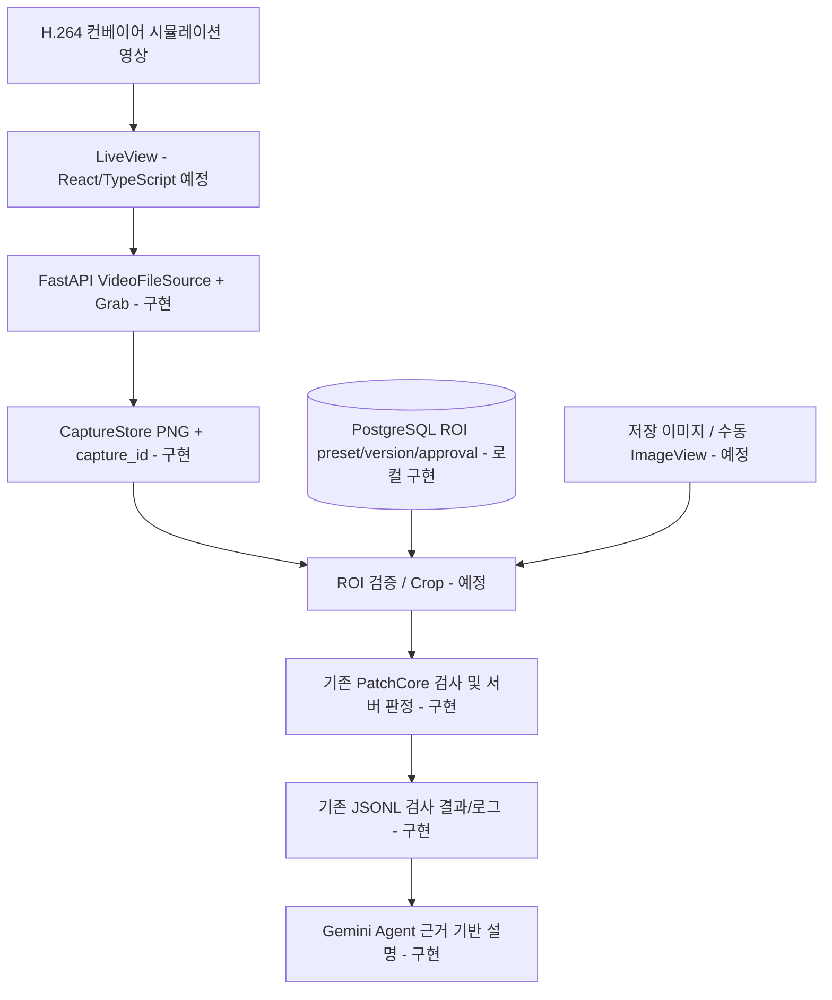

# VisionInsight 기술 스택 선정 및 대안 비교

> 프로젝트 기술 의사결정 기록(Architecture Decision Record + 포트폴리오 설명 자료)
>
> 작성 기준일: 2026-10-17 · 문서 상태: **설계·구현 현황 혼합** · 마지막 확인 근거: Day5 Step 3 Phase A Codex 보고 및 사용자 확정 의사결정
>
> **주의:** 이 문서는 프로젝트의 실제 코드를 직접 재검사하여 생성한 최신 인벤토리가 아니라, 지금까지 공유된 구현·검증 보고서와 확정된 개발 방향을 정리한 것이다. 버전·세부 설치 경로 등은 실제 저장소를 기준으로 갱신한다.

## 1. 프로젝트 목표와 기술 선택 기준

VisionInsight는 기존 **MVTec Bottle 이미지로 합성한 8초 컨베이어 영상**을 입력으로 사용하는 산업용 외관 검사 **포트폴리오 데모**다. 실제 카메라, PLC, 현장 생산 제어 또는 현장 성능 인증 시스템이 아니다.

최종 목표 흐름:

- **AUTO:** LiveView 영상 재생 → 제품 검사 위치 도착 → 자동 일시 정지 → 서버 Grab → **저장·승인된 ROI 자동 적용** → PatchCore 검사 및 서버 판정/기록 → 자동 재생.
- **MANUAL:** 저장 이미지 또는 LiveView Pause/Grab → ImageView 확대·Pan·원본 픽셀 GV/RGB 확인 → **사용자 ROI 지정** → AUTO와 **동일한 검사 엔진** 호출.
- Gemini Agent는 이미 확정된 검사 결과를 근거 기반으로 **설명**하며 서버 판정을 수정하지 않는다.
- 실제 PLC 연동은 범위 밖이다.

기술을 비교할 때 사용한 기준은 (1) 기존 자산 재사용, (2) Python/OpenCV/PatchCore 통합, (3) 검사 데이터의 추적성, (4) 데모 개발 비용·복잡도, (5) 향후 Cloud Run 배포 및 영속 저장, (6) 테스트·보안·근거 검증 가능성이다.

## 2. 구현·선택·계획 상태 한눈에 보기

| 영역 | 선택 기술 | 상태 (2026-10-17 기준) | 역할 |
|---|---|---|---|
| 백엔드/API | **Python 3.11 + FastAPI + Pydantic** | **구현됨** | 검사·Agent·영상·Grab API 및 입력 검증 |
| 비전·이미지 | **OpenCV** | **구현됨** | 디코딩, 프레임 추출, 이미지 처리; ROI 검사 연결은 예정 |
| 이상 탐지 | **PatchCore (CPU)** | **구현됨**, 영상 ROI 직접 성능 미검증 | 외관 이상 점수 산출 |
| 판정 정책 | **서버의 기존 OK/NG/REINSPECT/ERROR 규칙** | **구현됨** | Agent와 독립된 최종 판정 |
| AI 설명 | **Gemini Function Calling + 서버측 allowlist/Evidence/Fact 검증** | **구현됨** | 판정 근거와 로그의 설명, 서버 결과 변경 권한 없음 |
| 동영상 | **H.264/AVC MP4 + FFmpeg** | **구현·브라우저 검증됨** | Chrome 호환 컨베이어 데모 영상 |
| 영상 제공·Grab | **FastAPI FileResponse / OpenCV / PNG CaptureStore** | **구현됨** | `video_id + frame_index` Grab, `capture_id` 및 TTL·세션 관리 |
| 기존 검사·로그 저장 | **JSONL + 로컬 파일** | **구현됨** | 기존 검사 결과와 실행 로그 보존 |
| ROI 영구 설정 | **PostgreSQL 17.11** | **독립 B-1-DB 구현·실DB 검증, 전체 작업 PARTIAL(회귀1FAIL)** | ROI 버전·승인·활성화·적용 대상 저장 |
| DB 접근·마이그레이션 | **SQLAlchemy 2.0.52 + Alembic 1.20.0 + psycopg 3.3.6** | **설치·채택·실PostgreSQL migration 검증됨** | 트랜잭션, 제약조건, 스키마 변경 이력 |
| 웹 UI | **React + TypeScript** | **개발 계획 확정 / 실제 제품 UI 미구현** | LiveView, ImageView, ROI, 픽셀 Inspector |
| 검증 | **pytest**, API 통합 테스트, Chrome 자동 재생 검증 | **사용 중** | 회귀·계약·브라우저 스트리밍 검증 |
| 컨테이너·배포 | **Docker / Google Cloud Run** | **Dockerfile 존재; Cloud Run 배포는 계획** | 향후 데모 운영 |
| 클라우드 DB | **Cloud SQL for PostgreSQL (후보)** | **배포 옵션 / 미프로비저닝** | Cloud Run에서 ROI 데이터를 영속 저장 |
| 클라우드 이미지 저장 | **Cloud Storage (후보)** | **미구현** | 다중 인스턴스 환경의 공유 캡처·검사 이미지 저장 |

**마지막 FAIL0 공식 기준:** 1,268 PASS / 0 FAIL / 4 SKIP / 경고2건(Step2 PhaseB). **B-1-DB 최신 전체 실행1회:** 1,274 PASS / 1 FAIL / 51 SKIP / 경고2건,26.40초. 기존4 SKIP은 T03 fixture 부재이고 추가47 SKIP은 실모델 실행금지 정책이다. 기존JSONL 선행데이터 의존 테스트1FAIL이 있어 새FAIL0 기준으로 승격하지 않는다. 최종DB 신규55개는별도실행에서모두PASS했으며 전체실행당시에는54개였다. 상세는 [B-1-DB 보고서](day5-step3-phaseb1-db-postgresql-roi-completion.md)를 참조한다.

## 3. 기술별 선정 이유와 고려한 대안

### 3.1 Python + FastAPI

| 대안 | 장점 | 이 프로젝트의 판단 |
|---|---|---|
| **FastAPI (선택)** | Python 추론 코드를 그대로 호출, 타입 기반 API 스키마, Pydantic 유효성 검증, 비동기 API 경계 | PatchCore·OpenCV 및 기존 검사/Agent 워크플로와 자연스럽게 연결됨 |
| Flask | 작고 유연함 | 라우트별 입력 스키마·검증과 OpenAPI 구성은 추가 설계가 필요함 |
| Django / Django REST Framework | 관리자 화면·ORM·인증 기능이 풍부함 | 현재 데모의 영상/검사 API에는 프레임워크 범위가 과할 수 있음 |
| Node.js 서버 중심 구성 | React 생태계와 통일 가능 | 모델 추론이 Python 기반이므로 별도 Python 추론 서비스를 구성해야 함 |

**선정 논리:** Python 비전 코드를 별도 서비스로 나누지 않고 FastAPI에서 통합한다. 단, FastAPI의 async만으로 CPU 모델 추론이 자동으로 빨라지지는 않으며, 작업 격리와 자원 제한은 별도로 관리해야 한다.

### 3.2 OpenCV + H.264/FFmpeg + 서버 Grab

| 대안 | 장점 | 이 프로젝트의 판단 |
|---|---|---|
| **OpenCV VideoCapture (선택)** | 기존 Python 영상 처리와 연결 용이, 프레임 단위 접근 | 8초/240프레임 파일을 요청별 독립 디코더로 순차 처리하기 적합 |
| 브라우저 Canvas에서만 캡처 | 간단하고 화면과 가까움 | 서버 검사 전에 이미지 업로드·추적 관리가 추가로 필요하며 서버 재현성이 약함 |
| 카메라 SDK / RTSP | 실시간 카메라와 연동 가능 | 실제 카메라가 없는 합성 영상 데모에는 불필요한 복잡도 |
| OpenCV mp4v MP4 | 별도 인코더 설치 없이 생성 가능 | 실제 Chrome 155에서 `MEDIA_ERR_SRC_NOT_SUPPORTED`로 재생 실패 |
| **FFmpeg libx264 H.264 MP4 (선택)** | 넓은 브라우저 재생 호환성 | Chrome에서 재생·pause·seek·ended·loop와 HTTP Range 206/416 검증 완료 |

**기술적 결정:** 서버는 `video_id + frame_index`를 받아 PNG를 만들고 `capture_id`를 반환한다. 브라우저가 눈으로 본 프레임과 서버 PNG가 항상 픽셀 단위로 일치한다고 주장하지 않는다. ROI와 검사의 기준은 **서버가 반환한 PNG**다. 현재 캡처는 소유 세션 보호와 기본 30분 TTL을 갖는다.

### 3.3 PatchCore 이상 탐지

| 대안 | 장점 | 이 프로젝트의 판단 |
|---|---|---|
| **PatchCore (선택)** | 정상 이미지 기반 이상 탐지, 기존 학습 모델과 평가 자산 확보 | 동일한 Bottle 검사 엔진을 AUTO/MANUAL에서 재사용할 수 있음 |
| YOLO류 객체 검출 | 제품 위치/개체 검출에 적합 | **제품 도착·위치 감지** 용도는 가능하나 PatchCore의 외관 이상 판정과 역할이 다름. 새 학습·라벨이 필요할 수 있음 |
| 정상/불량 분류 CNN | 추론 결과 이해가 쉬움 | 불량 유형·학습 라벨 준비와 기존 자산의 재구성이 필요함 |
| 단순 OpenCV 임계값·규칙 | 매우 빠르고 해석 쉬움 | 여러 형태의 외관 이상을 하나의 규칙으로 다루기 어려울 수 있음 |

**주의:** 기존 모델은 CPU PatchCore, 고정 threshold `34.1442`다. 과거 정적 평가 AUROC 약 `0.8286`, CPU 모델 단독 평균 약 `42.53ms`는 **영상 ROI나 전체 API 처리 시간의 성능을 보장하지 않는다**. Day5 Step 3 Phase A가 제기한 외부/내부 ImageNet 정규화 중복은 **Phase B-1에서 실제 로드한 모델 구성과 호출 코드로 확인했다**. 외부 wrapper의 Normalize와 활성 내부 pre_processor.export_transform의 Normalize가 기존 predict 경로에 함께 존재한다. 실제 이미지 추론은 실행하지 않았다. 안전 게이트에 따라 PostgreSQL 구현도 시작하지 않았으며, 전처리·모델·threshold를 변경하지 않았다. 과거 점수/평가/보정의 영향 범위는 별도 승인 후 확인해야 한다. 상세 근거는 [Phase B-1 중단 보고서](day5-step3-phaseb1-postgresql-roi-implementation.md)를 참조한다.

### 3.4 React + TypeScript / ImageView

| 대안 | 장점 | 이 프로젝트의 판단 |
|---|---|---|
| **React + TypeScript (확정 계획)** | 컴포넌트 기반 LiveView·ImageView 구성, ROI 좌표 등 계약 타입 정의 가능 | 복잡한 UI 상태(AUTO/MANUAL, Pause/Grab, Zoom/ROI)에 적합 |
| Vue | 간결하고 생산적인 UI 개발 가능 | 충분히 가능하지만 현재 확정 계획 변경의 이득이 크지 않음 |
| Angular | 구조화된 대규모 앱에 유리 | 포트폴리오 데모에는 초기 복잡도가 높을 수 있음 |
| Streamlit / Gradio | AI 데모를 빠르게 표시 | 픽셀 Inspector, 정교한 ROI 편집, LiveView 상태 제어의 자유도가 상대적으로 낮음 |

**확정 UI 요구사항:** AUTO는 검사 위치에서 **자동 Pause → 자동 Grab → 저장·승인된 ROI → 검사 → 자동 Play**, MANUAL은 저장 이미지 또는 Pause/Grab → ImageView → **사용자 ROI** → 같은 검사 엔진. ImageView는 확대/축소, Pan, 원본 픽셀 좌표, 8-bit GV(0~255)와 RGB 각 채널(0~255), ROI 편집을 제공할 계획이다. 현 시점에 실제 React UI를 완성했다고 표현하지 않는다.

### 3.5 PostgreSQL 선택: SQLite / Firebase Firestore / PostgreSQL

| 항목 | SQLite | Cloud Firestore | **PostgreSQL (선택)** |
|---|---|---|---|
| 개발 방식 | 단일 파일, 설정 간편 | 관리형 NoSQL 문서 DB, 인터넷 연동 중심 | 관계형 서버 DB, 로컬·클라우드 공통 SQL |
| ROI 버전과 활성 상태의 일관성 | 단일 인스턴스에서 양호 | 문서 설계·트랜잭션 필요 | **트랜잭션·고유 제약·관계형 모델에 적합** |
| 검사 이력·ROI/제품별 복합 조회 확장 | 가능하나 동시 쓰기·운영 제약 | 조회 패턴별 인덱스·비정규화 설계 필요 | **JOIN, 인덱스, 집계 SQL에 강점** |
| Cloud Run 배포 | 인스턴스 로컬 파일은 영속성 보장 안 됨 | 관리형 클라우드 스토리지 | Cloud SQL 등 **외부 영속 PostgreSQL** 연결 필요 |
| 운영 편의/비용 | 가장 간단하고 저렴 | 서버 운영 부담 낮고 사용량 과금 | 서버/관리형 DB 운용 및 고정비가 발생할 수 있음 |
| 현재 VisionInsight 결정 | 신규 ROI용 미채택 | 대안으로 검토 | **정식 DB로 선정, 로컬 ROI 영속관리 구현·실DB 검증** |

**왜 PostgreSQL인가?** ROI preset, 버전, 활성 승인, 적용 대상, `capture_id → ROI → inspection_id` 추적 정보 사이에는 관계와 일관성 제약이 많다. 향후 제품별 검사 이력 조회·검색·통계를 확장할 때 관계형 SQL이 장점이다. 로컬에서 PostgreSQL로 개발하고 Cloud Run에서는 외부 관리형 PostgreSQL로 연결하면 DB 종류를 교체하는 부담을 줄일 수 있다.

**선택의 비용:** 로컬 PostgreSQL 실행/테스트 환경, 스키마 마이그레이션, 인증정보, 연결 풀, 클라우드 요금이 필요하다. SQLite보다 초기 구현은 무겁고, **Cloud SQL은 비용·과금 승인이 필요한 별도 배포 결정**이다. PostgreSQL 선택이 반드시 Cloud SQL 선택까지 의미하지는 않는다.

**도입 원칙:** 신규 ROI 설정·버전·승인·추적 metadata부터 PostgreSQL 사용. **기존 검사 결과/로그 JSONL은 이 단계에서 강제 이전하지 않는다.** 이미지·영상·모델 바이너리를 PostgreSQL BLOB으로 저장하지 않고 파일/객체 저장소에 두되 DB에는 식별자·메타데이터·무결성 정보를 연결한다.

**DB 라이브러리:** 독립승인된 B-1-DB에서 SQLAlchemy2.0.52/Alembic1.20.0/psycopg3.3.6을 실제설치·채택하고 requirements-db.txt에고정했다. pip check PASS이며 기존비전/Agent 패키지는변경하지않았다. 명시적migration을사용하고앱시작create_all은없다.

### 3.6 Gemini Agent: 생성형 설명과 최종 판정 분리

| 대안 | 장점 | 이 프로젝트의 판단 |
|---|---|---|
| **Gemini Function Calling + Python 도구 실행 (선택)** | 자연어 진단과 실제 서버 기록 조회를 연결 | AI는 조사·설명, 도구 실행과 판정은 서버가 통제 |
| LLM이 임의로 DB/파일 직접 조회 | 유연해 보임 | 권한 경계·정답 노출·재현성 위험이 큼 |
| 전부 규칙 기반 고정 문구 | 빠르고 결정적 | 복합 로그·Evidence의 자연어 설명 범위가 제한적 |
| LLM이 최종 NG/OK 결정 | 구현이 단순해 보일 수 있음 | 허위 근거·판정 변동 위험 때문에 **채택하지 않음** |

Gemini는 도구 사용을 **제안**하고 백엔드가 허용 목록·인자·결과를 검증해 실행한다. Evidence/Fact ID, JSON Pointer, 구조화된 응답 검증을 사용한다. 다만 자유 서술 텍스트의 모든 문장이 완전 검증된 것은 아니다. 실제 T01/T03/T05/T06 E2E에는 성공 실행 사례가 있으나 반복 신뢰성·운영 비용·현장 latency가 보장된 것은 아니다. Agent는 검사 결과를 수정하지 못한다.

### 3.7 JSONL 유지와 PostgreSQL의 단계적 공존

기존 JSONL 로그/결과는 현재 검사·Agent 테스트 자산과 연결돼 있다. 따라서 DB를 도입한다는 이유만으로 모든 결과를 마이그레이션하거나 기존 Evidence 조회를 수정하지 않는다. 신규 PostgreSQL 테이블이 검사 provenance를 참조하더라도 **트랜잭션 경계를 넘는 기록 일관성, 중복·실패 재시도, ROI 이미지 수명**을 명시적으로 설계해야 한다. 통합 영속화가 필요하면 이후 별도 migration 단계에서 처리한다.

### 3.8 테스트·배포 기술 선택

- **pytest:** 기존 FastAPI/Agent/이미지 처리를 작은 단위와 ASGI 통합으로 검증하고 1,268 PASS의 회귀 기준을 보존한다. 새 PostgreSQL 테스트는 독립 테스트 DB/스키마에서 실행하며 운영 데이터에 접근하지 않는다.
- **실제 Chrome 테스트:** mp4v → H.264 문제는 OpenCV 단독 테스트로 발견할 수 없었기 때문에 실제 `<video>` 재생/seek/HTTP Range를 별도 검증한다. 브라우저 기반 LiveView-서버 Grab의 완벽한 동기화는 아직 미검증이다.
- **Docker + Cloud Run (예정):** Python 기반 서버 데모를 컨테이너로 배포하기 편리하다. 다만 현재 Dockerfile은 로컬 영상을 복사하지 않는 것으로 보고됐으며, 로컬 파일·SQLite/PostgreSQL 컨테이너 파일은 Cloud Run 인스턴스 간 영속 공유되지 않는다. 영상·이미지의 객체 저장소/배포 방식 및 PostgreSQL 연결은 Day7 전에 별도 설계·검증이 필요하다.

## 4. 현재 구조와 향후 구조

이 도식은 **구현됨**과 **예정**이 섞인 목표 아키텍처다. 현재 CaptureStore에서 ROI/PatchCore로 연결되는 API는 아직 구현되지 않았다.

## 5. 다음 개발 단계에서의 기술 의사결정

### Day5 Step 3 Phase B-1 (안전 게이트 BLOCKED / 재개 승인 대기)

2026-10-17: 모델 구성의 읽기 전용 로딩으로 중복 정규화 경로를 확인했다. 사용자 지정 중단 조건에 따라 DB 환경 구성·설치·마이그레이션·ROI API 구현·테스트는 진행하지 않았다. PostgreSQL 선정은 유지하며 SQLAlchemy/Alembic은 실제 채택·검증 완료 상태로 승격하지 않는다. 임시 CaptureStore 세션을 영구 ROI 소유자로 사용하는 Phase A 후보도 채택하지 않는다. 재개 시 독립적인 관리 권한 경계를 확정해야 한다.

1. 코드 기준으로 PatchCore 외부·내부 전처리/정규화 실행 경로를 확인한다. 중복 확인 또는 불명확하면 모델·threshold 변경 없이 중단·보고한다.
2. PostgreSQL 개발 연결 방법을 확인한다(기존 Docker/로컬 설치 재사용 우선). 클라우드 과금 서비스는 생성하지 않는다.
3. **PostgreSQL에 ROI preset, 버전, 승인/활성, 적용 source·product·resolution 계약**을 설계·구현한다. 재시작 이후 보존, 동시 수정 충돌, 트랜잭션, 소유권을 검증한다.
4. 기존 JSONL·CaptureStore·PatchCore 경로는 보존한다. ROI → 실제 검사 추론 연결은 다음 승인 단계로 분리한다.
5. 적용 기술(SQLAlchemy/Alembic 등)의 실제 채택 여부를 코드와 테스트로 확인한 뒤 이 문서의 상태 칼럼을 갱신한다.

### Day5 Step 3 Phase B-1-DB (독립 재승인 결과)

전처리와분리한DB구현이명시재승인돼 **PostgreSQL17.11 전용컨테이너·SQLAlchemy/Alembic·8개관리API·버전/승인/활성화**를구현했다. Docker는기존설치를시작했고 공식이미지를digest로고정했다. 개발DB/테스트DB·DDL/runtime역할을분리하고loopback:55432/영속volume을사용한다. 앱새프로세스와DB컨테이너재시작 후v1/v2·승인·활성유지PASS다. 관리권한은local-only환경/loopback peer·Host/환경변수Bearer/Origin검사이며캡처임시세션을영구owner로쓰지않는다. 영구사용자계정/공용인터넷/CloudRun 인증은아니다.

최종신규55PASS,관련473PASS/6모델정책SKIP,전체1회1274PASS/1FAIL/51SKIP이다. 전체실패는실추론제외로비어있는선행JSONL에의존한기존Day2테스트이며감추지않고 **전체작업PARTIAL**로기록한다. 전체재실행은이번허용1회를사용했으므로추가승인이필요하다. [관리API계약](roi-postgresql-api.md)과 [실행·한계보고서](day5-step3-phaseb1-db-postgresql-roi-completion.md)를인수기준으로한다.

**PatchCore 중복정규화 UNRESOLVED**, ROI→추론연결 NOT IMPLEMENTED다. 기존JSONL·모델·영상/PNG파일저장은유지한다. PostgreSQL 도입으로공유이미지/영상/다중replica세션이해결된것은아니다. CloudSQL/CloudRun/과금은변경하지않았다.

### 남은 별도 검증 위험

- 합성 영상 ROI가 기존 PatchCore의 입력 분포와 달라 점수·정확도가 변할 수 있음
- 자동 검사의 **저장된 ROI 좌표**와 **제품 도착 트리거**는 별개이며 둘 다 실제 영상에서 검증해야 함
- CaptureStore 30분 TTL과 검사 ROI 이미지·영구 검사 provenance의 보존 기간 불일치
- Cloud Run의 다중 replica/일시적 파일 시스템과 로컬 PNG·영상·DB 연결의 호환성
- PostgreSQL 도입 후 기존 JSONL과의 정합성 및 실패/재시도 정책
- Cloud SQL 및 객체 저장소의 실제 비용·보안·운영 제약

## 6. 면접/포트폴리오에서 설명하는 방식

> “VisionInsight는 정상 Bottle 이미지로 학습한 PatchCore를 Python/FastAPI 서버에 결합한 검사 데모입니다. 브라우저 호환 H.264 합성 컨베이어 영상에서 서버가 정확한 프레임을 Grab하며, 자동 검사는 저장된 ROI, 수동 검사는 ImageView에서 지정한 ROI를 적용하도록 설계했습니다. 기존 검사 결과와 로그는 JSONL로 보존하고, 재시작 후에도 유지해야 하는 ROI 설정·승인·버전과 추적 관계에는 PostgreSQL을 선택했습니다. Gemini는 서버의 Evidence를 조회해 설명하지만 최종 판정을 변경할 수 없습니다. 현재 영상 Grab 백엔드까지 구현·검증했고, PostgreSQL ROI 및 React UI는 후속 구현 단계입니다.”

## 7. 실제 프로젝트 코드로 추가 확인해야 할 것

- PostgreSQL 로컬 구현 이후 클라우드 권한·연결·영속 저장·운영 migration 설계
- 확인된 모델 외부/내부 ImageNet 정규화 중복의 점수·calibration 영향 및 별도 수정 승인
- 기존JSONL 선행fixture 의존 실패를 해결할 오프라인 검증 계획과 전체회귀 추가 실행 승인
- JSONL 및 CaptureStore의 **정확한 현재 설정 경로**와 보존 정책
- React 실제 구현 여부 및 자동 트리거 검증 프레임
- Cloud Run·Cloud SQL·Cloud Storage 실제 배포 여부 및 비용

---

**관리 규칙:** 각 개발 단계 완료 시 `(구현됨 / 확정 계획 / 검증 대기 / 미도입)` 상태를 갱신한다. 벤치마크는 측정 대상(모델 단독 vs 전체 API)을, 테스트 수치는 실행 단계·일자를, 기능은 데모 시뮬레이션 vs 실제 현장 연동을 반드시 구분한다.
